# GoMatch 五子棋项目 - 数据库设计文档

## 1. 设计概述

本文档详细描述 GoMatch 五子棋项目的数据库设计，包括：
- 核心业务表设计
- Socket会话与消息持久化
- 棋局保存与恢复机制（通过工程文件URI实现）
- Repository接口规范
- 数据模型定义

### 1.1 部署架构

```mermaid
flowchart LR
    subgraph 客户端(Client)
        E[玩家电脑\nJavaFX桌面应用]
    end
    
    subgraph 服务端程序(Server)
        A[游戏服务端\nSocket多线程]
    end
    
    subgraph 数据库(Database)
        B[MySQL\n用户/设置/战绩]
        C[Redis\n会话/排行榜/匹配]
    end
    
    subgraph 云存储(Cloud)
        D[阿里云OSS\n头像/背景音乐]
    end
    
    E -->|TCP Socket JSON| A
    A -->|JDBC| B
    A -->|Lettuce| C
    A -->|OSS SDK| D
```

**说明**：
- 游戏服务端程序、MySQL数据库、Redis缓存部署在**同一台服务器**上
- 阿里云OSS为独立云存储服务，用于存储用户头像和背景音乐文件
- 客户端与服务端通过TCP Socket进行JSON协议通信
- 服务端通过JDBC访问MySQL，通过Lettuce访问Redis，通过OSS SDK访问阿里云OSS

### 1.2 数据流转总览

#### 1.2.1 用户设置数据流

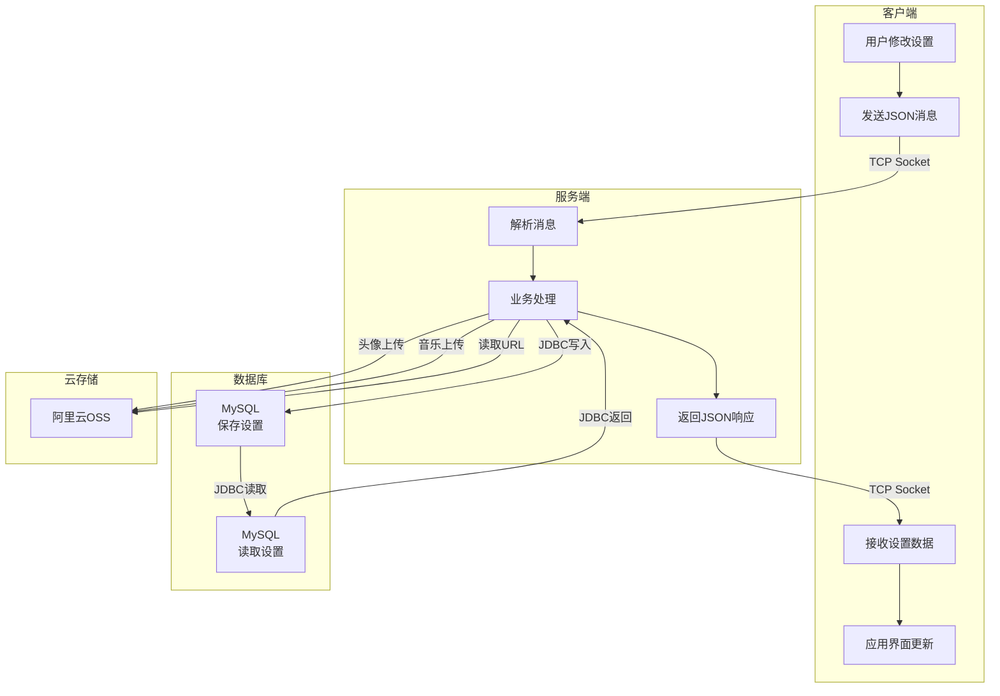

#### 1.2.2 头像数据流

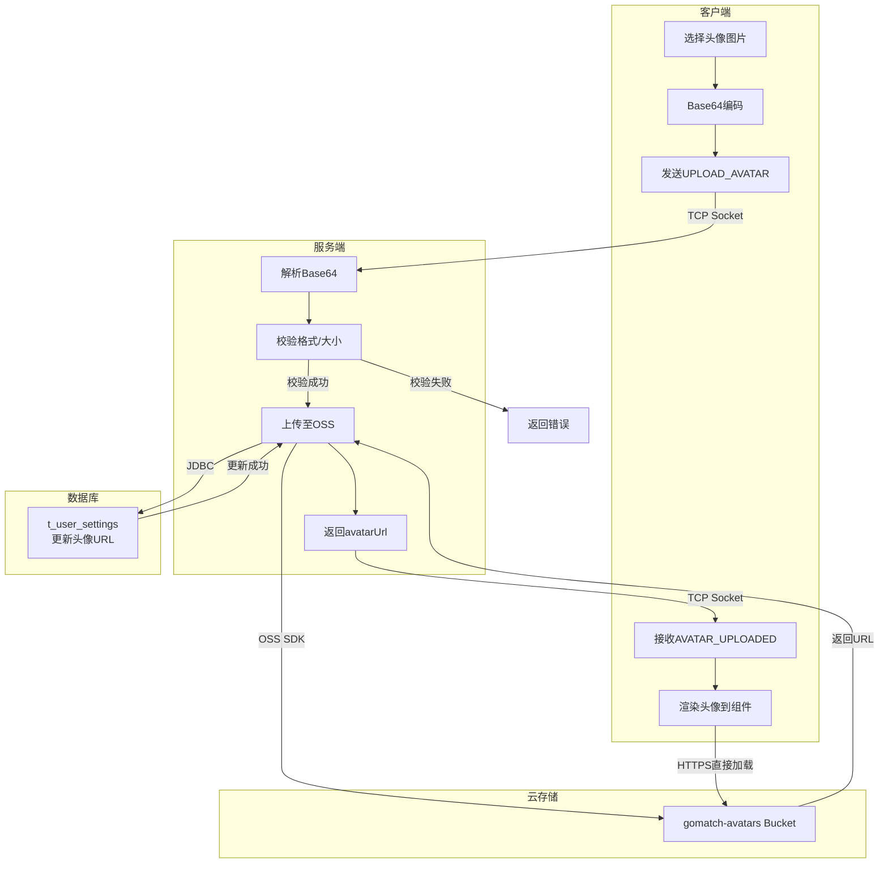

#### 1.2.3 背景音乐数据流

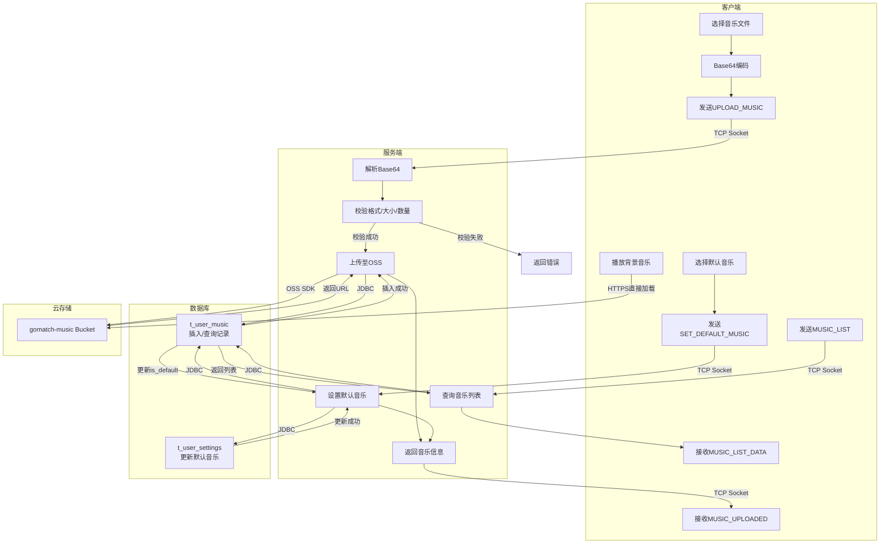

#### 1.2.4 设置加载与保存流程

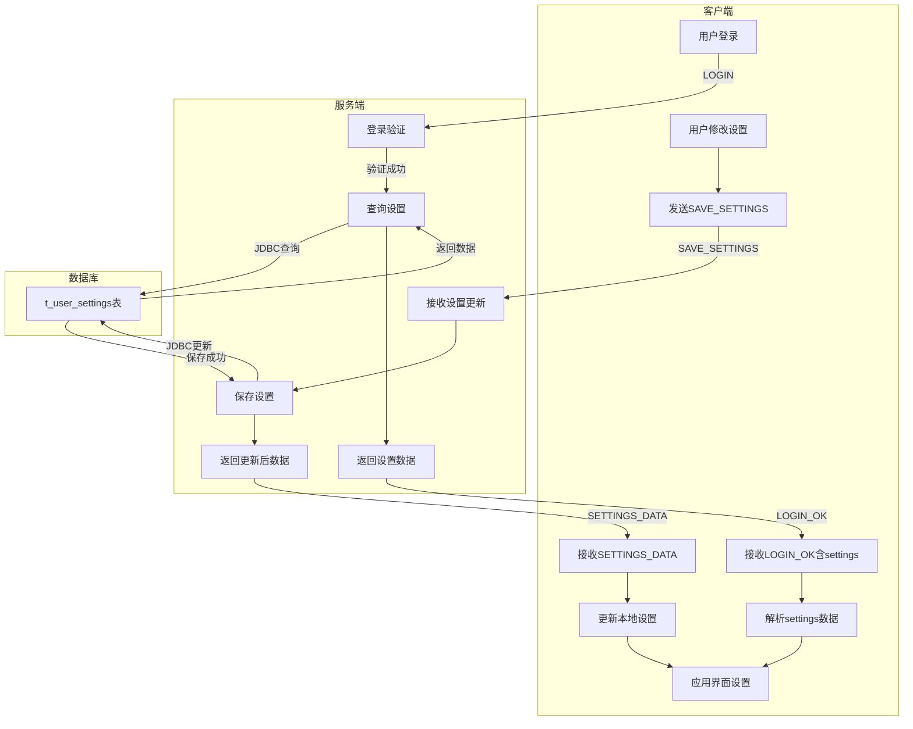

### 1.2 编码规范

**全链路UTF-8编码**，确保中文正常显示：

| 层级 | 配置项 | 值 |
|------|--------|-----|
| 数据库 | character_set_server | utf8mb4 |
| 数据库 | collation_server | utf8mb4_unicode_ci |
| 数据库 | character_set_database | utf8mb4 |
| 表 | DEFAULT CHARSET | utf8mb4 |
| 表 | COLLATE | utf8mb4_unicode_ci |
| 连接 | JDBC URL参数 | useUnicode=true&characterEncoding=utf8&connectionCollation=utf8mb4_unicode_ci |
| Java源码 | 文件编码 | UTF-8 |
| 日志文件 | 编码 | UTF-8 |

**为什么用utf8mb4而不是utf8？**
- MySQL的`utf8`只支持3字节Unicode字符，无法存储emoji表情和部分生僻汉字
- `utf8mb4`支持4字节Unicode字符，完整兼容所有Unicode字符

## 2. 数据库表设计

### 2.1 表关系图

```mermaid
erDiagram
    t_user ||--o{ t_game_record : "参与"
    t_user ||--o| t_rank : "拥有"
    t_user ||--o{ t_game_save : "保存"
    t_user ||--o{ t_socket_session : "连接"
    t_user ||--o{ t_chat_message : "发送"
    t_user ||--o{ t_room_watcher : "观战"
    t_user ||--o{ t_game_action : "操作"
    t_user ||--o{ t_friend : "好友"
    t_user ||--o{ t_friend_request : "好友请求"
    t_game_record ||--o| t_game_save : "关联"
    t_game_record ||--o{ t_game_action : "关联"
    t_room ||--o{ t_user : "成员"
    t_room ||--o{ t_chat_message : "消息"
    t_room ||--o{ t_room_watcher : "观战者"
    
    t_user {
        bigint user_id PK "用户ID"
        varchar username UK "用户名"
        varchar password "密码"
        varchar email UK "邮箱"
        varchar avatar_url "头像URL"
        varchar role "角色"
        varchar status "状态"
        int score "积分"
        int win_count "胜场数"
        int lose_count "负场数"
        int draw_count "平局数"
        int ai_win_count "AI胜场"
        int ai_lose_count "AI负场"
        int version "版本号(乐观锁)"
        datetime create_time "创建时间"
        datetime update_time "更新时间"
    }
    
    t_game_record {
        bigint record_id PK "记录ID"
        bigint player1_id FK "玩家1ID"
        bigint player2_id FK "玩家2ID"
        varchar game_type "游戏类型"
        varchar result "结果"
        text board_data "棋谱数据(JSON)"
        int duration "时长(秒)"
        int move_count "落子数"
        datetime create_time "创建时间"
    }
    
    t_rank {
        bigint rank_id PK "排名ID"
        bigint user_id FK UK "用户ID"
        int rank "排名"
        int score "积分"
        decimal win_rate "胜率"
        decimal ai_win_rate "AI胜率"
        int version "版本号(乐观锁)"
        datetime update_time "更新时间"
    }
    
    t_game_save {
        bigint save_id PK "保存ID"
        bigint user_id FK "用户ID"
        bigint record_id FK "关联对局ID"
        varchar file_uri UK "棋局文件URI"
        varchar save_name "保存名称"
        text board_data "棋盘状态(JSON)"
        int current_player "当前执子方"
        varchar game_status "游戏状态"
        varchar checksum "文件校验和"
        int file_size "文件大小(字节)"
        datetime create_time "创建时间"
        datetime update_time "更新时间"
    }
    
    t_socket_session {
        bigint session_id PK "会话ID"
        bigint user_id FK "用户ID"
        varchar session_key UK "会话密钥"
        varchar client_ip "客户端IP"
        varchar connection_id "连接ID"
        varchar status "连接状态"
        bigint room_id FK "当前房间ID"
        datetime last_heartbeat "最后活跃时间"
        datetime disconnect_time "断开时间"
        varchar disconnect_reason "断开原因"
        int reconnect_attempts "重连尝试次数"
        datetime create_time "创建时间"
        datetime update_time "更新时间"
    }
    
    t_chat_message {
        bigint message_id PK "消息ID"
        bigint room_id FK "房间ID"
        bigint user_id FK "发送者ID"
        varchar content "消息内容"
        varchar message_type "消息类型"
        datetime create_time "创建时间"
    }
    
    t_room {
        bigint room_id PK "房间ID"
        varchar room_name "房间名称"
        varchar password "房间密码"
        int max_players "最大人数"
        int current_players "当前人数"
        int watcher_count "观战人数"
        varchar status "房间状态"
        bigint host_id FK "房主ID"
        boolean allow_watch "允许观战"
        int version "版本号(乐观锁)"
        datetime create_time "创建时间"
        datetime update_time "更新时间"
    }
    
    t_room_watcher {
        bigint watcher_id PK "观战记录ID"
        bigint room_id FK "房间ID"
        bigint user_id FK "观战者ID"
        datetime join_time "加入时间"
        datetime leave_time "离开时间"
    }
    
    t_game_action {
        bigint action_id PK "操作ID"
        bigint record_id FK "对局ID"
        bigint user_id FK "操作用户ID"
        varchar action_type "操作类型"
        varchar action_status "操作状态"
        int move_number "操作时落子数"
        varchar reject_reason "拒绝原因"
        datetime create_time "创建时间"
    }
    
    t_friend {
        bigint friend_id PK "好友关系ID"
        bigint user_id FK "用户ID"
        bigint friend_user_id FK "好友ID"
        varchar relation_type "关系类型"
        datetime create_time "创建时间"
    }
    
    t_friend_request {
        bigint request_id PK "请求ID"
        bigint from_user_id FK "发起者ID"
        bigint to_user_id FK "接收者ID"
        varchar status "请求状态"
        datetime create_time "创建时间"
        datetime respond_time "响应时间"
    }
    
    t_user_settings {
        bigint settings_id PK "设置ID"
        bigint user_id FK UK "用户ID"
        varchar avatar_url "头像URL(阿里云OSS)"
        varchar language "语言"
        varchar font_family "字体"
        int font_size "字体大小"
        int frame_rate "帧率"
        int window_width "窗口宽度"
        int window_height "窗口高度"
        boolean background_music_enabled "背景音乐开关"
        decimal background_music_volume "背景音乐音量"
        boolean sound_effects_enabled "音效开关"
        decimal sound_effects_volume "音效音量"
        bigint lobby_music_id FK "当前大厅背景音乐ID"
        varchar theme "主题"
        int version "版本号(乐观锁)"
        datetime create_time "创建时间"
        datetime update_time "更新时间"
    }
    
    t_user_music {
        bigint music_id PK "音乐ID"
        bigint user_id FK "用户ID"
        varchar music_name "音乐名称"
        varchar music_url "音乐URL(阿里云OSS)"
        varchar file_name "文件名"
        int file_size "文件大小(字节)"
        varchar duration "时长(秒)"
        varchar music_type "音乐类型: BGM/LOBBY"
        boolean is_default "是否默认"
        datetime create_time "创建时间"
        datetime update_time "更新时间"
    }
```

### 2.2 表详细设计

#### 2.2.1 t_user（用户表）

| 字段名 | 类型 | 约束 | 说明 |
|--------|------|------|------|
| user_id | BIGINT | PRIMARY KEY, AUTO_INCREMENT | 用户唯一标识 |
| username | VARCHAR(50) | NOT NULL, UNIQUE | 用户名 |
| password | VARCHAR(100) | NOT NULL | 密码(明文) |
| email | VARCHAR(100) | UNIQUE | 邮箱 |
| avatar | VARCHAR(255) | NULL | 头像URL |
| role | VARCHAR(20) | NOT NULL, DEFAULT 'PLAYER' | 角色: PLAYER(玩家)/ADMIN(管理员) |
| status | VARCHAR(20) | NOT NULL, DEFAULT 'ACTIVE' | 状态: ACTIVE(活跃)/BANNED(封禁)/INACTIVE(未激活) |
| score | INT | DEFAULT 1000 | 积分(初始1000) |
| win_count | INT | DEFAULT 0 | 胜场数 |
| lose_count | INT | DEFAULT 0 | 负场数 |
| draw_count | INT | DEFAULT 0 | 平局数 |
| ai_win_count | INT | DEFAULT 0 | AI对战胜场数 |
| ai_lose_count | INT | DEFAULT 0 | AI对战负场数 |
| version | INT | DEFAULT 0 | 版本号(乐观锁) |
| create_time | DATETIME | DEFAULT CURRENT_TIMESTAMP | 创建时间 |
| update_time | DATETIME | ON UPDATE CURRENT_TIMESTAMP | 更新时间 |

**索引设计**：
| 索引名 | 字段 | 类型 |
|--------|------|------|
| PRIMARY | user_id | 主键 |
| uk_username | username | 唯一索引 |
| uk_email | email | 唯一索引 |
| idx_role | role | 普通索引 |
| idx_status | status | 普通索引 |
| idx_score | score | 普通索引 |
| idx_role_status | role, status | 联合索引 |
| idx_avatar_url | avatar_url | 普通索引 |

#### 2.2.2 t_game_record（游戏记录表）

| 字段名 | 类型 | 约束 | 说明 |
|--------|------|------|------|
| record_id | BIGINT | PRIMARY KEY, AUTO_INCREMENT | 记录唯一标识 |
| player1_id | BIGINT | NOT NULL, FK | 玩家1ID |
| player2_id | BIGINT | NOT NULL, FK | 玩家2ID |
| game_type | VARCHAR(20) | NOT NULL, DEFAULT 'PVP' | 游戏类型: PVP(双人)/PVE(人机) |
| winner_id | BIGINT | FK, NULL | 胜者ID(平局为NULL) |
| result | VARCHAR(10) | NOT NULL | 结果: win/lose/draw |
| board_data | TEXT | NOT NULL | 完整棋谱(JSON) |
| duration | INT | NULL | 对局时长(秒) |
| move_count | INT | DEFAULT 0 | 落子总数 |
| create_time | DATETIME | DEFAULT CURRENT_TIMESTAMP | 创建时间 |

**索引设计**：
| 索引名 | 字段 | 类型 |
|--------|------|------|
| PRIMARY | record_id | 主键 |
| idx_player1 | player1_id | 普通索引 |
| idx_player2 | player2_id | 普通索引 |
| idx_game_type | game_type | 普通索引 |
| idx_create_time | create_time | 普通索引 |

#### 2.2.3 t_rank（排行榜表）

| 字段名 | 类型 | 约束 | 说明 |
|--------|------|------|------|
| rank_id | BIGINT | PRIMARY KEY, AUTO_INCREMENT | 排名ID |
| user_id | BIGINT | NOT NULL, UNIQUE, FK | 用户ID |
| rank | INT | DEFAULT 0 | 当前排名 |
| score | INT | DEFAULT 0 | 当前积分 |
| win_rate | DECIMAL(5,2) | DEFAULT 0.00 | 胜率 |
| ai_win_rate | DECIMAL(5,2) | DEFAULT 0.00 | AI对战胜率 |
| version | INT | DEFAULT 0 | 版本号(乐观锁) |
| update_time | DATETIME | ON UPDATE CURRENT_TIMESTAMP | 更新时间 |

**索引设计**：
| 索引名 | 字段 | 类型 |
|--------|------|------|
| PRIMARY | rank_id | 主键 |
| uk_user_id | user_id | 唯一索引 |
| idx_rank | rank | 普通索引 |
| idx_score | score | 普通索引 |

#### 2.2.4 t_game_save（棋局保存表）

| 字段名 | 类型 | 约束 | 说明 |
|--------|------|------|------|
| save_id | BIGINT | PRIMARY KEY, AUTO_INCREMENT | 保存记录ID |
| user_id | BIGINT | NOT NULL, FK | 保存用户ID |
| record_id | BIGINT | FK, NULL | 关联对局记录ID(正在进行的对局为NULL) |
| file_uri | VARCHAR(500) | NOT NULL, UNIQUE | 棋局工程文件URI |
| save_name | VARCHAR(100) | NULL | 保存名称(便于识别) |
| board_data | TEXT | NOT NULL | 当前棋盘状态(JSON) |
| current_player | INT | NOT NULL | 当前执子方(1:黑棋, 2:白棋) |
| game_status | VARCHAR(20) | NOT NULL | 游戏状态: playing/paused/finished |
| checksum | VARCHAR(64) | NULL | 文件校验和(SHA-256) |
| file_size | INT | DEFAULT 0 | 文件大小(字节) |
| create_time | DATETIME | DEFAULT CURRENT_TIMESTAMP | 创建时间 |
| update_time | DATETIME | ON UPDATE CURRENT_TIMESTAMP | 更新时间 |

**索引设计**：
| 索引名 | 字段 | 类型 |
|--------|------|------|
| PRIMARY | save_id | 主键 |
| uk_file_uri | file_uri | 唯一索引 |
| idx_user_id | user_id | 普通索引 |
| idx_record_id | record_id | 普通索引 |

#### 2.2.5 t_socket_session（Socket会话表）

| 字段名 | 类型 | 约束 | 说明 |
|--------|------|------|------|
| session_id | BIGINT | PRIMARY KEY, AUTO_INCREMENT | 会话ID |
| user_id | BIGINT | NOT NULL, FK | 用户ID |
| session_key | VARCHAR(64) | NOT NULL, UNIQUE | 会话密钥(UUID) |
| client_ip | VARCHAR(50) | NULL | 客户端IP地址 |
| connection_id | VARCHAR(64) | NULL | Socket连接唯一标识 |
| room_id | BIGINT | FK, NULL | 当前所在房间ID |
| status | VARCHAR(20) | NOT NULL | 连接状态: connected/disconnected/reconnecting |
| last_heartbeat | DATETIME | NULL | 最后活跃时间 |
| disconnect_time | DATETIME | NULL | 断开连接时间 |
| disconnect_reason | VARCHAR(50) | NULL | 断开原因: timeout/network/normal |
| reconnect_attempts | INT | DEFAULT 0 | 重连尝试次数 |
| create_time | DATETIME | DEFAULT CURRENT_TIMESTAMP | 创建时间 |
| update_time | DATETIME | ON UPDATE CURRENT_TIMESTAMP | 更新时间 |

**索引设计**：
| 索引名 | 字段 | 类型 |
|--------|------|------|
| PRIMARY | session_id | 主键 |
| uk_session_key | session_key | 唯一索引 |
| idx_user_id | user_id | 普通索引 |
| idx_status | status | 普通索引 |
| idx_last_heartbeat | last_heartbeat | 普通索引 |
| idx_room_id | room_id | 普通索引 |
| idx_room_status | room_id, status | 联合索引 |

**设计说明**：
- `session_key`：用于断线重连时验证身份，客户端保存该密钥
- `connection_id`：Socket连接的唯一标识，服务端用于管理连接
- `last_heartbeat`：每次查询会话时自动更新，用于跟踪用户活跃状态和断线检测
- `status`：支持状态查询，便于管理在线用户

#### 2.2.6 t_chat_message（聊天消息表）

| 字段名 | 类型 | 约束 | 说明 |
|--------|------|------|------|
| message_id | BIGINT | PRIMARY KEY, AUTO_INCREMENT | 消息ID |
| room_id | BIGINT | NOT NULL, FK | 房间ID |
| user_id | BIGINT | NOT NULL, FK | 发送者ID |
| content | VARCHAR(500) | NOT NULL | 消息内容 |
| message_type | VARCHAR(20) | NOT NULL | 消息类型: text/system/game |
| create_time | DATETIME | DEFAULT CURRENT_TIMESTAMP | 创建时间 |

**索引设计**：
| 索引名 | 字段 | 类型 |
|--------|------|------|
| PRIMARY | message_id | 主键 |
| idx_room_id | room_id | 普通索引 |
| idx_user_id | user_id | 普通索引 |
| idx_create_time | create_time | 普通索引 |

**设计说明**：
- `message_type`：区分普通消息、系统消息、游戏消息
- `room_id`：关联房间，支持房间内消息历史查询
- 消息内容限制500字符，避免过大数据

#### 2.2.7 t_room（房间表）

| 字段名 | 类型 | 约束 | 说明 |
|--------|------|------|------|
| room_id | BIGINT | PRIMARY KEY, AUTO_INCREMENT | 房间ID |
| room_name | VARCHAR(100) | NOT NULL | 房间名称 |
| password | VARCHAR(100) | NULL | 房间密码(可选) |
| max_players | INT | DEFAULT 2 | 最大人数 |
| current_players | INT | DEFAULT 0 | 当前人数 |
| watcher_count | INT | DEFAULT 0 | 观战人数 |
| status | VARCHAR(20) | NOT NULL | 房间状态: waiting/playing/finished |
| host_id | BIGINT | NOT NULL, FK | 房主ID |
| allow_watch | BOOLEAN | DEFAULT TRUE | 是否允许观战 |
| version | INT | DEFAULT 0 | 版本号(乐观锁) |
| create_time | DATETIME | DEFAULT CURRENT_TIMESTAMP | 创建时间 |
| update_time | DATETIME | ON UPDATE CURRENT_TIMESTAMP | 更新时间 |

**索引设计**：
| 索引名 | 字段 | 类型 |
|--------|------|------|
| PRIMARY | room_id | 主键 |
| idx_status | status | 普通索引 |
| idx_host_id | host_id | 普通索引 |
| idx_allow_watch | allow_watch | 普通索引 |
| idx_status_players | status, current_players | 联合索引 |
| idx_watch_status | allow_watch, status | 联合索引 |

**设计说明**：
- 房间主要在内存中管理，数据库作为持久化备份
- `status`：支持房间列表查询（只显示waiting状态）
- `password`：支持密码房间
- `allow_watch`：控制是否允许其他玩家观战

#### 2.2.8 t_room_watcher（房间观战表）

| 字段名 | 类型 | 约束 | 说明 |
|--------|------|------|------|
| watcher_id | BIGINT | PRIMARY KEY, AUTO_INCREMENT | 观战记录ID |
| room_id | BIGINT | NOT NULL, FK | 房间ID |
| user_id | BIGINT | NOT NULL, FK | 观战者ID |
| join_time | DATETIME | NOT NULL | 加入观战时间 |
| leave_time | DATETIME | NULL | 离开观战时间 |

**索引设计**：
| 索引名 | 字段 | 类型 |
|--------|------|------|
| PRIMARY | watcher_id | 主键 |
| idx_room_id | room_id | 普通索引 |
| idx_user_id | user_id | 普通索引 |
| uk_room_user | room_id, user_id | 唯一索引 |

**设计说明**：
- 记录玩家观战历史，支持观战人数统计
- `uk_room_user`：防止同一用户重复观战同一房间
- `leave_time`：NULL表示正在观战

#### 2.2.9 t_game_action（游戏操作表）

| 字段名 | 类型 | 约束 | 说明 |
|--------|------|------|------|
| action_id | BIGINT | PRIMARY KEY, AUTO_INCREMENT | 操作记录ID |
| record_id | BIGINT | NOT NULL, FK | 关联对局ID |
| user_id | BIGINT | NOT NULL, FK | 操作用户ID |
| action_type | VARCHAR(20) | NOT NULL | 操作类型: REGRET(悔棋)/SURRENDER(投降)/DRAW(求和)/RESUME(继续) |
| action_status | VARCHAR(20) | NOT NULL | 操作状态: PENDING(待确认)/ACCEPTED(已接受)/REJECTED(已拒绝)/CANCELLED(已取消) |
| move_number | INT | NOT NULL | 操作发起时的落子数(用于悔棋回退) |
| reject_reason | VARCHAR(100) | NULL | 拒绝原因 |
| opponent_response | DATETIME | NULL | 对手响应时间 |
| create_time | DATETIME | DEFAULT CURRENT_TIMESTAMP | 创建时间 |

**索引设计**：
| 索引名 | 字段 | 类型 |
|--------|------|------|
| PRIMARY | action_id | 主键 |
| idx_record_id | record_id | 普通索引 |
| idx_user_id | user_id | 普通索引 |
| idx_action_type | action_type | 普通索引 |
| idx_action_status | action_status | 普通索引 |
| idx_record_status | record_id, action_status | 联合索引 |

**设计说明**：
- 记录游戏中的特殊操作（悔棋、投降、求和）
- `move_number`：悔棋时回退到该落子数之前的状态
- `action_status`：跟踪操作的审批状态
- `reject_reason`：记录拒绝操作的原因

#### 2.2.10 t_friend（好友关系表）

| 字段名 | 类型 | 约束 | 说明 |
|--------|------|------|------|
| friend_id | BIGINT | PRIMARY KEY, AUTO_INCREMENT | 好友关系ID |
| user_id | BIGINT | NOT NULL, FK | 用户ID |
| friend_user_id | BIGINT | NOT NULL, FK | 好友ID |
| relation_type | VARCHAR(20) | NOT NULL, DEFAULT 'FRIEND' | 关系类型: FRIEND(好友)/BLACKLIST(黑名单) |
| remark | VARCHAR(50) | NULL | 好友备注 |
| create_time | DATETIME | DEFAULT CURRENT_TIMESTAMP | 创建时间 |

**索引设计**：
| 索引名 | 字段 | 类型 |
|--------|------|------|
| PRIMARY | friend_id | 主键 |
| idx_user_id | user_id | 普通索引 |
| idx_friend_user_id | friend_user_id | 普通索引 |
| uk_user_friend | user_id, friend_user_id | 唯一索引 |
| idx_relation_type | relation_type | 普通索引 |

**设计说明**：
- 双向好友关系，A加B为好友时，同时创建两条记录(A→B, B→A)
- `relation_type`：支持好友和黑名单两种关系
- `remark`：支持自定义好友备注

#### 2.2.11 t_friend_request（好友请求表）

| 字段名 | 类型 | 约束 | 说明 |
|--------|------|------|------|
| request_id | BIGINT | PRIMARY KEY, AUTO_INCREMENT | 请求ID |
| from_user_id | BIGINT | NOT NULL, FK | 发起者ID |
| to_user_id | BIGINT | NOT NULL, FK | 接收者ID |
| status | VARCHAR(20) | NOT NULL | 状态: PENDING(待处理)/ACCEPTED(已接受)/REJECTED(已拒绝)/EXPIRED(已过期) |
| message | VARCHAR(200) | NULL | 请求附言 |
| create_time | DATETIME | DEFAULT CURRENT_TIMESTAMP | 创建时间 |
| respond_time | DATETIME | NULL | 响应时间 |

**索引设计**：
| 索引名 | 字段 | 类型 |
|--------|------|------|
| PRIMARY | request_id | 主键 |
| idx_from_user | from_user_id | 普通索引 |
| idx_to_user | to_user_id | 普通索引 |
| uk_from_to | from_user_id, to_user_id | 唯一索引 |
| idx_status | status | 普通索引 |
| idx_to_status | to_user_id, status | 联合索引 |

**设计说明**：
- 记录好友请求状态，防止重复请求（uk_from_to）
- `message`：支持请求时附带消息
- 请求超时自动标记为EXPIRED（建议24小时）

#### 2.2.12 t_user_settings（用户设置表）

| 字段名 | 类型 | 约束 | 说明 |
|--------|------|------|------|
| settings_id | BIGINT | PRIMARY KEY, AUTO_INCREMENT | 设置记录唯一标识 |
| user_id | BIGINT | NOT NULL, UNIQUE, FK | 用户ID，与t_user一对一关联 |
| avatar_url | VARCHAR(500) | NULL | 头像URL（阿里云OSS地址） |
| language | VARCHAR(20) | DEFAULT 'zh_CN' | 语言：zh_CN(中文)/en_US(英文) |
| font_family | VARCHAR(50) | DEFAULT 'SimSun' | 界面字体名称 |
| font_size | INT | DEFAULT 12 | 字体大小（像素） |
| frame_rate | INT | DEFAULT 60 | 帧率：30/60/120 |
| window_width | INT | DEFAULT 900 | 窗口宽度（像素） |
| window_height | INT | DEFAULT 640 | 窗口高度（像素） |
| background_music_enabled | BOOLEAN | DEFAULT TRUE | 背景音乐开关 |
| background_music_volume | DECIMAL(3,2) | DEFAULT 0.5 | 背景音乐音量（0-1） |
| sound_effects_enabled | BOOLEAN | DEFAULT TRUE | 音效开关 |
| sound_effects_volume | DECIMAL(3,2) | DEFAULT 0.7 | 音效音量（0-1） |
| lobby_music_id | BIGINT | FK, NULL | 当前大厅背景音乐ID，关联t_user_music |
| theme | VARCHAR(50) | DEFAULT 'light' | 主题：light(浅色)/dark(深色) |
| version | INT | DEFAULT 0 | 版本号（乐观锁） |
| create_time | DATETIME | DEFAULT CURRENT_TIMESTAMP | 创建时间 |
| update_time | DATETIME | ON UPDATE CURRENT_TIMESTAMP | 更新时间 |

**索引设计**：
| 索引名 | 字段 | 类型 |
|--------|------|------|
| PRIMARY | settings_id | 主键 |
| uk_user_id | user_id | 唯一索引 |
| idx_lobby_music_id | lobby_music_id | 普通索引 |

**设计说明**：
- 用户设置表与用户表一对一关联，用户首次保存设置时创建记录
- 登录时自动加载设置，客户端重新登录后恢复到之前的状态
- `avatar_url`：存储阿里云OSS上的头像文件地址
- `lobby_music_id`：关联用户自定义的背景音乐，支持用户导入自己的音乐文件
- 所有设置项都有默认值，新用户使用默认配置
- `version`：乐观锁，防止并发修改冲突

#### 2.2.13 t_user_music（用户音乐表）

| 字段名 | 类型 | 约束 | 说明 |
|--------|------|------|------|
| music_id | BIGINT | PRIMARY KEY, AUTO_INCREMENT | 音乐记录唯一标识 |
| user_id | BIGINT | NOT NULL, FK | 用户ID，与t_user多对一关联 |
| music_name | VARCHAR(100) | NOT NULL | 音乐名称（用户自定义） |
| music_url | VARCHAR(500) | NOT NULL | 音乐文件URL（阿里云OSS地址） |
| file_name | VARCHAR(200) | NOT NULL | 原始文件名 |
| file_size | INT | DEFAULT 0 | 文件大小（字节） |
| duration | INT | NULL | 音乐时长（秒） |
| music_type | VARCHAR(20) | NOT NULL, DEFAULT 'LOBBY' | 音乐类型：LOBBY(大厅)/BGM(游戏背景) |
| is_default | BOOLEAN | DEFAULT FALSE | 是否设为默认音乐 |
| create_time | DATETIME | DEFAULT CURRENT_TIMESTAMP | 创建时间 |
| update_time | DATETIME | ON UPDATE CURRENT_TIMESTAMP | 更新时间 |

**索引设计**：
| 索引名 | 字段 | 类型 |
|--------|------|------|
| PRIMARY | music_id | 主键 |
| idx_user_id | user_id | 普通索引 |
| idx_music_type | music_type | 普通索引 |
| uk_user_filename | user_id, file_name | 唯一索引 |

**设计说明**：
- 用户可以导入自己的背景音乐文件，存储到阿里云OSS
- `music_type`：区分大厅背景音乐和游戏背景音乐
- `is_default`：标记是否设为默认播放音乐，每个用户每种类型只能有一个默认
- `uk_user_filename`：防止同一用户上传同名文件
- 文件大小限制：单个音乐文件不超过10MB
- 支持格式：mp3、wav、ogg、flac

### 2.3 索引优化策略

| 表名 | 优化场景 | 索引方案 |
|------|----------|----------|
| t_user | 登录查询 | username唯一索引 |
| t_user | 积分排序 | score普通索引 |
| t_game_record | 个人战绩查询 | player1_id, player2_id联合索引 |
| t_game_record | 时间排序 | create_time普通索引 |
| t_rank | 排行榜查询 | score降序索引 |
| t_game_save | 文件恢复查询 | file_uri唯一索引 |
| t_game_save | 用户存档列表 | user_id普通索引 |
| t_socket_session | 断线重连 | session_key唯一索引 |
| t_socket_session | 在线状态查询 | user_id+status联合索引 |
| t_socket_session | 活跃状态跟踪 | last_heartbeat普通索引 |
| t_chat_message | 房间消息查询 | room_id+create_time联合索引 |
| t_room | 大厅房间列表 | status+current_players联合索引 |
| t_room | 观战房间查询 | allow_watch+status联合索引 |
| t_room_watcher | 房间观战者 | room_id普通索引 |
| t_room_watcher | 用户观战记录 | user_id普通索引 |
| t_game_action | 对局操作记录 | record_id普通索引 |
| t_socket_session | 断线重连定位 | room_id+status联合索引 |
| t_friend | 好友列表查询 | user_id普通索引 |
| t_friend | 好友关系查询 | user_id+friend_user_id联合索引 |
| t_friend_request | 待处理请求 | to_user_id+status联合索引 |
| t_friend_request | 发送请求 | from_user_id普通索引 |
| t_user_settings | 设置加载 | user_id唯一索引 |

## 3. Socket会话管理机制

### 3.1 连接流程

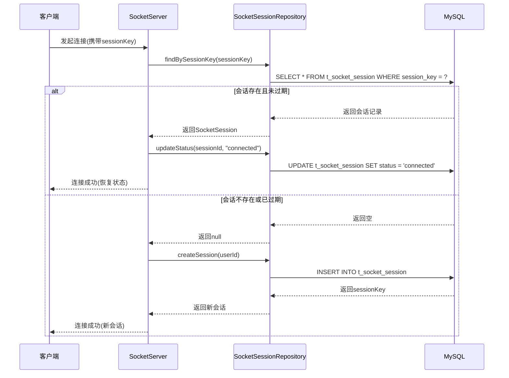

### 3.2 会话活跃状态维护

> 已移除独立的心跳包机制。`last_heartbeat` 字段在每次 `SessionManager.getSession*()` 查询会话时自动更新（调用 `SocketSessionDAO.updateHeartbeat()`），用于跟踪用户活跃状态。断线由 Socket 连接断开事件直接触发。

### 3.3 断线重连流程

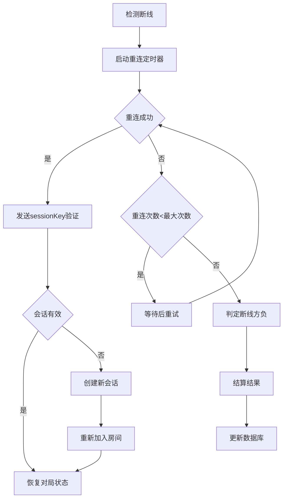

## 4. 棋局保存与恢复机制

### 4.1 设计思路

通过"数据库记录 + 文件存储"的方式实现棋局保存与恢复：
- **数据库记录**：保存棋局元数据和关键状态
- **文件存储**：保存完整的棋局工程文件，通过URI引用

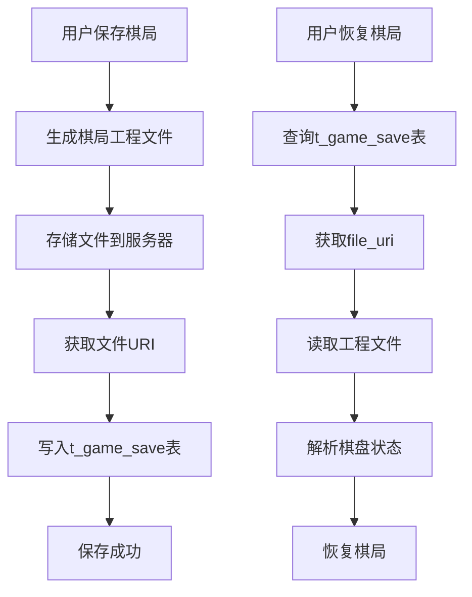

### 4.2 棋局文件URI格式

```
格式: game://{server}/{version}/{user_id}/{timestamp}/{hash}
示例: game://localhost:8080/v1/1/20260101120000/abc123
```

| 部分 | 说明 |
|------|------|
| game:// | 协议标识 |
| server | 服务器地址 |
| version | 版本号 |
| user_id | 用户ID |
| timestamp | 保存时间戳 |
| hash | 文件校验码 |

### 4.3 棋局工程文件结构

```json
{
    "version": "1.0",
    "metadata": {
        "saveId": 1,
        "userId": 1,
        "recordId": null,
        "saveTime": "2026-01-01 12:00:00",
        "saveName": "关键对局"
    },
    "gameState": {
        "boardSize": 15,
        "board": [
            [0, 0, 0, ...],
            [0, 1, 0, ...],
            ...
        ],
        "currentPlayer": 1,
        "moveHistory": [
            {"x": 7, "y": 7, "player": 1, "time": "12:00:00"},
            {"x": 8, "y": 8, "player": 2, "time": "12:00:05"},
            ...
        ],
        "gameStatus": "playing",
        "winner": null,
        "duration": 60
    },
    "players": {
        "player1": {"userId": 1, "username": "player1", "pieceColor": 1},
        "player2": {"userId": 2, "username": "player2", "pieceColor": 2}
    }
}
```

## 5. Repository接口设计

### 5.1 接口分层架构

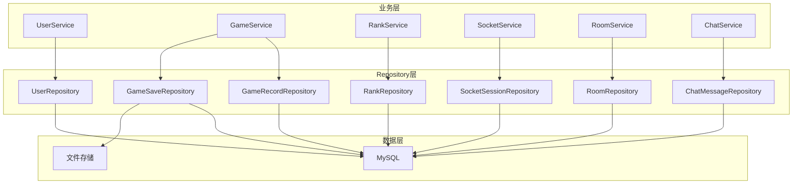

### 5.2 UserRepository

| 方法名 | 参数 | 返回值 | 说明 |
|--------|------|--------|------|
| findById | Long userId | User | 根据ID查询用户 |
| findByUsername | String username | User | 根据用户名查询 |
| findByEmail | String email | User | 根据邮箱查询 |
| save | User user | User | 保存用户 |
| update | User user | User | 更新用户 |
| deleteById | Long userId | void | 删除用户 |
| existsByUsername | String username | boolean | 用户名是否存在 |
| existsByEmail | String email | boolean | 邮箱是否存在 |
| updateScore | Long userId, int score | int | 更新积分 |
| updateWinCount | Long userId | int | 增加胜场数 |
| updateLoseCount | Long userId | int | 增加负场数 |
| updateDrawCount | Long userId | int | 增加平局数 |
| findByScoreRange | int minScore, int maxScore | List\<User\> | 按积分范围查询 |

### 5.3 GameRecordRepository

| 方法名 | 参数 | 返回值 | 说明 |
|--------|------|--------|------|
| findById | Long recordId | GameRecord | 根据ID查询记录 |
| findByUserId | Long userId, int page, int size | List\<GameRecord\> | 查询用户战绩(分页) |
| findRecent | int limit | List\<GameRecord\> | 查询最近对局 |
| findByTimeRange | Date startTime, Date endTime | List\<GameRecord\> | 按时间范围查询 |
| save | GameRecord record | GameRecord | 保存对局记录 |
| deleteById | Long recordId | void | 删除记录 |
| countByUserId | Long userId | int | 统计用户对局数 |
| countByResult | Long userId, String result | int | 统计胜负平次数 |

### 5.4 RankRepository

| 方法名 | 参数 | 返回值 | 说明 |
|--------|------|--------|------|
| findByUserId | Long userId | Rank | 查询用户排名 |
| findAll | int page, int size | List\<Rank\> | 查询所有排名(分页) |
| findTopN | int n | List\<Rank\> | 查询前N名 |
| findByScoreDesc | int page, int size | List\<Rank\> | 按积分降序查询 |
| save | Rank rank | Rank | 保存排名 |
| update | Rank rank | Rank | 更新排名 |
| deleteById | Long rankId | void | 删除排名 |
| refreshRank | void | void | 刷新所有排名 |
| updateUserRank | Long userId | void | 更新单个用户排名 |

### 5.5 GameSaveRepository（棋局保存接口）

| 方法名 | 参数 | 返回值 | 说明 |
|--------|------|--------|------|
| findById | Long saveId | GameSave | 根据ID查询存档 |
| findByFileUri | String fileUri | GameSave | 根据文件URI查询 |
| findByUserId | Long userId, int page, int size | List\<GameSave\> | 查询用户存档(分页) |
| findByRecordId | Long recordId | List\<GameSave\> | 查询对局关联存档 |
| findByStatus | String status | List\<GameSave\> | 按状态查询 |
| save | GameSave save | GameSave | 保存存档 |
| update | GameSave save | GameSave | 更新存档 |
| deleteById | Long saveId | void | 删除存档 |
| deleteByFileUri | String fileUri | void | 根据URI删除 |
| countByUserId | Long userId | int | 统计用户存档数 |

### 5.6 SocketSessionRepository（Socket会话接口）

| 方法名 | 参数 | 返回值 | 说明 |
|--------|------|--------|------|
| findById | Long sessionId | SocketSession | 根据ID查询会话 |
| findBySessionKey | String sessionKey | SocketSession | 根据会话密钥查询 |
| findByUserId | Long userId | SocketSession | 根据用户ID查询会话 |
| findByStatus | String status | List\<SocketSession\> | 按状态查询 |
| findExpiredSessions | Date timeout | List\<SocketSession\> | 查询过期会话 |
| save | SocketSession session | SocketSession | 保存会话 |
| update | SocketSession session | SocketSession | 更新会话 |
| updateStatus | Long sessionId, String status | int | 更新连接状态 |
| updateHeartbeat | Long sessionId | int | 更新活跃时间 |
| updateConnectionId | Long sessionId, String connectionId | int | 更新连接ID |
| deleteById | Long sessionId | void | 删除会话 |
| deleteByUserId | Long userId | void | 删除用户所有会话 |
| countByStatus | String status | int | 统计在线人数 |

### 5.7 RoomRepository（房间接口）

| 方法名 | 参数 | 返回值 | 说明 |
|--------|------|--------|------|
| findById | Long roomId | Room | 根据ID查询房间 |
| findByStatus | String status, int page, int size | List\<Room\> | 按状态查询房间 |
| findByHostId | Long hostId | List\<Room\> | 查询房主创建的房间 |
| findByName | String roomName | List\<Room\> | 按名称查询 |
| save | Room room | Room | 保存房间 |
| update | Room room | Room | 更新房间 |
| updateStatus | Long roomId, String status | int | 更新房间状态 |
| updatePlayerCount | Long roomId, int count | int | 更新人数 |
| deleteById | Long roomId | void | 删除房间 |
| countByStatus | String status | int | 统计房间数 |

### 5.8 ChatMessageRepository（聊天消息接口）

| 方法名 | 参数 | 返回值 | 说明 |
|--------|------|--------|------|
| findById | Long messageId | ChatMessage | 根据ID查询消息 |
| findByRoomId | Long roomId, int page, int size | List\<ChatMessage\> | 查询房间消息 |
| findByUserId | Long userId, int page, int size | List\<ChatMessage\> | 查询用户发送的消息 |
| findRecentByRoomId | Long roomId, int limit | List\<ChatMessage\> | 查询房间最近消息 |
| save | ChatMessage message | ChatMessage | 保存消息 |
| deleteById | Long messageId | void | 删除消息 |
| deleteByRoomId | Long roomId | void | 删除房间所有消息 |
| countByRoomId | Long roomId | int | 统计房间消息数 |

### 5.9 RoomWatcherRepository（房间观战接口）

| 方法名 | 参数 | 返回值 | 说明 |
|--------|------|--------|------|
| findById | Long watcherId | RoomWatcher | 根据ID查询 |
| findByRoomId | Long roomId | List\<RoomWatcher\> | 查询房间观战者 |
| findByUserId | Long userId | List\<RoomWatcher\> | 查询用户观战记录 |
| findByRoomIdAndUserId | Long roomId, Long userId | RoomWatcher | 查询特定观战记录 |
| save | RoomWatcher watcher | RoomWatcher | 保存观战记录 |
| updateLeaveTime | Long watcherId, Date leaveTime | int | 更新离开时间 |
| deleteById | Long watcherId | void | 删除观战记录 |
| deleteByRoomId | Long roomId | void | 删除房间所有观战记录 |
| countByRoomId | Long roomId | int | 统计房间观战人数 |

### 5.10 GameActionRepository（游戏操作接口）

| 方法名 | 参数 | 返回值 | 说明 |
|--------|------|--------|------|
| findById | Long actionId | GameAction | 根据ID查询 |
| findByRecordId | Long recordId | List\<GameAction\> | 查询对局操作记录 |
| findByUserId | Long userId | List\<GameAction\> | 查询用户操作记录 |
| findByRecordIdAndStatus | Long recordId, String status | List\<GameAction\> | 查询对局待处理操作 |
| save | GameAction action | GameAction | 保存操作记录 |
| updateStatus | Long actionId, String status | int | 更新操作状态 |
| updateRejectReason | Long actionId, String reason | int | 更新拒绝原因 |
| deleteById | Long actionId | void | 删除操作记录 |
| deleteByRecordId | Long recordId | void | 删除对局所有操作记录 |

### 5.11 FriendRepository（好友关系接口）

| 方法名 | 参数 | 返回值 | 说明 |
|--------|------|--------|------|
| findById | Long friendId | Friend | 根据ID查询 |
| findByUserId | Long userId | List\<Friend\> | 查询用户好友列表 |
| findByUserIdAndRelationType | Long userId, String relationType | List\<Friend\> | 按关系类型查询 |
| findByUserIdAndFriendUserId | Long userId, Long friendUserId | Friend | 查询好友关系 |
| existsByUserIdAndFriendUserId | Long userId, Long friendUserId | boolean | 是否存在好友关系 |
| save | Friend friend | Friend | 保存好友关系 |
| updateRemark | Long friendId, String remark | int | 更新好友备注 |
| deleteById | Long friendId | void | 删除好友关系 |
| deleteByUserIdAndFriendUserId | Long userId, Long friendUserId | void | 删除双向好友关系 |
| countByUserId | Long userId | int | 统计好友数量 |

### 5.12 FriendRequestRepository（好友请求接口）

| 方法名 | 参数 | 返回值 | 说明 |
|--------|------|--------|------|
| findById | Long requestId | FriendRequest | 根据ID查询 |
| findByFromUserId | Long fromUserId | List\<FriendRequest\> | 查询发出的请求 |
| findByToUserId | Long toUserId | List\<FriendRequest\> | 查询收到的请求 |
| findByToUserIdAndStatus | Long toUserId, String status | List\<FriendRequest\> | 查询待处理请求 |
| findByFromUserIdAndToUserId | Long fromUserId, Long toUserId | FriendRequest | 查询特定请求 |
| existsByFromUserIdAndToUserId | Long fromUserId, Long toUserId | boolean | 是否存在请求 |
| save | FriendRequest request | FriendRequest | 保存请求 |
| updateStatus | Long requestId, String status | int | 更新请求状态 |
| updateRespondTime | Long requestId, Date respondTime | int | 更新响应时间 |
| deleteById | Long requestId | void | 删除请求 |
| deleteExpiredRequests | Date expireTime | int | 删除过期请求 |
| countByToUserIdAndStatus | Long toUserId, String status | int | 统计待处理请求数 |

## 6. 数据模型定义

### 6.1 User 实体

```java
public class User {
    private Long userId;
    private String username;
    private String password;
    private String email;
    private String avatarUrl;
    private String role;
    private String status;
    private Integer score;
    private Integer winCount;
    private Integer loseCount;
    private Integer drawCount;
    private Integer aiWinCount;
    private Integer aiLoseCount;
    private Integer version;
    private Date createTime;
    private Date updateTime;
}
```

### 6.2 GameRecord 实体

```java
public class GameRecord {
    private Long recordId;
    private Long player1Id;
    private Long player2Id;
    private String gameType;
    private Long winnerId;
    private String result;
    private String boardData;
    private Integer duration;
    private Integer moveCount;
    private Date createTime;
}
```

### 6.3 Rank 实体

```java
public class Rank {
    private Long rankId;
    private Long userId;
    private Integer rank;
    private Integer score;
    private BigDecimal winRate;
    private BigDecimal aiWinRate;
    private Integer version;
    private Date updateTime;
}
```

### 6.4 GameSave 实体

```java
public class GameSave {
    private Long saveId;
    private Long userId;
    private Long recordId;
    private String fileUri;
    private String saveName;
    private String boardData;
    private Integer currentPlayer;
    private String gameStatus;
    private String checksum;
    private Integer fileSize;
    private Date createTime;
    private Date updateTime;
}
```

### 6.5 SocketSession 实体

```java
public class SocketSession {
    private Long sessionId;
    private Long userId;
    private String sessionKey;
    private String clientIp;
    private String connectionId;
    private Long roomId;
    private String status;
    private Date lastHeartbeat;
    private Date disconnectTime;
    private String disconnectReason;
    private Integer reconnectAttempts;
    private Date createTime;
    private Date updateTime;
}
```

### 6.6 ChatMessage 实体

```java
public class ChatMessage {
    private Long messageId;
    private Long roomId;
    private Long userId;
    private String content;
    private String messageType;
    private Date createTime;
}
```

### 6.7 Room 实体

```java
public class Room {
    private Long roomId;
    private String roomName;
    private String password;
    private Integer maxPlayers;
    private Integer currentPlayers;
    private Integer watcherCount;
    private String status;
    private Long hostId;
    private Boolean allowWatch;
    private Integer version;
    private Date createTime;
    private Date updateTime;
}
```

### 6.8 RoomWatcher 实体

```java
public class RoomWatcher {
    private Long watcherId;
    private Long roomId;
    private Long userId;
    private Date joinTime;
    private Date leaveTime;
}
```

### 6.9 GameAction 实体

```java
public class GameAction {
    private Long actionId;
    private Long recordId;
    private Long userId;
    private String actionType;
    private String actionStatus;
    private Integer moveNumber;
    private String rejectReason;
    private Date opponentResponse;
    private Date createTime;
}
```

### 6.10 Friend 实体

```java
public class Friend {
    private Long friendId;
    private Long userId;
    private Long friendUserId;
    private String relationType;
    private String remark;
    private Date createTime;
}
```

### 6.11 FriendRequest 实体

```java
public class FriendRequest {
    private Long requestId;
    private Long fromUserId;
    private Long toUserId;
    private String status;
    private String message;
    private Date createTime;
    private Date respondTime;
}
```

### 6.12 DTO 定义

#### UserDTO（用户信息传输对象）

| 字段名 | 类型 | 说明 |
|--------|------|------|
| userId | Long | 用户ID |
| username | String | 用户名 |
| email | String | 邮箱 |
| avatar | String | 头像URL(阿里云OSS) |
| score | Integer | 积分 |
| winCount | Integer | 胜场数 |
| loseCount | Integer | 负场数 |
| drawCount | Integer | 平局数 |

#### GameRecordDTO（对局记录传输对象）

| 字段名 | 类型 | 说明 |
|--------|------|------|
| recordId | Long | 记录ID |
| player1Id | Long | 玩家1ID |
| player1Name | String | 玩家1名称 |
| player2Id | Long | 玩家2ID |
| player2Name | String | 玩家2名称 |
| winnerId | Long | 胜者ID |
| result | String | 结果 |
| boardData | String | 棋谱数据 |
| duration | Integer | 时长 |
| createTime | Date | 创建时间 |

#### GameSaveDTO（棋局保存传输对象）

| 字段名 | 类型 | 说明 |
|--------|------|------|
| saveId | Long | 保存ID |
| userId | Long | 用户ID |
| recordId | Long | 关联对局ID |
| fileUri | String | 文件URI |
| saveName | String | 保存名称 |
| boardData | String | 棋盘状态 |
| currentPlayer | Integer | 当前执子方 |
| gameStatus | String | 游戏状态 |
| createTime | Date | 创建时间 |

#### SocketSessionDTO（Socket会话传输对象）

| 字段名 | 类型 | 说明 |
|--------|------|------|
| sessionId | Long | 会话ID |
| userId | Long | 用户ID |
| sessionKey | String | 会话密钥 |
| status | String | 连接状态 |
| lastHeartbeat | Date | 最后活跃时间 |

#### ChatMessageDTO（聊天消息传输对象）

| 字段名 | 类型 | 说明 |
|--------|------|------|
| messageId | Long | 消息ID |
| roomId | Long | 房间ID |
| userId | Long | 发送者ID |
| username | String | 发送者名称 |
| content | String | 消息内容 |
| messageType | String | 消息类型 |
| createTime | Date | 创建时间 |

#### RoomDTO（房间传输对象）

| 字段名 | 类型 | 说明 |
|--------|------|------|
| roomId | Long | 房间ID |
| roomName | String | 房间名称 |
| passwordRequired | Boolean | 是否需要密码 |
| maxPlayers | Integer | 最大人数 |
| currentPlayers | Integer | 当前人数 |
| status | String | 房间状态 |
| hostId | Long | 房主ID |
| hostName | String | 房主名称 |
| createTime | Date | 创建时间 |

## 7. SQL脚本

### 7.1 MySQL配置（my.cnf / my.ini）

确保MySQL服务端全局UTF-8编码：

```ini
[mysqld]
character-set-server = utf8mb4
collation-server = utf8mb4_unicode_ci
default-storage-engine = InnoDB
max_connections = 1000
wait_timeout = 600
interactive_timeout = 600

[mysql]
default-character-set = utf8mb4

[client]
default-character-set = utf8mb4
```

**验证编码配置**：
```sql
SHOW VARIABLES LIKE 'character_set_%';
SHOW VARIABLES LIKE 'collation_%';
```

**预期结果**：
| 变量名 | 值 |
|--------|-----|
| character_set_server | utf8mb4 |
| collation_server | utf8mb4_unicode_ci |
| character_set_database | utf8mb4 |
| character_set_client | utf8mb4 |
| character_set_connection | utf8mb4 |

### 7.2 创建数据库

```sql
CREATE DATABASE IF NOT EXISTS gomatch 
    DEFAULT CHARACTER SET utf8mb4 
    COLLATE utf8mb4_unicode_ci;

USE gomatch;

-- 设置会话编码（确保当前连接也是UTF-8）
SET NAMES utf8mb4 COLLATE utf8mb4_unicode_ci;
SET CHARACTER SET utf8mb4;
```

### 7.3 创建表

```sql
CREATE TABLE IF NOT EXISTS `t_user` (
    `user_id` BIGINT PRIMARY KEY AUTO_INCREMENT COMMENT '用户ID',
    `username` VARCHAR(50) NOT NULL UNIQUE COMMENT '用户名',
    `password` VARCHAR(100) NOT NULL COMMENT '密码(加密)',
    `email` VARCHAR(100) UNIQUE COMMENT '邮箱',
    `avatar_url` VARCHAR(500) COMMENT '头像URL(阿里云OSS)',
    `role` VARCHAR(20) NOT NULL DEFAULT 'PLAYER' COMMENT '角色: PLAYER/ADMIN',
    `status` VARCHAR(20) NOT NULL DEFAULT 'ACTIVE' COMMENT '状态: ACTIVE/BANNED/INACTIVE',
    `score` INT DEFAULT 1000 COMMENT '积分',
    `win_count` INT DEFAULT 0 COMMENT '胜场数',
    `lose_count` INT DEFAULT 0 COMMENT '负场数',
    `draw_count` INT DEFAULT 0 COMMENT '平局数',
    `ai_win_count` INT DEFAULT 0 COMMENT 'AI对战胜场数',
    `ai_lose_count` INT DEFAULT 0 COMMENT 'AI对战负场数',
    `version` INT DEFAULT 0 COMMENT '版本号(乐观锁)',
    `create_time` DATETIME DEFAULT CURRENT_TIMESTAMP COMMENT '创建时间',
    `update_time` DATETIME DEFAULT CURRENT_TIMESTAMP ON UPDATE CURRENT_TIMESTAMP COMMENT '更新时间',
    INDEX `idx_username` (`username`),
    INDEX `idx_role` (`role`),
    INDEX `idx_status` (`status`),
    INDEX `idx_role_status` (`role`, `status`),
    INDEX `idx_score` (`score`),
    INDEX `idx_avatar_url` (`avatar_url`)
) ENGINE=InnoDB DEFAULT CHARSET=utf8mb4 COMMENT='用户表';

CREATE TABLE IF NOT EXISTS `t_game_record` (
    `record_id` BIGINT PRIMARY KEY AUTO_INCREMENT COMMENT '记录ID',
    `player1_id` BIGINT NOT NULL COMMENT '玩家1ID',
    `player2_id` BIGINT NOT NULL COMMENT '玩家2ID',
    `game_type` VARCHAR(20) NOT NULL DEFAULT 'PVP' COMMENT '游戏类型: PVP/PVE',
    `winner_id` BIGINT COMMENT '胜者ID(平局为NULL)',
    `result` VARCHAR(10) NOT NULL COMMENT '结果: win/lose/draw',
    `board_data` TEXT NOT NULL COMMENT '棋谱数据(JSON格式)',
    `duration` INT COMMENT '对局时长(秒)',
    `move_count` INT DEFAULT 0 COMMENT '落子总数',
    `create_time` DATETIME DEFAULT CURRENT_TIMESTAMP COMMENT '创建时间',
    INDEX `idx_player1` (`player1_id`),
    INDEX `idx_player2` (`player2_id`),
    INDEX `idx_game_type` (`game_type`),
    INDEX `idx_create_time` (`create_time`),
    FOREIGN KEY (`player1_id`) REFERENCES `t_user`(`user_id`) ON DELETE CASCADE,
    FOREIGN KEY (`player2_id`) REFERENCES `t_user`(`user_id`) ON DELETE CASCADE,
    FOREIGN KEY (`winner_id`) REFERENCES `t_user`(`user_id`) ON DELETE SET NULL
) ENGINE=InnoDB DEFAULT CHARSET=utf8mb4 COMMENT='游戏记录表';

CREATE TABLE IF NOT EXISTS `t_rank` (
    `rank_id` BIGINT PRIMARY KEY AUTO_INCREMENT COMMENT '排名ID',
    `user_id` BIGINT NOT NULL UNIQUE COMMENT '用户ID',
    `rank` INT DEFAULT 0 COMMENT '排名',
    `score` INT DEFAULT 0 COMMENT '积分',
    `win_rate` DECIMAL(5,2) DEFAULT 0.00 COMMENT '胜率',
    `ai_win_rate` DECIMAL(5,2) DEFAULT 0.00 COMMENT 'AI对战胜率',
    `version` INT DEFAULT 0 COMMENT '版本号(乐观锁)',
    `update_time` DATETIME DEFAULT CURRENT_TIMESTAMP ON UPDATE CURRENT_TIMESTAMP COMMENT '更新时间',
    INDEX `idx_rank` (`rank`),
    INDEX `idx_score` (`score`),
    FOREIGN KEY (`user_id`) REFERENCES `t_user`(`user_id`) ON DELETE CASCADE
) ENGINE=InnoDB DEFAULT CHARSET=utf8mb4 COMMENT='排行榜表';

CREATE TABLE IF NOT EXISTS `t_game_save` (
    `save_id` BIGINT PRIMARY KEY AUTO_INCREMENT COMMENT '保存ID',
    `user_id` BIGINT NOT NULL COMMENT '用户ID',
    `record_id` BIGINT COMMENT '关联对局ID',
    `file_uri` VARCHAR(500) NOT NULL UNIQUE COMMENT '棋局文件URI',
    `save_name` VARCHAR(100) COMMENT '保存名称',
    `board_data` TEXT NOT NULL COMMENT '棋盘状态(JSON)',
    `current_player` INT NOT NULL COMMENT '当前执子方',
    `game_status` VARCHAR(20) NOT NULL COMMENT '游戏状态',
    `checksum` VARCHAR(64) COMMENT '文件校验和(SHA-256)',
    `file_size` INT DEFAULT 0 COMMENT '文件大小(字节)',
    `create_time` DATETIME DEFAULT CURRENT_TIMESTAMP COMMENT '创建时间',
    `update_time` DATETIME DEFAULT CURRENT_TIMESTAMP ON UPDATE CURRENT_TIMESTAMP COMMENT '更新时间',
    INDEX `idx_user_id` (`user_id`),
    INDEX `idx_record_id` (`record_id`),
    FOREIGN KEY (`user_id`) REFERENCES `t_user`(`user_id`) ON DELETE CASCADE,
    FOREIGN KEY (`record_id`) REFERENCES `t_game_record`(`record_id`) ON DELETE SET NULL
) ENGINE=InnoDB DEFAULT CHARSET=utf8mb4 COMMENT='棋局保存表';

CREATE TABLE IF NOT EXISTS `t_socket_session` (
    `session_id` BIGINT PRIMARY KEY AUTO_INCREMENT COMMENT '会话ID',
    `user_id` BIGINT NOT NULL COMMENT '用户ID',
    `session_key` VARCHAR(64) NOT NULL UNIQUE COMMENT '会话密钥',
    `client_ip` VARCHAR(50) COMMENT '客户端IP',
    `connection_id` VARCHAR(64) COMMENT '连接ID',
    `room_id` BIGINT COMMENT '当前所在房间ID',
    `status` VARCHAR(20) NOT NULL DEFAULT 'connected' COMMENT '连接状态',
    `last_heartbeat` DATETIME COMMENT '最后活跃时间',
    `disconnect_time` DATETIME COMMENT '断开连接时间',
    `disconnect_reason` VARCHAR(50) COMMENT '断开原因',
    `reconnect_attempts` INT DEFAULT 0 COMMENT '重连尝试次数',
    `create_time` DATETIME DEFAULT CURRENT_TIMESTAMP COMMENT '创建时间',
    `update_time` DATETIME DEFAULT CURRENT_TIMESTAMP ON UPDATE CURRENT_TIMESTAMP COMMENT '更新时间',
    INDEX `idx_user_id` (`user_id`),
    INDEX `idx_status` (`status`),
    INDEX `idx_last_heartbeat` (`last_heartbeat`),
    INDEX `idx_room_id` (`room_id`),
    INDEX `idx_room_status` (`room_id`, `status`),
    FOREIGN KEY (`user_id`) REFERENCES `t_user`(`user_id`) ON DELETE CASCADE,
    FOREIGN KEY (`room_id`) REFERENCES `t_room`(`room_id`) ON DELETE SET NULL
) ENGINE=InnoDB DEFAULT CHARSET=utf8mb4 COMMENT='Socket会话表';

CREATE TABLE IF NOT EXISTS `t_room` (
    `room_id` BIGINT PRIMARY KEY AUTO_INCREMENT COMMENT '房间ID',
    `room_name` VARCHAR(100) NOT NULL COMMENT '房间名称',
    `password` VARCHAR(100) COMMENT '房间密码',
    `max_players` INT DEFAULT 2 COMMENT '最大人数',
    `current_players` INT DEFAULT 0 COMMENT '当前人数',
    `watcher_count` INT DEFAULT 0 COMMENT '观战人数',
    `status` VARCHAR(20) NOT NULL DEFAULT 'waiting' COMMENT '房间状态',
    `host_id` BIGINT NOT NULL COMMENT '房主ID',
    `allow_watch` BOOLEAN DEFAULT TRUE COMMENT '是否允许观战',
    `version` INT DEFAULT 0 COMMENT '版本号(乐观锁)',
    `create_time` DATETIME DEFAULT CURRENT_TIMESTAMP COMMENT '创建时间',
    `update_time` DATETIME DEFAULT CURRENT_TIMESTAMP ON UPDATE CURRENT_TIMESTAMP COMMENT '更新时间',
    INDEX `idx_status` (`status`),
    INDEX `idx_host_id` (`host_id`),
    INDEX `idx_allow_watch` (`allow_watch`),
    INDEX `idx_status_players` (`status`, `current_players`),
    INDEX `idx_watch_status` (`allow_watch`, `status`),
    FOREIGN KEY (`host_id`) REFERENCES `t_user`(`user_id`) ON DELETE CASCADE
) ENGINE=InnoDB DEFAULT CHARSET=utf8mb4 COMMENT='房间表';

CREATE TABLE IF NOT EXISTS `t_chat_message` (
    `message_id` BIGINT PRIMARY KEY AUTO_INCREMENT COMMENT '消息ID',
    `room_id` BIGINT NOT NULL COMMENT '房间ID',
    `user_id` BIGINT NOT NULL COMMENT '发送者ID',
    `content` VARCHAR(500) NOT NULL COMMENT '消息内容',
    `message_type` VARCHAR(20) NOT NULL DEFAULT 'text' COMMENT '消息类型',
    `create_time` DATETIME DEFAULT CURRENT_TIMESTAMP COMMENT '创建时间',
    INDEX `idx_room_id` (`room_id`),
    INDEX `idx_user_id` (`user_id`),
    INDEX `idx_create_time` (`create_time`),
    FOREIGN KEY (`room_id`) REFERENCES `t_room`(`room_id`) ON DELETE CASCADE,
    FOREIGN KEY (`user_id`) REFERENCES `t_user`(`user_id`) ON DELETE CASCADE
) ENGINE=InnoDB DEFAULT CHARSET=utf8mb4 COMMENT='聊天消息表';

CREATE TABLE IF NOT EXISTS `t_room_watcher` (
    `watcher_id` BIGINT PRIMARY KEY AUTO_INCREMENT COMMENT '观战记录ID',
    `room_id` BIGINT NOT NULL COMMENT '房间ID',
    `user_id` BIGINT NOT NULL COMMENT '观战者ID',
    `join_time` DATETIME NOT NULL COMMENT '加入观战时间',
    `leave_time` DATETIME COMMENT '离开观战时间',
    INDEX `idx_room_id` (`room_id`),
    INDEX `idx_user_id` (`user_id`),
    UNIQUE INDEX `uk_room_user` (`room_id`, `user_id`),
    FOREIGN KEY (`room_id`) REFERENCES `t_room`(`room_id`) ON DELETE CASCADE,
    FOREIGN KEY (`user_id`) REFERENCES `t_user`(`user_id`) ON DELETE CASCADE
) ENGINE=InnoDB DEFAULT CHARSET=utf8mb4 COMMENT='房间观战表';

CREATE TABLE IF NOT EXISTS `t_game_action` (
    `action_id` BIGINT PRIMARY KEY AUTO_INCREMENT COMMENT '操作记录ID',
    `record_id` BIGINT NOT NULL COMMENT '关联对局ID',
    `user_id` BIGINT NOT NULL COMMENT '操作用户ID',
    `action_type` VARCHAR(20) NOT NULL COMMENT '操作类型',
    `action_status` VARCHAR(20) NOT NULL COMMENT '操作状态',
    `move_number` INT NOT NULL COMMENT '操作时落子数',
    `reject_reason` VARCHAR(100) COMMENT '拒绝原因',
    `opponent_response` DATETIME COMMENT '对手响应时间',
    `create_time` DATETIME DEFAULT CURRENT_TIMESTAMP COMMENT '创建时间',
    INDEX `idx_record_id` (`record_id`),
    INDEX `idx_user_id` (`user_id`),
    INDEX `idx_action_type` (`action_type`),
    INDEX `idx_action_status` (`action_status`),
    INDEX `idx_record_status` (`record_id`, `action_status`),
    FOREIGN KEY (`record_id`) REFERENCES `t_game_record`(`record_id`) ON DELETE CASCADE,
    FOREIGN KEY (`user_id`) REFERENCES `t_user`(`user_id`) ON DELETE CASCADE
) ENGINE=InnoDB DEFAULT CHARSET=utf8mb4 COMMENT='游戏操作表';

CREATE TABLE IF NOT EXISTS `t_friend` (
    `friend_id` BIGINT PRIMARY KEY AUTO_INCREMENT COMMENT '好友关系ID',
    `user_id` BIGINT NOT NULL COMMENT '用户ID',
    `friend_user_id` BIGINT NOT NULL COMMENT '好友ID',
    `relation_type` VARCHAR(20) NOT NULL DEFAULT 'FRIEND' COMMENT '关系类型',
    `remark` VARCHAR(50) COMMENT '好友备注',
    `create_time` DATETIME DEFAULT CURRENT_TIMESTAMP COMMENT '创建时间',
    INDEX `idx_user_id` (`user_id`),
    INDEX `idx_friend_user_id` (`friend_user_id`),
    UNIQUE INDEX `uk_user_friend` (`user_id`, `friend_user_id`),
    INDEX `idx_relation_type` (`relation_type`),
    FOREIGN KEY (`user_id`) REFERENCES `t_user`(`user_id`) ON DELETE CASCADE,
    FOREIGN KEY (`friend_user_id`) REFERENCES `t_user`(`user_id`) ON DELETE CASCADE
) ENGINE=InnoDB DEFAULT CHARSET=utf8mb4 COMMENT='好友关系表';

CREATE TABLE IF NOT EXISTS `t_friend_request` (
    `request_id` BIGINT PRIMARY KEY AUTO_INCREMENT COMMENT '请求ID',
    `from_user_id` BIGINT NOT NULL COMMENT '发起者ID',
    `to_user_id` BIGINT NOT NULL COMMENT '接收者ID',
    `status` VARCHAR(20) NOT NULL DEFAULT 'PENDING' COMMENT '请求状态',
    `message` VARCHAR(200) COMMENT '请求附言',
    `create_time` DATETIME DEFAULT CURRENT_TIMESTAMP COMMENT '创建时间',
    `respond_time` DATETIME COMMENT '响应时间',
    INDEX `idx_from_user` (`from_user_id`),
    INDEX `idx_to_user` (`to_user_id`),
    UNIQUE INDEX `uk_from_to` (`from_user_id`, `to_user_id`),
    INDEX `idx_status` (`status`),
    INDEX `idx_to_status` (`to_user_id`, `status`),
    FOREIGN KEY (`from_user_id`) REFERENCES `t_user`(`user_id`) ON DELETE CASCADE,
    FOREIGN KEY (`to_user_id`) REFERENCES `t_user`(`user_id`) ON DELETE CASCADE
) ENGINE=InnoDB DEFAULT CHARSET=utf8mb4 COMMENT='好友请求表';

CREATE TABLE IF NOT EXISTS `t_user_settings` (
    `settings_id` BIGINT PRIMARY KEY AUTO_INCREMENT COMMENT '设置ID',
    `user_id` BIGINT NOT NULL UNIQUE COMMENT '用户ID',
    `avatar_url` VARCHAR(500) COMMENT '头像URL(阿里云OSS)',
    `language` VARCHAR(20) DEFAULT 'zh_CN' COMMENT '语言: zh_CN/en_US',
    `font_family` VARCHAR(50) DEFAULT 'SimSun' COMMENT '字体',
    `font_size` INT DEFAULT 12 COMMENT '字体大小(px)',
    `frame_rate` INT DEFAULT 60 COMMENT '帧率(30/60/120)',
    `window_width` INT DEFAULT 900 COMMENT '窗口宽度',
    `window_height` INT DEFAULT 640 COMMENT '窗口高度',
    `background_music_enabled` BOOLEAN DEFAULT TRUE COMMENT '背景音乐开关',
    `background_music_volume` DECIMAL(3,2) DEFAULT 0.5 COMMENT '背景音乐音量(0-1)',
    `sound_effects_enabled` BOOLEAN DEFAULT TRUE COMMENT '音效开关',
    `sound_effects_volume` DECIMAL(3,2) DEFAULT 0.7 COMMENT '音效音量(0-1)',
    `lobby_song` VARCHAR(100) DEFAULT 'default' COMMENT '大厅背景音乐',
    `theme` VARCHAR(50) DEFAULT 'light' COMMENT '主题: light/dark',
    `version` INT DEFAULT 0 COMMENT '版本号(乐观锁)',
    `create_time` DATETIME DEFAULT CURRENT_TIMESTAMP COMMENT '创建时间',
    `update_time` DATETIME DEFAULT CURRENT_TIMESTAMP ON UPDATE CURRENT_TIMESTAMP COMMENT '更新时间',
    INDEX `idx_user_id` (`user_id`),
    FOREIGN KEY (`user_id`) REFERENCES `t_user`(`user_id`) ON DELETE CASCADE
) ENGINE=InnoDB DEFAULT CHARSET=utf8mb4 COMMENT='用户设置表';
```

### 7.4 初始化数据

```sql
INSERT INTO `t_user` (`username`, `password`, `email`, `role`, `status`, `score`) VALUES
('admin', '$2a$10$N9qo8uLOickgx2ZMRZoMye.IjzqAKL9xL5jvMFVdNJHvGCgTq/VEq', '[redacted-email]', 'ADMIN', 'ACTIVE', 9999),
('player1', '$2a$10$N9qo8uLOickgx2ZMRZoMye.IjzqAKL9xL5jvMFVdNJHvGCgTq/VEq', '[redacted-email]', 'PLAYER', 'ACTIVE', 1000),
('player2', '$2a$10$N9qo8uLOickgx2ZMRZoMye.IjzqAKL9xL5jvMFVdNJHvGCgTq/VEq', '[redacted-email]', 'PLAYER', 'ACTIVE', 1000);
```

### 7.5 JDBC连接配置

确保Java应用连接数据库时使用UTF-8编码：

```java
// JDBC URL配置
String url = "jdbc:mysql://localhost:3306/gomatch?useUnicode=true&characterEncoding=utf8&connectionCollation=utf8mb4_unicode_ci&serverTimezone=Asia/Shanghai";

// HikariCP连接池配置
HikariConfig config = new HikariConfig();
config.setJdbcUrl(url);
config.setUsername("gomatch");
config.setPassword("password");
config.setMaximumPoolSize(60);
config.setMinimumIdle(10);
config.setConnectionTimeout(30000);
config.setIdleTimeout(600000);
config.setMaxLifetime(1800000);
```

**连接池初始化时执行编码设置**：
```java
// 在连接池初始化后执行
try (Connection conn = dataSource.getConnection()) {
    try (Statement stmt = conn.createStatement()) {
        stmt.execute("SET NAMES utf8mb4 COLLATE utf8mb4_unicode_ci");
        stmt.execute("SET CHARACTER SET utf8mb4");
    }
} catch (SQLException e) {
    // 处理异常
}
```

## 8. Socket协议与数据库交互设计

### 8.1 Socket消息类型

| 消息类型 | 方向 | 说明 | 数据库操作 |
|----------|------|------|------------|
| CONNECT | Client→Server | 客户端连接 | 插入/更新t_socket_session |
| DISCONNECT | Client→Server | 客户端断开 | 更新t_socket_session状态 |
| MOVE | Client→Server | 落子请求 | 实时内存更新，对局结束后写入t_game_record |
| CHAT | Client→Server | 聊天消息 | 插入t_chat_message |
| CREATE_ROOM | Client→Server | 创建房间 | 插入t_room |
| JOIN_ROOM | Client→Server | 加入房间 | 更新t_room.current_players |
| LEAVE_ROOM | Client→Server | 离开房间 | 更新t_room.current_players |
| GAME_OVER | Server→Client | 游戏结束 | 插入t_game_record，更新t_user积分/胜负场 |
| SAVE_GAME | Client→Server | 保存棋局 | 插入t_game_save，写入文件存储 |
| LOAD_GAME | Client→Server | 恢复棋局 | 查询t_game_save，读取文件存储 |

### 8.2 实时数据与持久化数据分离

```mermaid
flowchart LR
    subgraph 实时数据(内存)
        A[房间状态]
        B[棋盘状态]
        C[当前玩家]
        D[Socket连接]
    end
    
    subgraph 持久化数据(数据库)
        E[t_user]
        F[t_game_record]
        G[t_socket_session]
        H[t_chat_message]
        I[t_game_save]
    end
    
    A -.-> H
    B -.-> F
    B -.-> I
    C -.-> F
    D -.-> G
    E -.-> F
    E -.-> H
    
    style A fill:#f9f,stroke:#333
    style B fill:#f9f,stroke:#333
    style C fill:#f9f,stroke:#333
    style D fill:#f9f,stroke:#333
    style E fill:#bbf,stroke:#333
    style F fill:#bbf,stroke:#333
    style G fill:#bbf,stroke:#333
    style H fill:#bbf,stroke:#333
    style I fill:#bbf,stroke:#333
```

**设计原则**：
- 实时数据（棋盘状态、连接状态）优先保存在内存中，保证低延迟
- 持久化数据（用户信息、对局记录、消息历史）写入数据库
- 关键状态变更时，异步写入数据库（如每N步落子后保存一次）

## 9. 事务与并发

### 9.1 事务边界

| 操作 | 事务要求 | 说明 |
|------|----------|------|
| 用户注册 | REQUIRED | 保证用户数据完整 |
| 用户登录 | SUPPORTS | 只读操作 |
| 对局结束结算 | REQUIRED | 更新战绩、积分、排名 |
| 保存棋局 | REQUIRED | 写入数据库和文件 |
| 恢复棋局 | SUPPORTS | 只读操作 |
| 创建房间 | REQUIRED | 写入房间数据 |
| 发送消息 | REQUIRED | 写入消息数据 |
| Socket连接 | REQUIRED | 写入会话数据 |

### 9.2 并发控制

| 场景 | 策略 | 说明 |
|------|------|------|
| 积分更新 | 乐观锁 | 使用版本号或CAS操作 |
| 排名刷新 | 悲观锁 | 锁定排行榜表 |
| 棋局保存 | 唯一性约束 | file_uri唯一索引 |
| 用户状态更新 | 行锁 | 通过主键锁定 |
| 房间人数更新 | 行锁 | 通过room_id锁定 |
| Socket会话更新 | 行锁 | 通过session_key锁定 |

## 10. 多线程与分布式架构设计

### 10.1 分布式锁机制

针对双服务器实时下棋场景，需要使用分布式锁保证同一棋局在同一时刻只有一个服务器处理。

#### 10.1.1 数据库分布式锁表

```sql
CREATE TABLE IF NOT EXISTS `t_distributed_lock` (
    `lock_id` BIGINT PRIMARY KEY AUTO_INCREMENT COMMENT '锁ID',
    `lock_key` VARCHAR(128) NOT NULL UNIQUE COMMENT '锁键',
    `owner` VARCHAR(64) NOT NULL COMMENT '锁持有者(服务器标识)',
    `expire_time` DATETIME NOT NULL COMMENT '过期时间',
    `create_time` DATETIME DEFAULT CURRENT_TIMESTAMP COMMENT '创建时间',
    `update_time` DATETIME DEFAULT CURRENT_TIMESTAMP ON UPDATE CURRENT_TIMESTAMP COMMENT '更新时间',
    INDEX `idx_lock_key` (`lock_key`),
    INDEX `idx_expire_time` (`expire_time`)
) ENGINE=InnoDB DEFAULT CHARSET=utf8mb4 COMMENT='分布式锁表';
```

**锁键设计**：
| 场景 | 锁键格式 | 示例 |
|------|----------|------|
| 棋局操作 | game:{gameId} | game:123 |
| 用户操作 | user:{userId} | user:456 |
| 房间操作 | room:{roomId} | room:789 |

#### 10.1.2 分布式锁接口

| 方法名 | 参数 | 返回值 | 说明 |
|--------|------|--------|------|
| tryLock | String lockKey, String owner, long timeoutMs | boolean | 尝试获取锁 |
| unlock | String lockKey, String owner | void | 释放锁 |
| renewLock | String lockKey, String owner, long timeoutMs | boolean | 续期锁 |
| isLocked | String lockKey | boolean | 检查锁是否存在 |

### 10.2 乐观锁版本号

为高并发更新场景添加版本号字段，防止数据覆盖。

#### 10.2.1 需要乐观锁的表

| 表名 | 新增字段 | 说明 |
|------|----------|------|
| t_user | version INT DEFAULT 1 | 用户数据版本号 |
| t_rank | version INT DEFAULT 1 | 排名数据版本号 |
| t_room | version INT DEFAULT 1 | 房间数据版本号 |

#### 10.2.2 更新SQL示例

```sql
-- 更新用户积分（乐观锁）
UPDATE t_user 
SET score = score + 100, version = version + 1 
WHERE user_id = ? AND version = ?;

-- 更新房间人数（乐观锁）
UPDATE t_room 
SET current_players = current_players + 1, version = version + 1 
WHERE room_id = ? AND version = ? AND current_players < max_players;
```

### 10.3 数据库连接池配置

针对多线程环境，配置合理的连接池参数。

#### 10.3.1 HikariCP配置建议

| 参数 | 值 | 说明 |
|------|-----|------|
| maximumPoolSize | 60 | 最大连接数（CPU核心数×5） |
| minimumIdle | 10 | 最小空闲连接数 |
| connectionTimeout | 30000 | 连接超时时间(ms) |
| idleTimeout | 600000 | 空闲连接超时时间(ms) |
| maxLifetime | 1800000 | 连接最大生命周期(ms) |
| transactionIsolation | TRANSACTION_READ_COMMITTED | 事务隔离级别 |

#### 10.3.2 连接池监控

| 监控指标 | 说明 | 告警阈值 |
|----------|------|----------|
| activeConnections | 活跃连接数 | > 80% of maxPoolSize |
| idleConnections | 空闲连接数 | < minimumIdle |
| connectionWaitTime | 连接等待时间 | > 500ms |
| poolUtilization | 连接池利用率 | > 90% |

### 10.4 读写分离策略

针对高并发场景，采用主从复制实现读写分离。

#### 10.4.1 读写分配规则

| 操作类型 | 数据库 | 说明 |
|----------|--------|------|
| 用户注册/登录 | 主库 | 写操作 |
| 创建/加入房间 | 主库 | 写操作 |
| 落子操作 | 主库 | 写操作（实时性要求高） |
| 聊天消息 | 主库 | 写操作 |
| 个人战绩查询 | 从库 | 读操作 |
| 排行榜查询 | 从库 | 读操作 |
| 用户信息查询 | 从库 | 读操作 |
| 房间列表查询 | 从库 | 读操作 |

#### 10.4.2 数据一致性保障

| 场景 | 策略 | 说明 |
|------|------|------|
| 对局结束结算 | 同步写入主库 | 确保数据不丢失 |
| 排行榜刷新 | 异步同步到从库 | 允许短暂不一致 |
| 战绩查询 | 从库读取 | 接受秒级延迟 |

### 10.5 双客户端架构设计

针对两台服务器实时下棋场景，需要保证数据同步和状态一致性。

#### 10.5.1 服务器架构图

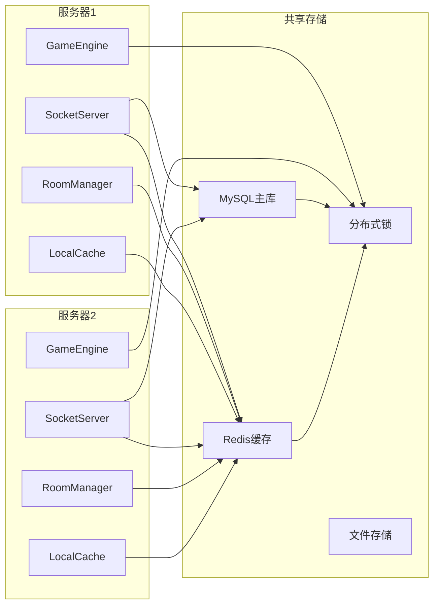

#### 10.5.2 服务器通信协议

| 消息类型 | 说明 | 数据结构 |
|----------|------|----------|
| GAME_SYNC | 棋局状态同步 | gameId, boardData, currentPlayer |
| ROOM_MIGRATE | 房间迁移通知 | roomId, targetServer |
| SESSION_RELOCATE | 会话重定位 | sessionKey, targetServer |
| BROADCAST_MESSAGE | 广播消息 | roomId, message |

#### 10.5.3 棋局状态同步流程

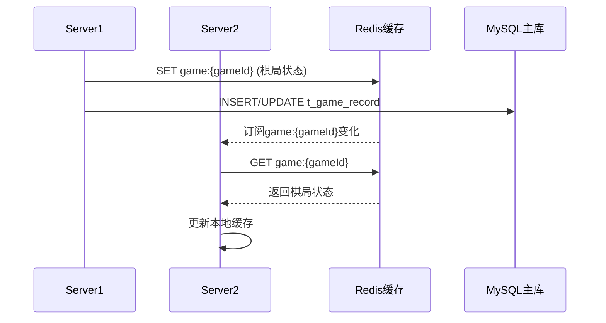

### 10.6 多客户端并发处理

针对多个客户端同时请求的场景，需要保证请求顺序和数据一致性。

#### 10.6.1 请求队列设计

| 队列类型 | 用途 | 处理策略 |
|----------|------|----------|
| MoveQueue | 落子请求队列 | FIFO，单线程处理 |
| ChatQueue | 聊天消息队列 | FIFO，批量写入 |
| SaveQueue | 保存请求队列 | 合并写入，减少IO |

#### 10.6.2 请求去重

| 场景 | 去重策略 | 说明 |
|------|----------|------|
| 重复落子请求 | 请求ID + 时间戳 | 同一请求5秒内只处理一次 |
| 重复加入房间 | 用户ID + 房间ID | 同一用户同一房间只允许加入一次 |
| 重复创建房间 | 用户ID + 房间名 | 同一用户同房间名只允许创建一次 |

## 11. 角色与权限设计

### 11.1 角色定义

| 角色 | 标识 | 说明 |
|------|------|------|
| 普通玩家 | PLAYER | 可以下棋、聊天、查看战绩、保存棋局 |
| 管理员 | ADMIN | 除玩家权限外，可管理用户、房间、查看所有数据 |

### 11.2 用户状态

| 状态 | 标识 | 说明 |
|------|------|------|
| 活跃 | ACTIVE | 正常使用 |
| 封禁 | BANNED | 被管理员封禁，无法登录 |
| 未激活 | INACTIVE | 注册后未激活邮箱 |

### 11.3 权限矩阵

| 功能 | 普通玩家 | 管理员 |
|------|----------|--------|
| 用户登录 | ✅ | ✅ |
| 用户注册 | ✅ | ❌ |
| 创建房间 | ✅ | ✅ |
| 加入房间 | ✅ | ✅ |
| 落子下棋 | ✅ | ✅ |
| 聊天 | ✅ | ✅ |
| 保存/恢复棋局 | ✅ | ✅ |
| 查看个人战绩 | ✅ | ✅ |
| 查看排行榜 | ✅ | ✅ |
| 查看个人中心 | ✅ | ✅ |
| 管理用户（封禁/解封） | ❌ | ✅ |
| 管理房间（强制关闭） | ❌ | ✅ |
| 查看所有用户数据 | ❌ | ✅ |
| 查看所有对局记录 | ❌ | ✅ |
| 查看所有聊天记录 | ❌ | ✅ |
| 管理系统配置 | ❌ | ✅ |
| 查看系统日志 | ❌ | ✅ |

### 11.4 角色转换流程

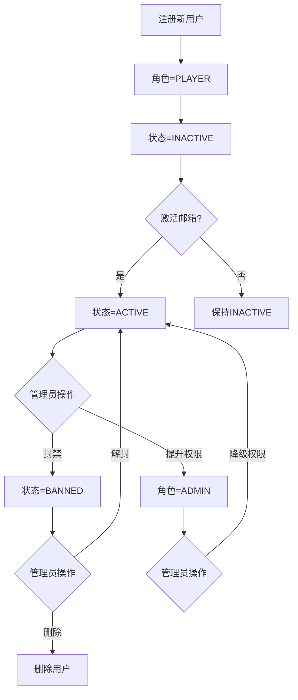

### 11.5 Repository接口扩展

**UserRepository新增方法**：

| 方法名 | 参数 | 返回值 | 说明 |
|--------|------|--------|------|
| findByRole | String role | List\<User\> | 按角色查询用户 |
| findByStatus | String status | List\<User\> | 按状态查询用户 |
| findByRoleAndStatus | String role, String status | List\<User\> | 按角色和状态查询 |
| updateRole | Long userId, String role | int | 更新用户角色 |
| updateStatus | Long userId, String status | int | 更新用户状态 |
| countByRole | String role | int | 统计角色人数 |
| countByStatus | String status | int | 统计状态人数 |

## 12. 数据安全

### 12.1 加密策略

| 数据项 | 加密方式 | 说明 |
|--------|----------|------|
| 密码 | 明文 | 实训演示环境直接存储 |
| 文件URI | Base64编码 | 防止敏感信息泄露 |
| 房间密码 | 明文 | 实训演示环境直接存储 |
| 棋谱数据 | 无 | 非敏感数据 |

### 12.2 访问控制

| 角色 | 可访问表 | 权限 |
|------|----------|------|
| 普通玩家(ACTIVE) | t_user(本人), t_game_record, t_rank, t_game_save(本人), t_socket_session(本人), t_chat_message(本人), t_room | SELECT, INSERT, UPDATE |
| 普通玩家(BANNED) | 无 | 封禁状态无法登录 |
| 普通玩家(INACTIVE) | t_user(本人) | 仅可激活账户 |
| 管理员(ADMIN) | 所有表 | ALL |

### 12.3 数据清理

| 数据项 | 清理策略 | 说明 |
|--------|----------|------|
| 过期存档 | 定时任务 | 超过30天的存档自动清理 |
| 文件存储 | 关联删除 | 数据库记录删除时同步删除文件 |
| 过期会话 | 定时任务 | 超过1小时的断开会话自动清理 |
| 旧消息 | 定时任务 | 超过30天的消息自动清理 |
| 过期锁 | 定时任务 | 超过超时时间的锁自动释放 |

## 13. 阿里云OSS存储设计

### 13.1 存储方案概述

为用户头像和背景音乐提供可靠的云存储服务，采用阿里云对象存储OSS作为存储后端。**核心设计原则：存储私有化、服务端代理、文件不落地。**

| 项目 | 值 | 说明 |
|------|-----|------|
| 服务 | 阿里云OSS | 对象存储服务 |
| 区域 | 华北2（北京） | oss-cn-beijing |
| Bucket名称 | gomatch-storage | 统一存储桶（头像+音乐） |
| 存储类型 | 标准存储 | 高可用、高可靠 |
| 访问权限 | 私有 | 仅服务端可访问，客户端通过代理获取 |
| 文件大小限制 | 头像2MB、音乐10MB | 防止过大文件 |

### 13.2 OSS配置

#### 13.2.1 地域选择说明

**推荐地域：华北2（北京）**

选择理由：
- 华北地区核心节点，对北京及周边用户访问速度最快
- 对华北、东北、西北用户都有较好的访问速度
- 标准存储单价约0.12元/GB/月，价格适中

**地域选择原则**：
1. 就近原则：选择与主要用户距离最近的地域
2. 同域内网免费：若服务端部署在阿里云ECS，必须选择同一地域，可使用内网Endpoint，内网传输完全免费
3. 地域创建后无法更改，选错只能重建Bucket迁移数据

#### 13.2.2 Endpoint配置

根据部署环境选择不同的Endpoint：

| 部署环境 | Endpoint类型 | 示例（华北2） |
|----------|--------------|---------------|
| 阿里云ECS同地域部署 | 内网Endpoint | `oss-cn-beijing-internal.aliyuncs.com` |
| 公网服务器/本地开发 | 外网Endpoint | `oss-cn-beijing.aliyuncs.com` |
| 全球用户访问 | 传输加速Endpoint | `oss-accelerate.aliyuncs.com` |

**正式配置**：

| 配置项 | 值 |
|--------|-----|
| Endpoint（外网） | https://oss-cn-beijing.aliyuncs.com |
| Endpoint（内网） | https://oss-cn-beijing-internal.aliyuncs.com |
| Bucket名称 | gomatch-storage |
| OSS路径（头像） | avatar/{user_id}_{timestamp}.{ext} |
| OSS路径（音乐） | music/{user_id}/{timestamp}_{filename} |

#### 13.2.3 安全配置

| 配置项 | 值 | 说明 |
|--------|-----|------|
| AccessKeyId | 配置文件管理 | 通过环境变量或配置文件注入，禁止硬编码 |
| AccessKeySecret | 配置文件管理 | 通过环境变量或配置文件注入，禁止硬编码 |
| 权限策略 | 仅允许服务端写入 | 使用RAM子账号，分配最小权限 |
| 主账号AK | 禁用 | 禁止直接使用主账号AK，使用RAM子账号 |

### 13.3 文件命名规则

```
格式: avatar/{user_id}_{timestamp}.{extension}
示例: avatar/1_20260709123456.png
```

| 部分 | 说明 |
|------|------|
| avatar/ | 固定目录前缀 |
| {user_id} | 用户ID，确保每个用户的头像隔离 |
| {timestamp} | 时间戳，防止文件名冲突 |
| {extension} | 文件扩展名（png/jpg/jpeg/gif） |

### 13.4 存储流程

#### 13.4.1 头像上传流程

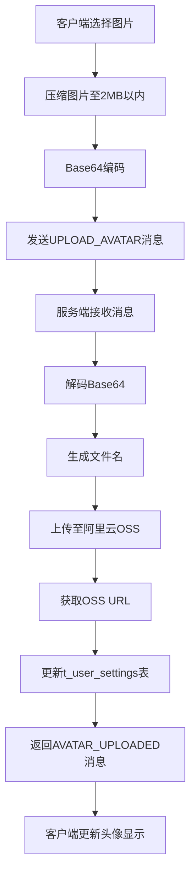

#### 13.4.2 头像加载流程（服务端代理，不落地）

**核心设计**：文件不在客户端本地磁盘落地，通过服务端代理获取后直接在内存中渲染。

```mermaid
flowchart TD
    subgraph 客户端(内存处理)
        A[请求头像]
        B[接收AVATAR_DATA]
        C[解码Base64为Image]
        D[渲染到ImageView]
    end
    
    subgraph 服务端
        E[验证用户身份]
        F[查询t_user_settings]
        G[读取文件字节]
        H[Base64编码]
        I[返回AVATAR_DATA]
    end
    
    subgraph 存储(私有)
        J[阿里云OSS]
    end
    
    A -->|GET_AVATAR| E
    E --> F
    F --> G
    G -->|内部访问| J
    J -->|文件字节| G
    G --> H
    H --> I
    I --> B
    B --> C --> D
```

**流程说明**：

| 步骤 | 客户端 | 服务端 |
|------|--------|--------|
| 1 | 发送 `GET_AVATAR` 请求 | - |
| 2 | - | 验证用户身份和权限 |
| 3 | - | 查询t_user_settings获取文件路径 |
| 4 | - | 从存储读取文件字节 |
| 5 | - | 将字节编码为Base64 |
| 6 | 接收AVATAR_DATA消息 | - |
| 7 | 解码Base64为Image对象 | - |
| 8 | 渲染到ImageView组件 | - |

### 13.5 文件管理

#### 13.5.1 文件更新策略

| 场景 | 策略 |
|------|------|
| 用户更换头像 | 上传新文件，更新数据库URL，旧文件保留（可定时清理） |
| 用户删除头像 | 清除数据库URL，删除OSS文件 |

#### 13.5.2 旧文件清理

| 项目 | 说明 |
|------|------|
| 清理时机 | 用户更换头像后 |
| 清理方式 | 记录旧URL，异步任务清理 |
| 清理策略 | 保留最近3个版本的头像文件 |

### 13.6 OSS工具类设计

#### 13.6.1 接口定义

| 方法名 | 参数 | 返回值 | 说明 |
|--------|------|--------|------|
| uploadAvatar | Long userId, String base64Data, String fileName | String | 上传头像，返回URL |
| deleteAvatar | String avatarUrl | void | 删除头像文件 |
| getAvatarUrl | Long userId, String fileName | String | 构建头像URL |

#### 13.6.2 错误处理

| 错误类型 | 处理策略 |
|----------|----------|
| OSS连接失败 | 返回null，记录日志 |
| 文件过大 | 拒绝上传，返回错误 |
| 格式不支持 | 拒绝上传，返回错误 |
| 权限不足 | 返回null，记录日志 |

### 13.7 数据库与OSS关联

#### 13.7.1 数据流向

| 操作 | 数据库 | OSS |
|------|--------|-----|
| 上传头像 | 更新avatar_url字段 | 存储图片文件 |
| 删除头像 | 清除avatar_url字段 | 删除图片文件 |
| 查询头像 | 读取avatar_url字段 | 通过URL访问 |
| 上传音乐 | 插入t_user_music记录 | 存储音乐文件 |
| 删除音乐 | 删除t_user_music记录 | 删除音乐文件 |
| 查询音乐 | 读取music_url字段 | 通过URL访问 |

#### 13.7.2 一致性保障

| 场景 | 保障策略 |
|------|----------|
| 上传成功但数据库写入失败 | 删除OSS文件，回滚操作 |
| 数据库写入成功但OSS上传失败 | 数据库事务回滚 |
| 用户删除时文件删除失败 | 记录错误日志，后续重试 |

### 13.8 用户音乐存储方案

#### 13.8.1 存储配置

| 项目 | 值 | 说明 |
|------|-----|------|
| Bucket名称 | gomatch-music | 音乐专用存储桶 |
| 区域 | 华北2（北京） | oss-cn-beijing |
| 存储类型 | 标准存储 | 高可用、高可靠 |
| 访问权限 | 公开读 | 客户端可直接访问 |
| 文件大小限制 | 10MB | 防止过大文件 |

#### 13.8.2 文件命名规则

```
格式: music/{user_id}/{timestamp}_{original_filename}
示例: music/1/20260709123456_my_song.mp3
```

| 部分 | 说明 |
|------|------|
| music/ | 固定目录前缀 |
| {user_id} | 用户ID，确保每个用户的音乐文件隔离 |
| {timestamp} | 时间戳，防止文件名冲突 |
| {original_filename} | 原始文件名，保留用户上传的文件名 |

#### 13.8.3 支持格式

| 格式 | 扩展名 | MIME类型 |
|------|--------|----------|
| MP3 | .mp3 | audio/mpeg |
| WAV | .wav | audio/wav |
| OGG | .ogg | audio/ogg |
| FLAC | .flac | audio/flac |

#### 13.8.4 音乐上传流程

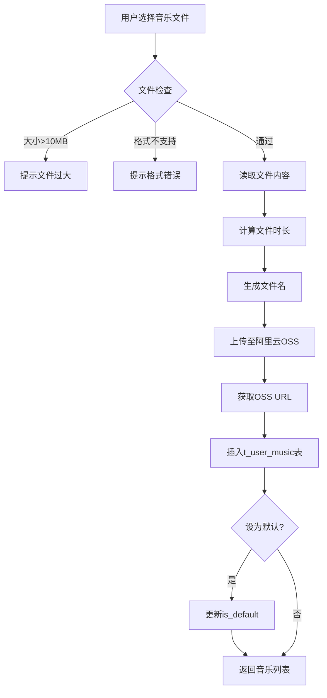

#### 13.8.5 音乐加载流程（服务端代理，不落地）

**核心设计**：音乐文件不在客户端本地磁盘落地，通过服务端代理获取后直接在内存中解码播放。

```mermaid
flowchart TD
    subgraph 客户端(内存处理)
        A[请求音乐]
        B[接收MUSIC_DATA]
        C[解码Base64为音频流]
        D[直接播放]
    end
    
    subgraph 服务端
        E[验证用户身份]
        F[查询t_user_music]
        G[读取文件字节]
        H[Base64编码]
        I[返回MUSIC_DATA]
    end
    
    subgraph 存储(私有)
        J[阿里云OSS]
    end
    
    A -->|GET_MUSIC| E
    E --> F
    F --> G
    G -->|内部访问| J
    J -->|文件字节| G
    G --> H
    H --> I
    I --> B
    B --> C --> D
```

**流程说明**：

| 步骤 | 客户端 | 服务端 |
|------|--------|--------|
| 1 | 发送 `GET_MUSIC` 请求 | - |
| 2 | - | 验证用户身份和权限 |
| 3 | - | 查询t_user_music获取文件路径 |
| 4 | - | 从存储读取音乐文件字节 |
| 5 | - | 将字节编码为Base64 |
| 6 | 接收MUSIC_DATA消息 | - |
| 7 | 解码Base64为AudioInputStream | - |
| 8 | 直接播放（不落地） | - |

#### 13.8.6 音乐管理

| 场景 | 策略 |
|------|------|
| 用户上传音乐 | 存储到OSS，插入数据库记录 |
| 用户删除音乐 | 删除OSS文件，删除数据库记录 |
| 用户设为默认 | 更新is_default字段，取消同类型其他默认 |
| 用户更换音乐 | 更新lobby_music_id引用 |

#### 13.8.7 OSS工具类扩展

| 方法名 | 参数 | 返回值 | 说明 |
|--------|------|--------|------|
| uploadMusic | Long userId, byte[] data, String fileName, String musicType | String | 上传音乐，返回URL |
| deleteMusic | String musicUrl | void | 删除音乐文件 |
| getMusicUrl | Long userId, String fileName | String | 构建音乐URL |

#### 13.8.8 音乐文件清理

| 项目 | 说明 |
|------|------|
| 清理时机 | 用户删除音乐文件时 |
| 清理方式 | 删除数据库记录时同步删除OSS文件 |
| 清理策略 | 无保留策略，删除即清除 |
| 存储空间限制 | 每个用户最多存储20首音乐文件 |

## 14. 用户设置接口协议设计

### 14.1 协议概述

客户端与服务端通过Socket TCP长连接通信，采用JSON格式传递消息。所有设置相关消息包含`cmd`字段标识命令类型。

**消息通用格式**：
```json
{
  "cmd": "COMMAND_NAME",
  "data": { ... }
}
```

### 14.2 客户端→服务端协议

#### 14.2.1 获取用户设置

| 项目 | 值 |
|------|-----|
| 命令 | `GET_SETTINGS` |
| 数据 | 无 |

**请求示例**：
```json
{"cmd": "GET_SETTINGS"}
```

**触发时机**：用户登录成功后

#### 14.2.2 保存用户设置

| 项目 | 值 |
|------|-----|
| 命令 | `SAVE_SETTINGS` |
| 数据 | 用户设置对象 |

**请求示例**：
```json
{
  "cmd": "SAVE_SETTINGS",
  "data": {
    "language": "zh_CN",
    "fontFamily": "SimSun",
    "fontSize": 14,
    "frameRate": 60,
    "windowWidth": 900,
    "windowHeight": 640,
    "backgroundMusicEnabled": true,
    "backgroundMusicVolume": 0.5,
    "soundEffectsEnabled": true,
    "soundEffectsVolume": 0.7,
    "theme": "light"
  }
}
```

**字段说明**：

| 字段名 | 类型 | 必填 | 默认值 | 说明 |
|--------|------|------|--------|------|
| language | String | 否 | zh_CN | 语言：zh_CN/en_US |
| fontFamily | String | 否 | SimSun | 字体名称 |
| fontSize | int | 否 | 12 | 字体大小(px) |
| frameRate | int | 否 | 60 | 帧率：30/60/120 |
| windowWidth | int | 否 | 900 | 窗口宽度 |
| windowHeight | int | 否 | 640 | 窗口高度 |
| backgroundMusicEnabled | boolean | 否 | true | 背景音乐开关 |
| backgroundMusicVolume | double | 否 | 0.5 | 背景音乐音量(0-1) |
| soundEffectsEnabled | boolean | 否 | true | 音效开关 |
| soundEffectsVolume | double | 否 | 0.7 | 音效音量(0-1) |
| theme | String | 否 | light | 主题：light/dark |

#### 14.2.3 上传头像

| 项目 | 值 |
|------|-----|
| 命令 | `UPLOAD_AVATAR` |
| 数据 | base64编码的图片数据、文件名 |

**请求示例**：
```json
{
  "cmd": "UPLOAD_AVATAR",
  "data": {
    "base64": "data:image/png;base64,iVBORw0KGgo...",
    "fileName": "avatar.png"
  }
}
```

**字段说明**：

| 字段名 | 类型 | 必填 | 说明 |
|--------|------|------|------|
| base64 | String | 是 | Base64编码的图片数据，可包含data:image前缀 |
| fileName | String | 是 | 原始文件名，用于判断文件类型 |

**限制**：
- 文件大小：≤2MB
- 支持格式：png、jpg、jpeg、gif

#### 14.2.4 获取头像（服务端代理）

| 项目 | 值 |
|------|-----|
| 命令 | `GET_AVATAR` |
| 数据 | 用户ID、头像尺寸 |

**请求示例**：
```json
{
  "cmd": "GET_AVATAR",
  "data": {
    "userId": 1,
    "size": "normal"
  }
}
```

**字段说明**：

| 字段名 | 类型 | 必填 | 说明 |
|--------|------|------|------|
| userId | long | 是 | 目标用户ID，不传则获取自己的头像 |
| size | String | 否 | 尺寸：small/normal/large，默认normal |

**权限说明**：
- 获取自己的头像：始终允许
- 获取他人头像：仅好友或排行榜可见用户

#### 14.2.4.1 删除头像

| 项目 | 值 |
|------|-----|
| 命令 | `DELETE_AVATAR` |
| 数据 | 无 |

**请求示例**：
```json
{"cmd": "DELETE_AVATAR"}
```

#### 14.2.5 上传背景音乐

| 项目 | 值 |
|------|-----|
| 命令 | `UPLOAD_MUSIC` |
| 数据 | base64编码的音乐数据、文件名、音乐类型 |

**请求示例**：
```json
{
  "cmd": "UPLOAD_MUSIC",
  "data": {
    "base64": "data:audio/mpeg;base64,SUQzBAAAAAAAI1RTU0UAAAAPAAADTGF2ZjU4LjM3LjEwMAAAAAAAAAAAAAAA//tQAAAAAAAAAAAAAAAAAAAAAAAAAAAAAAAAAAAAAAAAAAAAAAAASW5mbwAAAA8AAABAAABhgH//tQAAAAAAAAAAAAAAAAAAAAAAAAAAAAAAAAAAAAAAAAAAAAAAAASW5mbwAAAA8AAABAAABhgH//tQAAAAAAAAAAAAAAAAAAAAAAAAAAAAAAAAAAAAAAAAAAAAAAAASW5mbwAAAA8AAABAAABhgH8AAAAAAAAAAD/2Q==",
    "fileName": "my_song.mp3",
    "musicType": "LOBBY",
    "musicName": "我的背景音乐"
  }
}
```

**字段说明**：

| 字段名 | 类型 | 必填 | 说明 |
|--------|------|------|------|
| base64 | String | 是 | Base64编码的音乐数据 |
| fileName | String | 是 | 原始文件名 |
| musicType | String | 否 | 音乐类型：LOBBY/BGM，默认LOBBY |
| musicName | String | 否 | 用户自定义名称，默认使用文件名 |

**限制**：
- 文件大小：≤10MB
- 支持格式：mp3、wav、ogg、flac
- 每个用户最多20首音乐

#### 14.2.6 获取音乐（服务端代理）

| 项目 | 值 |
|------|-----|
| 命令 | `GET_MUSIC` |
| 数据 | 音乐ID |

**请求示例**：
```json
{
  "cmd": "GET_MUSIC",
  "data": {
    "musicId": 1
  }
}
```

**字段说明**：

| 字段名 | 类型 | 必填 | 说明 |
|--------|------|------|------|
| musicId | long | 是 | 音乐记录ID |

**权限说明**：
- 仅允许获取自己的音乐文件

#### 14.2.6.1 删除背景音乐

| 项目 | 值 |
|------|-----|
| 命令 | `DELETE_MUSIC` |
| 数据 | 音乐ID |

**请求示例**：
```json
{
  "cmd": "DELETE_MUSIC",
  "data": {
    "musicId": 1
  }
}
```

**字段说明**：

| 字段名 | 类型 | 必填 | 说明 |
|--------|------|------|------|
| musicId | long | 是 | 音乐记录ID |

#### 14.2.7 设置默认音乐

| 项目 | 值 |
|------|-----|
| 命令 | `SET_DEFAULT_MUSIC` |
| 数据 | 音乐ID、音乐类型 |

**请求示例**：
```json
{
  "cmd": "SET_DEFAULT_MUSIC",
  "data": {
    "musicId": 1,
    "musicType": "LOBBY"
  }
}
```

**字段说明**：

| 字段名 | 类型 | 必填 | 说明 |
|--------|------|------|------|
| musicId | long | 是 | 音乐记录ID |
| musicType | String | 否 | 音乐类型：LOBBY/BGM，默认LOBBY |

#### 14.2.8 获取音乐列表

| 项目 | 值 |
|------|-----|
| 命令 | `MUSIC_LIST` |
| 数据 | 音乐类型（可选） |

**请求示例**：
```json
{
  "cmd": "MUSIC_LIST",
  "data": {
    "musicType": "LOBBY"
  }
}
```

**字段说明**：

| 字段名 | 类型 | 必填 | 说明 |
|--------|------|------|------|
| musicType | String | 否 | 过滤类型：LOBBY/BGM，不传则返回全部 |

### 14.3 服务端→客户端协议

#### 14.3.1 返回用户设置

| 项目 | 值 |
|------|-----|
| 命令 | `SETTINGS_DATA` |
| 数据 | 用户设置对象 |

**响应示例**：
```json
{
  "cmd": "SETTINGS_DATA",
  "data": {
    "userId": 1,
    "avatarPath": "avatar/1_20260709123456.png",
    "language": "zh_CN",
    "fontFamily": "SimSun",
    "fontSize": 14,
    "frameRate": 60,
    "windowWidth": 900,
    "windowHeight": 640,
    "backgroundMusicEnabled": true,
    "backgroundMusicVolume": 0.5,
    "soundEffectsEnabled": true,
    "soundEffectsVolume": 0.7,
    "lobbyMusicId": 1,
    "theme": "light"
  }
}
```

**字段说明**：

| 字段名 | 类型 | 说明 |
|--------|------|------|
| userId | long | 用户ID |
| avatarPath | String | 头像文件路径（服务端内部路径，客户端需通过GET_AVATAR获取） |
| language | String | 语言 |
| fontFamily | String | 字体 |
| fontSize | int | 字体大小 |
| frameRate | int | 帧率 |
| windowWidth | int | 窗口宽度 |
| windowHeight | int | 窗口高度 |
| backgroundMusicEnabled | boolean | 背景音乐开关 |
| backgroundMusicVolume | double | 背景音乐音量 |
| soundEffectsEnabled | boolean | 音效开关 |
| soundEffectsVolume | double | 音效音量 |
| lobbyMusicId | long | 当前大厅背景音乐ID（可为空） |
| theme | String | 主题 |

#### 14.3.2 返回头像数据（服务端代理，不落地）

| 项目 | 值 |
|------|-----|
| 命令 | `AVATAR_DATA` |
| 数据 | Base64编码的头像数据 |

**响应示例**：
```json
{
  "cmd": "AVATAR_DATA",
  "data": {
    "userId": 1,
    "base64": "data:image/png;base64,iVBORw0KGgoAAAANSUhEUgAAAAEAAAABCAYAAAAfFcSJAAAADUlEQVR42mP8z8DwHwAFBQIAX8jx0gAAAABJRU5ErkJggg==",
    "fileName": "avatar.png"
  }
}
```

**字段说明**：

| 字段名 | 类型 | 说明 |
|--------|------|------|
| userId | long | 用户ID |
| base64 | String | Base64编码的图片数据，包含data:image前缀 |
| fileName | String | 原始文件名，用于判断文件类型 |

**客户端处理**：直接解码Base64为Image对象渲染，不保存到本地磁盘。

#### 14.3.3 头像上传成功

| 项目 | 值 |
|------|-----|
| 命令 | `AVATAR_UPLOADED` |
| 数据 | 头像文件路径 |

**响应示例**：
```json
{
  "cmd": "AVATAR_UPLOADED",
  "data": {
    "avatarPath": "avatar/1_20260709123456.png"
  }
}
```

#### 14.3.4 头像删除成功

| 项目 | 值 |
|------|-----|
| 命令 | `AVATAR_DELETED` |
| 数据 | 无 |

**响应示例**：
```json
{"cmd": "AVATAR_DELETED"}
```

#### 14.3.5 返回音乐数据（服务端代理，不落地）

| 项目 | 值 |
|------|-----|
| 命令 | `MUSIC_DATA` |
| 数据 | Base64编码的音乐数据 |

**响应示例**：
```json
{
  "cmd": "MUSIC_DATA",
  "data": {
    "musicId": 1,
    "base64": "data:audio/mpeg;base64,SUQzBAAAAAAAI1RTU0UAAAAPAAADTGF2ZjU4LjM3LjEwMAAAAAAAAAAAAAAA//tQAAAAAAAAAAAAAAAAAAAAAAAAAAAAAAAAAAAAAAAAAAAAAAAASW5mbwAAAA8AAABAAABhgH//tQ==",
    "fileName": "bgm.mp3",
    "duration": 180
  }
}
```

**字段说明**：

| 字段名 | 类型 | 说明 |
|--------|------|------|
| musicId | long | 音乐记录ID |
| base64 | String | Base64编码的音乐数据，包含data:audio前缀 |
| fileName | String | 原始文件名 |
| duration | int | 音乐时长（秒） |

**客户端处理**：直接解码Base64为AudioInputStream播放，不保存到本地磁盘。

#### 14.3.6 音乐上传成功

| 项目 | 值 |
|------|-----|
| 命令 | `MUSIC_UPLOADED` |
| 数据 | 音乐信息 |

**响应示例**：
```json
{
  "cmd": "MUSIC_UPLOADED",
  "data": {
    "musicId": 1,
    "musicName": "我的背景音乐",
    "musicPath": "music/1/20260709123456_my_song.mp3",
    "fileName": "my_song.mp3",
    "fileSize": 5242880,
    "duration": 180,
    "musicType": "LOBBY",
    "isDefault": false
  }
}
```

**字段说明**：

| 字段名 | 类型 | 说明 |
|--------|------|------|
| musicId | long | 音乐记录ID |
| musicName | String | 音乐名称 |
| musicPath | String | 音乐文件路径（服务端内部路径，客户端需通过GET_MUSIC获取） |
| fileName | String | 原始文件名 |
| fileSize | int | 文件大小（字节） |
| duration | int | 音乐时长（秒） |
| musicType | String | 音乐类型 |
| isDefault | boolean | 是否为默认音乐 |

#### 14.3.7 音乐删除成功

| 项目 | 值 |
|------|-----|
| 命令 | `MUSIC_DELETED` |
| 数据 | 音乐ID |

**响应示例**：
```json
{
  "cmd": "MUSIC_DELETED",
  "data": {
    "musicId": 1
  }
}
```

#### 14.3.8 返回音乐列表

| 项目 | 值 |
|------|-----|
| 命令 | `MUSIC_LIST_DATA` |
| 数据 | 音乐列表数组 |

**响应示例**：
```json
{
  "cmd": "MUSIC_LIST_DATA",
  "data": {
    "musics": [
      {
        "musicId": 1,
        "musicName": "我的背景音乐",
        "musicPath": "music/1/20260709123456_my_song.mp3",
        "fileName": "my_song.mp3",
        "fileSize": 5242880,
        "duration": 180,
        "musicType": "LOBBY",
        "isDefault": true,
        "createTime": "2026-07-09 12:34:56"
      },
      {
        "musicId": 2,
        "musicName": "游戏背景音乐",
        "musicPath": "music/1/20260709130000_game_bgm.mp3",
        "fileName": "game_bgm.mp3",
        "fileSize": 3145728,
        "duration": 120,
        "musicType": "BGM",
        "isDefault": false,
        "createTime": "2026-07-09 13:00:00"
      }
    ]
  }
}
```

### 14.4 错误响应

所有接口失败时返回统一错误格式：

**响应示例**：
```json
{
  "cmd": "ERROR",
  "data": {
    "code": "ERROR_CODE",
    "msg": "错误描述信息"
  }
}
```

**错误码说明**：

| 错误码 | 说明 |
|--------|------|
| AVATAR_TOO_LARGE | 头像文件超过2MB |
| AVATAR_FORMAT_INVALID | 头像格式不支持 |
| MUSIC_TOO_LARGE | 音乐文件超过10MB |
| MUSIC_FORMAT_INVALID | 音乐格式不支持 |
| MUSIC_LIMIT_EXCEEDED | 音乐数量超过20首限制 |
| MUSIC_NOT_FOUND | 音乐不存在 |
| SETTINGS_SAVE_FAILED | 设置保存失败 |
| OSS_UPLOAD_FAILED | OSS上传失败 |
| OSS_DELETE_FAILED | OSS删除失败 |

### 14.5 登录时自动返回设置

用户登录成功时，`LOGIN_OK` 响应中自动包含用户设置：

**响应示例**：
```json
{
  "cmd": "LOGIN_OK",
  "data": {
    "userId": 1,
    "username": "player1",
    "score": 1500,
    "role": "USER",
    "settings": {
      "avatarPath": "avatar/1_20260709123456.png",
      "language": "zh_CN",
      "fontFamily": "SimSun",
      "fontSize": 14,
      "frameRate": 60,
      "windowWidth": 900,
      "windowHeight": 640,
      "backgroundMusicEnabled": true,
      "backgroundMusicVolume": 0.5,
      "soundEffectsEnabled": true,
      "soundEffectsVolume": 0.7,
      "lobbyMusicId": 1,
      "theme": "light"
    }
  }
}
```

### 14.6 协议交互流程

#### 14.6.1 头像上传流程

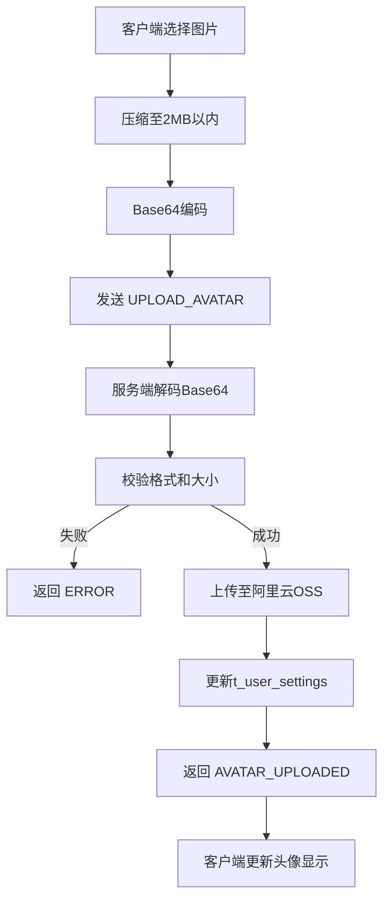

#### 14.6.2 设置加载流程

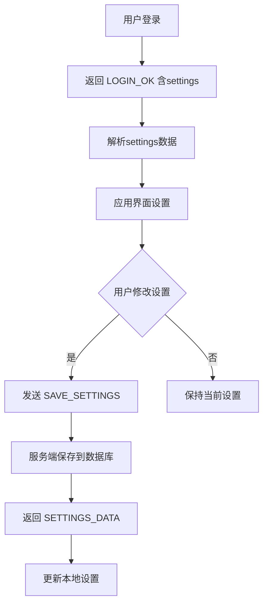

#### 14.6.3 音乐管理流程

```mermaid
flowchart TD
    A[用户上传音乐] --> B[发送 UPLOAD_MUSIC]
    B --> C[服务端校验并上传OSS]
    C --> D[插入t_user_music]
    D --> E[返回 MUSIC_UPLOADED]
    E --> F[用户设置默认]
    F --> G[发送 SET_DEFAULT_MUSIC]
    G --> H[更新is_default字段]
    H --> I[更新t_user_settings.lobby_music_id]
    I --> J[返回 MUSIC_UPLOADED]
    J --> K[用户删除音乐]
    K --> L[发送 DELETE_MUSIC]
    L --> M[删除OSS文件]
    M --> N[删除t_user_music记录]
    N --> O[返回 MUSIC_DELETED]
```

## 15. 用户设置隐私保护设计

### 15.1 隐私保护原则

| 原则 | 说明 |
|------|------|
| **最小化收集** | 只收集必要的设置信息，不收集无关数据 |
| **加密存储** | 敏感数据加密存储，防止数据泄露 |
| **访问控制** | 严格的权限控制，用户只能访问自己的设置 |
| **传输加密** | 数据传输全程加密，防止中间人攻击 |
| **用户控制** | 用户拥有数据的完全控制权，可随时删除 |
| **安全审计** | 记录所有数据访问操作，便于追溯 |
| **合规性** | 遵循相关法律法规要求 |

### 15.2 数据加密存储

#### 15.2.1 数据库字段加密

| 字段 | 加密方式 | 说明 |
|------|----------|------|
| avatar_path | 不加密 | 服务端内部路径，非公开URL |
| music_path | 不加密 | 服务端内部路径，非公开URL |
| language | 不加密 | 非敏感数据 |
| fontFamily | 不加密 | 非敏感数据 |
| fontSize | 不加密 | 非敏感数据 |
| frameRate | 不加密 | 非敏感数据 |
| windowWidth/Height | 不加密 | 非敏感数据 |
| backgroundMusicEnabled/Volume | 不加密 | 非敏感数据 |
| soundEffectsEnabled/Volume | 不加密 | 非敏感数据 |
| theme | 不加密 | 非敏感数据 |

**说明**：用户设置数据主要为界面配置信息，不包含敏感隐私数据（如密码、身份证号等），因此采用明文存储。但需确保数据库访问权限严格控制。

#### 15.2.2 阿里云OSS加密

| 项目 | 加密方式 | 说明 |
|------|----------|------|
| 静态数据加密 | SSE-OSS | OSS使用服务端加密，使用阿里云托管密钥 |
| 传输加密 | SSL/TLS | 所有数据传输使用SSL/TLS加密 |
| 文件访问控制 | 私有 | 仅服务端可访问，客户端通过代理获取 |

### 15.3 访问控制机制

#### 15.3.1 数据库访问控制

| 角色 | 权限 |
|------|------|
| 应用程序 | 读写所有用户设置表 |
| 管理员 | 只读用户设置（用于排查问题） |
| 用户 | 仅能读写自己的设置 |

**实现方式**：
- 所有SQL查询必须包含 `user_id` 条件
- 使用参数化查询防止SQL注入
- 数据库用户权限最小化

#### 15.3.2 服务端访问控制

| 接口 | 访问限制 |
|------|----------|
| GET_SETTINGS | 仅当前登录用户 |
| SAVE_SETTINGS | 仅当前登录用户 |
| UPLOAD_AVATAR | 仅当前登录用户 |
| GET_AVATAR | 自己或好友/排行榜用户 |
| DELETE_AVATAR | 仅当前登录用户 |
| UPLOAD_MUSIC | 仅当前登录用户 |
| GET_MUSIC | 仅当前登录用户 |
| DELETE_MUSIC | 仅当前登录用户 |
| SET_DEFAULT_MUSIC | 仅当前登录用户 |
| MUSIC_LIST | 仅当前登录用户 |

**实现方式**：
- 使用 `userId` 关联当前连接的用户
- 在 `ClientHandler` 中验证操作权限
- 禁止跨用户访问

#### 15.3.3 文件存储访问控制

| 角色 | 权限 |
|------|------|
| 服务端 | 读写权限（通过OSS SDK） |
| 客户端 | 无直接访问权限（通过服务端代理） |
| 公网用户 | 无访问权限（存储为私有） |

**实现方式**：
- OSS：设置Bucket为私有，仅服务端通过SDK访问
- 客户端：通过Socket协议获取文件数据，不直接访问存储

### 15.4 文件不落地设计（核心隐私保护）

#### 15.4.1 设计原则

| 原则 | 说明 |
|------|------|
| **不落地** | 文件不在客户端本地磁盘保存 |
| **内存处理** | 数据获取后直接在内存中处理 |
| **即时渲染** | 图片直接渲染到界面组件 |
| **即时播放** | 音乐直接解码播放 |

#### 15.4.2 头像处理流程

```mermaid
flowchart TD
    A[客户端请求头像] --> B[服务端验证权限]
    B --> C[读取文件字节]
    C --> D[Base64编码]
    D --> E[返回AVATAR_DATA]
    E --> F[客户端解码为Image]
    F --> G[渲染到ImageView]
    G --> H[内存缓存]
```

**客户端处理代码逻辑**：

```java
// 获取头像后直接在内存中渲染，不保存到磁盘
private void handleAvatarData(JSONObject data) {
    String base64 = data.getString("base64");
    byte[] imageBytes = Base64.getDecoder().decode(base64.split(",")[1]);
    Image image = new Image(new ByteArrayInputStream(imageBytes));
    avatarImageView.setImage(image);
}
```

#### 15.4.3 音乐处理流程

```mermaid
flowchart TD
    A[客户端请求音乐] --> B[服务端验证权限]
    B --> C[读取文件字节]
    C --> D[Base64编码]
    D --> E[返回MUSIC_DATA]
    E --> F[客户端解码为音频流]
    F --> G[直接播放]
    G --> H[内存缓存]
```

**客户端处理代码逻辑**：

```java
// 获取音乐后直接在内存中播放，不保存到磁盘
private void handleMusicData(JSONObject data) {
    String base64 = data.getString("base64");
    byte[] audioBytes = Base64.getDecoder().decode(base64.split(",")[1]);
    AudioInputStream audioStream = AudioSystem.getAudioInputStream(
        new ByteArrayInputStream(audioBytes));
    Clip clip = AudioSystem.getClip();
    clip.open(audioStream);
    clip.start();
}
```

#### 15.4.4 内存缓存策略

| 项目 | 策略 |
|------|------|
| 头像缓存 | 登录期间缓存，退出登录清除 |
| 音乐缓存 | 当前会话缓存，切换场景清除 |
| 缓存上限 | 最多缓存10个头像、5首音乐 |
| 淘汰策略 | LRU（最近最少使用） |

**缓存类设计**：

```java
public class MemoryCache {
    private static final Map<String, Image> avatarCache = new ConcurrentHashMap<>();
    private static final Map<String, byte[]> musicCache = new ConcurrentHashMap<>();
    
    public static void putAvatar(String userId, Image image) {
        avatarCache.put(userId, image);
    }
    
    public static Image getAvatar(String userId) {
        return avatarCache.get(userId);
    }
    
    public static void putMusic(String musicId, byte[] data) {
        musicCache.put(musicId, data);
    }
    
    public static byte[] getMusic(String musicId) {
        return musicCache.get(musicId);
    }
    
    public static void clear() {
        avatarCache.clear();
        musicCache.clear();
    }
}
```

### 15.5 传输加密

#### 15.5.1 Socket通信加密

| 项目 | 说明 |
|------|------|
| 协议 | TCP + SSL/TLS |
| 证书 | 使用SSL证书加密传输 |
| 加密算法 | AES-256 |

**说明**：设置数据通过Socket传输时，应使用SSL/TLS加密，防止中间人攻击。

#### 15.5.2 文件数据传输

| 项目 | 说明 |
|------|------|
| 编码方式 | Base64 |
| 传输通道 | Socket（与游戏数据共用） |
| 加密方式 | SSL/TLS（与Socket通信一致） |

### 15.6 用户数据控制权

#### 15.6.1 数据删除

| 操作 | 删除范围 |
|------|----------|
| 删除头像 | 清除数据库路径 + 删除存储文件 |
| 删除音乐 | 删除数据库记录 + 删除存储文件 |
| 重置设置 | 恢复所有设置为默认值 |
| 用户注销 | 删除所有用户数据（包括设置、音乐、头像） |

#### 15.5.2 数据导出

| 操作 | 导出内容 |
|------|----------|
| 导出设置 | 导出用户所有设置为JSON文件 |
| 导出音乐 | 下载用户上传的所有音乐文件 |

### 15.6 安全审计

#### 15.6.1 操作日志

| 日志类型 | 记录内容 |
|----------|----------|
| 设置修改 | 用户ID、修改时间、修改内容 |
| 头像上传 | 用户ID、时间、文件大小、URL |
| 头像删除 | 用户ID、时间、原URL |
| 音乐上传 | 用户ID、时间、文件大小、URL |
| 音乐删除 | 用户ID、时间、音乐ID |
| 设置重置 | 用户ID、时间 |

#### 15.6.2 日志存储

| 项目 | 值 |
|------|-----|
| 存储位置 | 独立日志表 `t_audit_log` |
| 保留时间 | 90天 |
| 访问权限 | 仅管理员可查询 |

### 15.7 合规性

#### 15.7.1 数据分类

| 分类 | 说明 |
|------|------|
| 公开数据 | 头像URL、音乐URL（公开访问） |
| 用户私有数据 | 界面设置（仅用户自己访问） |
| 敏感数据 | 无（设置数据不含敏感信息） |

#### 15.7.2 法律法规遵循

| 法规 | 遵循要点 |
|------|----------|
| 《个人信息保护法》 | 用户有权删除、导出自己的数据 |
| 《网络安全法》 | 数据传输加密、访问控制 |
| GDPR（如涉及海外用户） | 用户数据控制权、数据最小化 |

### 15.8 安全最佳实践

#### 15.8.1 开发安全

| 实践 | 说明 |
|------|------|
| 参数化查询 | 防止SQL注入 |
| 输入验证 | 验证文件类型、大小、格式 |
| 异常处理 | 不暴露系统内部信息 |
| 日志脱敏 | 日志中不记录敏感数据 |

#### 15.8.2 运维安全

| 实践 | 说明 |
|------|------|
| 定期备份 | 数据库定期备份 |
| 安全审计 | 定期安全检查 |
| 密钥管理 | RAM密钥定期轮换 |
| 访问监控 | 异常访问告警 |

#### 15.8.3 数据安全

| 实践 | 说明 |
|------|------|
| 数据隔离 | 开发/测试环境使用模拟数据 |
| 定期清理 | 过期日志定期清理 |
| 数据备份 | 设置数据随用户数据一起备份 |

### 15.9 新增审计日志表

#### 15.9.1 t_audit_log（审计日志表）

| 字段名 | 类型 | 约束 | 说明 |
|--------|------|------|------|
| log_id | BIGINT | PRIMARY KEY, AUTO_INCREMENT | 日志ID |
| user_id | BIGINT | NOT NULL | 用户ID |
| action_type | VARCHAR(50) | NOT NULL | 操作类型 |
| action_desc | VARCHAR(200) | NULL | 操作描述 |
| target_type | VARCHAR(50) | NULL | 目标类型 |
| target_id | BIGINT | NULL | 目标ID |
| before_data | TEXT | NULL | 修改前数据（JSON格式） |
| after_data | TEXT | NULL | 修改后数据（JSON格式） |
| ip_address | VARCHAR(50) | NULL | 操作IP地址 |
| create_time | DATETIME | DEFAULT CURRENT_TIMESTAMP | 创建时间 |

**索引设计**：
| 索引名 | 字段 | 类型 |
|--------|------|------|
| PRIMARY | log_id | 主键 |
| idx_user_id | user_id | 普通索引 |
| idx_action_type | action_type | 普通索引 |
| idx_create_time | create_time | 普通索引 |

**操作类型枚举**：

| 操作类型 | 说明 |
|----------|------|
| SETTINGS_GET | 获取设置 |
| SETTINGS_SAVE | 保存设置 |
| AVATAR_UPLOAD | 上传头像 |
| AVATAR_DELETE | 删除头像 |
| MUSIC_UPLOAD | 上传音乐 |
| MUSIC_DELETE | 删除音乐 |
| MUSIC_SET_DEFAULT | 设置默认音乐 |
| SETTINGS_RESET | 重置设置 |

### 15.10 SQL脚本更新

**新增审计日志表**：

```sql
CREATE TABLE IF NOT EXISTS `t_audit_log` (
    `log_id` BIGINT PRIMARY KEY AUTO_INCREMENT COMMENT '日志ID',
    `user_id` BIGINT NOT NULL COMMENT '用户ID',
    `action_type` VARCHAR(50) NOT NULL COMMENT '操作类型',
    `action_desc` VARCHAR(200) COMMENT '操作描述',
    `target_type` VARCHAR(50) COMMENT '目标类型',
    `target_id` BIGINT COMMENT '目标ID',
    `before_data` TEXT COMMENT '修改前数据(JSON)',
    `after_data` TEXT COMMENT '修改后数据(JSON)',
    `ip_address` VARCHAR(50) COMMENT '操作IP地址',
    `create_time` DATETIME DEFAULT CURRENT_TIMESTAMP COMMENT '创建时间',
    INDEX `idx_user_id` (`user_id`),
    INDEX `idx_action_type` (`action_type`),
    INDEX `idx_create_time` (`create_time`)
) ENGINE=InnoDB DEFAULT CHARSET=utf8mb4 COMMENT='审计日志表';
```

### 15.11 隐私保护流程图

```mermaid
flowchart TD
    A[用户操作] --> B{验证权限}
    B -->|未登录| C[拒绝访问]
    B -->|已登录| D{操作类型}
    D -->|读取设置| E[验证用户身份]
    E --> F[返回当前用户设置]
    D -->|修改设置| G[验证用户身份]
    G --> H[记录审计日志]
    H --> I[更新数据库]
    I --> J[返回成功]
    D -->|上传文件| K[验证文件大小/格式]
    K -->|失败| L[返回错误]
    K -->|成功| M[上传至OSS]
    M --> N[记录审计日志]
    N --> O[保存数据库记录]
    O --> P[返回成功]
    D -->|删除数据| Q[验证用户身份]
    Q --> R[记录审计日志]
    R --> S[删除OSS文件]
    S --> T[删除数据库记录]
    T --> U[返回成功]
```

