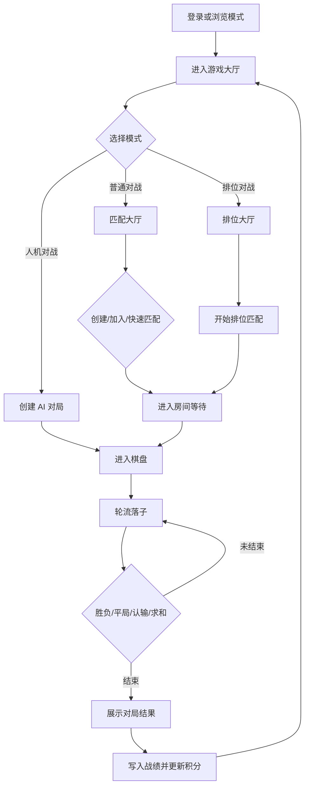
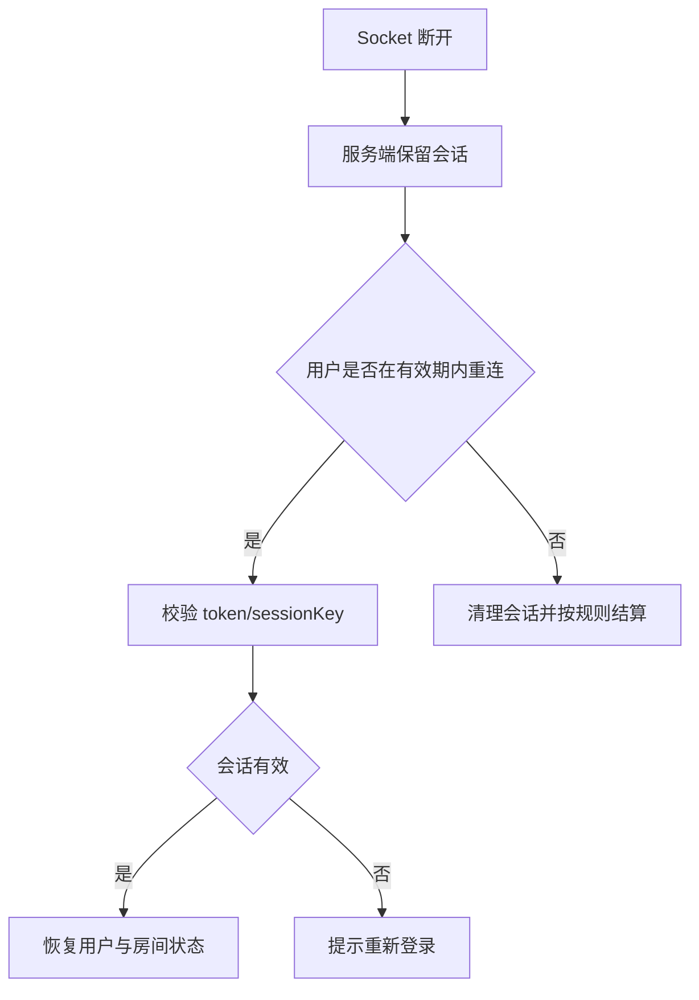
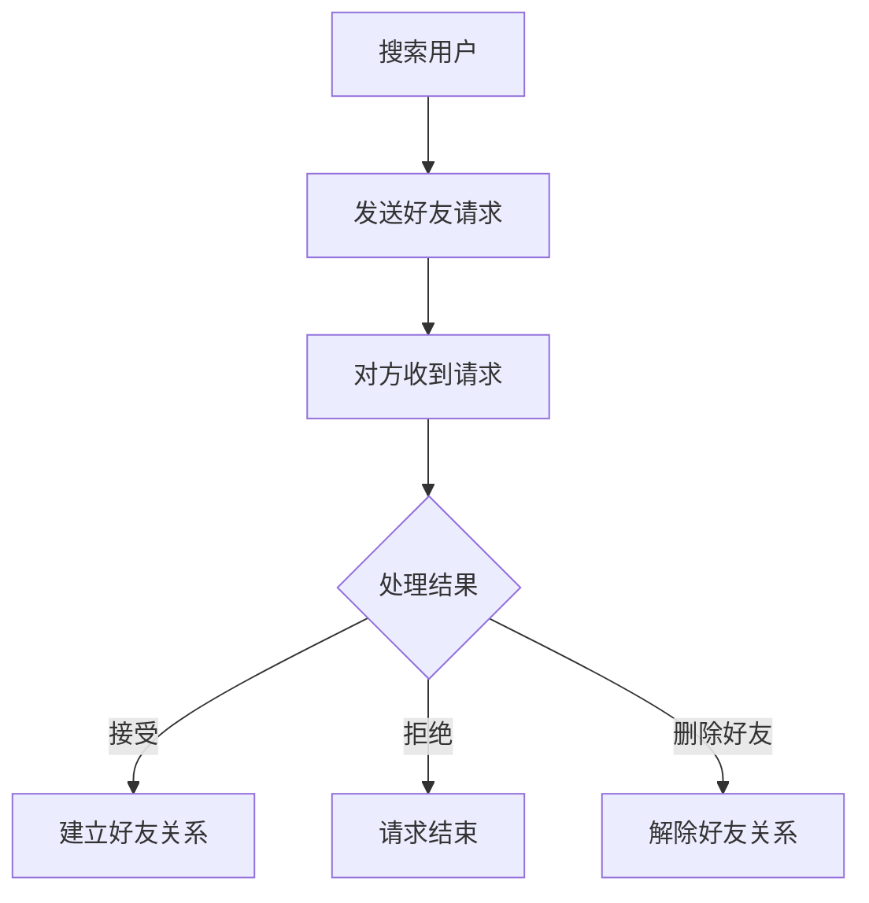

# GoMatch 五子棋对战平台 - 产品需求文档（PRD）

## 1. 产品概述

GoMatch 是一个基于 JavaFX 桌面客户端和 Socket 服务端的网络五子棋对战平台，面向校园实训和局域网对战场景，支持账号注册登录、在线实时对弈、房间管理、快速/排位匹配、聊天、观战、战绩统计、排行榜、个人设置和基础社交能力。

### 1.1 目标用户

| 用户类型 | 核心需求 |
|----------|----------|
| 休闲玩家 | 快速开始一局对战，界面清晰，反馈及时。 |
| 竞技玩家 | 排位匹配、积分变化、排行榜和历史战绩。 |
| 实训学生/教师 | 结构完整、可演示、可说明 C/S 架构与数据库设计。 |

### 1.2 核心价值

- **完整对战闭环**：账号、房间、落子、结算、战绩、排行一体化。
- **实时互动**：TCP 长连接支持落子、聊天、观战状态同步。
- **可演示性强**：无服务器时可用浏览模式展示主要界面。
- **工程分层清晰**：client/server/common/database 多模块拆分，便于团队协作。

## 2. 功能需求

| 编号 | 模块 | 需求 |
|------|------|------|
| FR-001 | 用户 | 用户可以通过用户名、邮箱、手机号和密码注册账号，用户名唯一，手机号必填，注册成功后返回登录流程。 |
| FR-002 | 用户 | 用户可以使用用户名、邮箱或手机号配合密码登录系统，登录成功后进入游戏大厅并建立 Socket 连接。 |
| FR-003 | 用户 | 用户可以查看个人信息、积分、胜负平统计和历史战绩。 |
| FR-004 | 大厅 | 用户可以查看房间列表，房间展示名称、房主、人数、状态和是否可观战。 |
| FR-005 | 大厅 | 用户可以创建普通房间，可配置房间名和可选密码。 |
| FR-006 | 大厅 | 用户可以加入未满且允许加入的房间，带密码房间需要校验密码。 |
| FR-007 | 匹配 | 用户可以发起快速匹配或排位匹配，系统自动分配对手并创建对局。 |
| FR-008 | 对战 | 棋盘使用 15x15 五子棋规则，显示双方信息、当前轮次和对局状态。 |
| FR-009 | 对战 | 玩家落子后服务端校验坐标、回合和棋局状态，并广播给玩家与观战者。 |
| FR-010 | 对战 | 服务端负责胜负判定，支持横、竖、两条斜线四方向五连检测和平局判定。 |
| FR-011 | 对战 | 系统控制黑白轮次，拒绝非当前回合玩家落子。 |
| FR-012 | 对战 | 玩家可以发起悔棋、求和、认输，对方确认后由服务端更新对局状态。 |
| FR-013 | 聊天 | 房间内玩家和观战者可以发送文本聊天消息，消息广播给房间所有成员。 |
| FR-014 | 战绩 | 用户可以查询历史对局记录，并在有棋谱数据时进入回放。 |
| FR-015 | 排行榜 | 系统展示按积分/胜率聚合的排行榜，并支持刷新。 |
| FR-016 | 观战 | 用户可以进入对局中房间观战，同步棋盘状态和聊天消息，但不能落子。 |
| FR-017 | 断线 | 支持断线检测、会话保留和重连恢复；超时后按规则清理会话或结算。 |
| FR-018 | 人机 | 用户可以进行人机对战，AI 使用启发式评分策略选择落子。 |
| FR-019 | 好友 | 用户可以添加、接受、拒绝、删除好友，并查看好友列表和请求列表。 |
| FR-020 | 设置 | 用户可以配置语言、主题、字体、帧率、窗口大小、服务器地址和音频偏好。 |
| FR-021 | 用户 | 用户忘记密码时可通过邮箱验证码重置密码。 |
| FR-022 | 对战 | 对局结束后任一方可发起"再来一局"，对方同意后立即开始新对局。 |
| FR-023 | 管理 | 管理员可封禁/解禁用户、强制结束房间、查看用户列表与运营统计。 |
| FR-024 | 设置 | 大厅背景音乐循环播放，支持全局、背景音乐、音效多通道音量控制。 |
| FR-025 | 人机 | 人机对战支持简单、中等、困难三档难度，AI 采用差异化落子策略。 |

### 2.1 功能模块总览

| 模块 | 功能 |
|------|------|
| 用户认证 | 注册、登录、退出、修改密码、个人资料展示。 |
| 游戏大厅 | 普通对战入口、排位入口、房间列表、排行榜抽屉、好友/设置入口。 |
| 房间与匹配 | 创建房间、加入房间、快速匹配、排位匹配、等待开局。 |
| 棋盘对战 | 15x15 棋盘、实时落子、轮次控制、胜负判定、悔棋、求和、认输。 |
| 社交互动 | 房间聊天、好友列表、好友请求、观战聊天。 |
| 数据统计 | 战绩查询、棋谱回放、积分、胜率、排行榜。 |
| 人机对战 | 本地/服务端 AI 能力用于练习和预览体验。 |
| 用户设置 | 主题、语言、字体、音频、窗口大小、服务器地址等偏好。 |

## 3. 角色与权限

| 角色 | 权限 |
|------|------|
| 游客/浏览模式 | 无需服务器即可浏览主要界面，使用假数据体验流程。 |
| 玩家 | 登录、大厅、创建/加入房间、匹配、对战、聊天、观战、查看战绩/排行榜、个人中心、好友、设置。 |
| 管理员 | 玩家权限 + 管理入口；具体管理能力以客户端和服务端实现为准。 |

## 4. 界面清单

| 编号 | 界面 | 说明 |
|------|------|------|
| UI-001 | 登录界面 | 用户名、密码、注册入口、浏览模式入口。 |
| UI-002 | 注册界面 | 用户名、密码、确认密码、返回登录。 |
| UI-003 | 游戏大厅 | 头像/昵称、普通对战、排位入口、排行榜抽屉、好友/设置入口。 |
| UI-004 | 匹配大厅 | 房间列表、观战列表、创建房间、加入房间、快速匹配。 |
| UI-005 | 排位大厅 | 段位展示、开始匹配按钮。 |
| UI-006 | 创建房间弹窗 | 房间名、密码、确认/取消。 |
| UI-007 | 房间等待界面 | 玩家列表、开始按钮、聊天区域。 |
| UI-008 | 棋盘对战界面 | 棋盘、双方信息、聊天、悔棋、求和、认输、回放相关入口。 |
| UI-009 | 对局结束弹窗 | 结果展示、返回大厅、再来一局。 |
| UI-010 | 战绩界面 | 历史对局、结果、时间、回放。 |
| UI-011 | 排行榜界面/抽屉 | 排名、用户名、积分、胜率。 |
| UI-012 | 个人中心 | 用户信息、统计、修改密码入口。 |
| UI-013 | 好友界面 | 好友列表、添加好友、好友请求处理。 |
| UI-014 | 设置界面 | 主题、语言、字体、音频、窗口、服务器配置。 |
| UI-015 | 关于界面 | 产品名称、版本、开发者信息。 |
| UI-016 | 忘记密码界面 | 输入邮箱 → 输入验证码 → 设置新密码三阶段流程。 |
| UI-017 | 头像预览界面 | 放大查看头像与切换头像配色。 |
| UI-018 | 服务器配置弹窗 | 选择/输入服务器 IP 与连通性测试。 |
| UI-019 | 管理员控制台 | 仅管理员可见：用户列表、封禁/解禁、强制结束房间、运营统计。 |

### 4.1 页面体验

| 页面 | 体验目标 |
|------|----------|
| 登录/注册 | 最短路径进入系统；浏览模式可绕过网络依赖。 |
| 游戏大厅 | 提供清晰的模式入口和个人状态反馈。 |
| 匹配大厅 | 让用户快速理解哪些房间可加入、可观战、是否有密码。 |
| 排位大厅 | 突出段位/积分和开始匹配动作。 |
| 房间等待 | 展示双方状态，并在开局前支持聊天。 |
| 棋盘对战 | 棋盘是视觉中心，双方信息、聊天和操作按钮不干扰落子。 |
| 对局结束 | 明确展示结果，并提供返回大厅或再来一局。 |
| 战绩/排行榜 | 便于比较、回看和确认积分变化。 |
| 好友/设置/关于 | 作为辅助页面，保持信息密度和操作清晰。 |

## 5. 核心流程

### 5.1 对战流程

### 5.2 断线重连流程

### 5.3 好友流程

## 6. 非功能需求

| 编号 | 需求 | 标准 |
|------|------|------|
| NFR-001 | 性能 | 局域网内正常落子同步目标延迟不超过 100ms。 |
| NFR-002 | 并发 | 服务端目标支持 100 个连接或 50 个房间级别的课堂演示压力。 |
| NFR-003 | 可用性 | 所有网络失败、校验失败和权限失败都应给出明确提示。 |
| NFR-004 | 一致性 | 对局状态、排行榜、战绩、会话数据不得出现明显前后矛盾。 |
| NFR-005 | 可维护性 | 协议常量集中在 common；客户端不依赖 server DAO；服务端业务按 handler/room/game/session/dao 分层。 |
| NFR-006 | UI 一致性 | 新增页面和控件遵守 UI 视觉与组件规范。 |
| NFR-007 | 实训约束 | 运行环境以 JDK 21、JavaFX 21、Maven、多模块项目为基础。 |

## 7. 验收标准

1. 两名玩家可以完整进行一局五子棋，胜负和平局判定正确。
2. 落子、聊天、游戏结束等消息能在双方客户端同步显示。
3. 创建房间、加入房间、快速匹配、排位匹配至少各能走通一个正常流程。
4. 战绩和积分可以正确写入并在个人中心/排行榜展示。
5. 断线后系统能执行重连或结算策略，并给客户端明确反馈。
6. 观战者可以同步棋盘和聊天，且不能执行玩家专属操作。
7. 浏览模式在无服务器时可以进入主要界面并展示假数据。
8. UI 不出现明显主题错色、文字截断或 FXML 加载失败。

## 8. 交付与演示

验收时重点展示：

1. 登录到完成一局对战的主流程。
2. 房间、匹配、聊天、观战、战绩、排行榜等扩展能力。
3. 断线/重连或异常提示场景。
4. JavaFX 客户端 UI 的双主题和响应式表现。
5. C/S 架构、多模块 Maven、Socket 协议、MySQL/Redis 数据支撑。

## 9. 参考文档

| 内容 | 文档 |
|------|------|
| 总体技术架构 | [TSD.md](TSD.md) |
| 通信协议常量与 JSON 报文模型 | [COMMON.md](COMMON.md) |
| 客户端页面、路由、Controller | [CLIENT.md](CLIENT.md) |
| 服务端业务、房间、匹配、DAO | [SERVER.md](SERVER.md) |
| MySQL 表、Redis Key、持久化设计 | [DB_DESIGN.md](DB_DESIGN.md) |
| UI 视觉与组件规范 | [UI_GUIDELINE.md](UI_GUIDELINE.md) |

## 10. 文档版本

| 版本 | 日期 | 说明 |
|------|------|------|
| v4.0 | 2026-07-09 | 添加用户设置、OSS、隐私保护等产品说明。 |
| v4.1 | 2026-07-10 | 去除与需求、架构、数据库文档重复的实现细节，收敛为产品说明文档。 |
| v5.0 | 2026-07-10 | 合并 requirements.md，PRD 成为产品需求唯一权威文档。 |
| v5.1 | 2026-07-12 | BCrypt 密码哈希；多标识登录（用户名/邮箱/手机号）；手机号必填注册；TIMER_PAUSE 时间同步协议。 |
