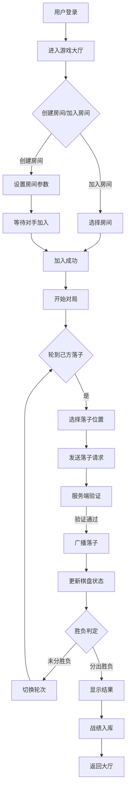
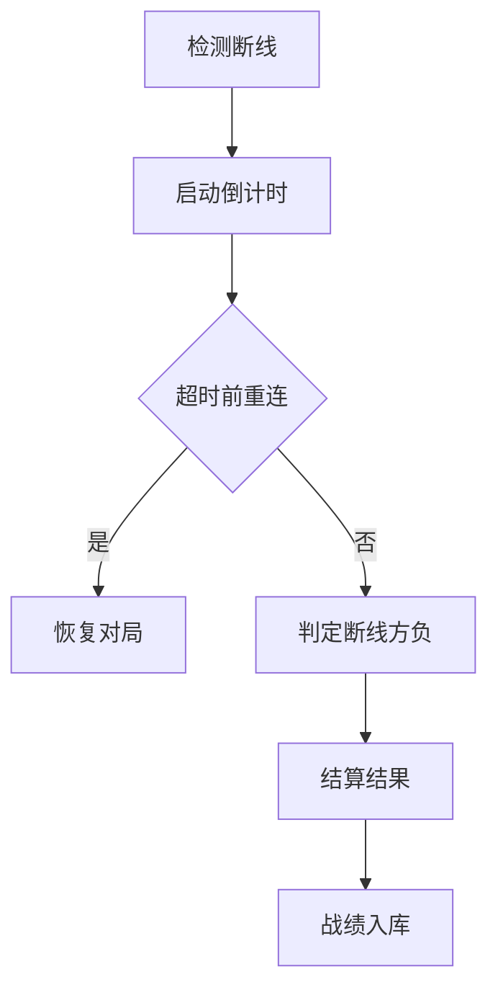

## 1. 产品概述

两名玩家在线实时对弈五子棋，含大厅、房间、观战与胜负判定。提供完整的游戏体验，包括用户注册登录、房间管理、实时对战、战绩统计和排行榜功能。

- **目标用户**：五子棋爱好者，支持双人实时对战
- **核心价值**：提供流畅的在线五子棋对战体验，包含完整的社交和竞技功能

## 2. 核心功能

### 2.1 用户角色

| 角色 | 注册方式 | 核心权限 |
|------|----------|----------|
| 普通玩家 | 账号密码注册 | 登录、创建/加入房间、对战、聊天、查看战绩、排行榜、个人中心 |
| 管理员 | 后台配置 | 玩家管理、游戏监控、数据统计 |

### 2.2 功能模块

1. **用户认证模块**：登录、注册、身份验证
2. **游戏大厅模块**：房间列表、创建房间、加入房间
3. **对战模块**：棋盘对战、实时落子、轮次控制、胜负判定
4. **社交模块**：聊天功能
5. **数据统计模块**：战绩记录、排行榜、个人中心

### 2.3 页面详情

| 页面名称 | 模块名称 | 功能描述 |
|----------|----------|----------|
| 登录页 | 用户认证 | 用户登录，账号密码验证 |
| 注册页 | 用户认证 | 新用户注册，创建账号 |
| 游戏大厅 | 大厅模块 | 房间列表展示、创建房间、加入房间 |
| 创建房间 | 大厅模块 | 设置房间名称、人数限制、密码等 |
| 棋盘对战 | 对战模块 | 实时落子、显示对手信息、计时器 |
| 对局结束 | 对战模块 | 显示胜负结果、结算界面 |
| 聊天 | 社交模块 | 房间内实时聊天 |
| 战绩 | 数据统计 | 查看个人历史对局记录 |
| 排行榜 | 数据统计 | 按积分/胜率排名展示 |
| 个人中心 | 数据统计 | 查看个人信息、修改资料 |
| 关于 | 通用 | 版本信息、帮助说明 |

## 3. 核心流程

### 3.1 游戏对战流程

### 3.2 断线处理流程

