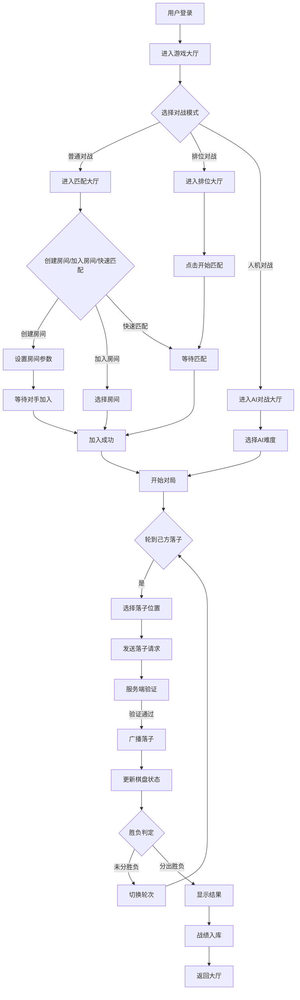
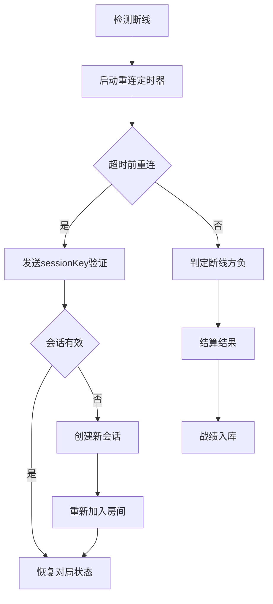
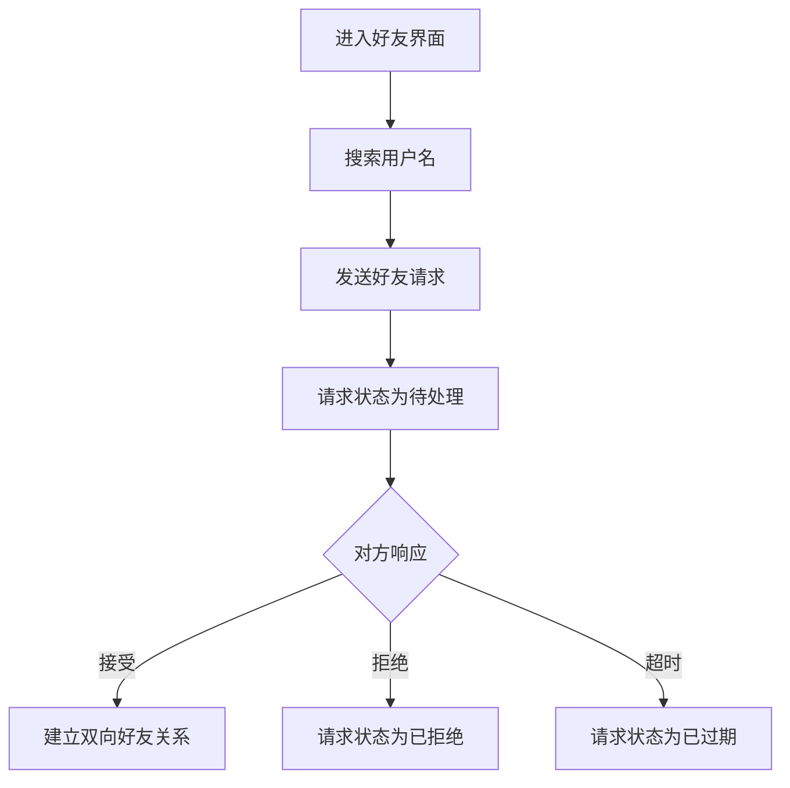

# GoMatch 五子棋对战平台 - 产品需求文档（PRD）

---

## 1. 产品概述

### 1.1 产品定位

GoMatch 是一个基于 **JavaFX + Socket 多线程服务端 + JDBC** 三段式架构的五子棋对战平台，支持玩家在线实时对弈、房间管理、聊天、观战、战绩统计与排行榜等功能。面向校园/局域网场景，提供轻量级的联机对战体验。

### 1.2 目标用户

| 用户类型 | 描述 | 核心需求 |
|----------|------|----------|
| 五子棋爱好者 | 休闲玩家，喜欢在线对战 | 流畅的对战体验、社交互动 |
| 竞技玩家 | 追求排名和积分 | 排位匹配、排行榜、战绩统计 |
| 校园学生 | 课程实训或社团活动 | 局域网对战、界面美观 |

### 1.3 核心价值

- **流畅对战**：基于 TCP Socket 的实时双向通信，落子延迟 ≤ 100ms
- **完整功能**：从注册登录到对战结算的全流程体验
- **社交属性**：好友系统、房间聊天、观战功能
- **竞技体系**：积分排名、排位匹配、胜率统计

---

## 2. 核心功能

### 2.1 用户角色

| 角色 | 注册方式 | 核心权限 |
|------|----------|----------|
| 普通玩家 | 账号密码注册 | 登录、创建/加入房间、对战、聊天、查看战绩、排行榜、个人中心、好友系统 |
| 管理员 | 后台配置 | 玩家管理、游戏监控、数据统计 |

### 2.2 功能模块

| 模块 | 功能列表 | 需求编号 |
|------|----------|----------|
| 用户认证模块 | 登录、注册、身份验证、修改密码 | FR-001、FR-002、FR-003 |
| 游戏大厅模块 | 房间列表、创建房间、加入房间、快速匹配 | FR-004、FR-005、FR-006、FR-007 |
| 排位匹配模块 | 段位显示、排位匹配、积分结算 | FR-007 |
| 棋盘对战模块 | 实时落子、轮次控制、胜负判定、悔棋、求和、认输 | FR-008、FR-009、FR-010、FR-011、FR-012 |
| 人机对战模块 | AI 对战、AI 评分 | FR-018 |
| 社交模块 | 聊天、好友系统、观战 | FR-013、FR-016 |
| 数据统计模块 | 战绩记录、排行榜、个人中心 | FR-014、FR-015 |
| 断线处理模块 | 断线判负、断线重连 | FR-017 |

### 2.3 页面详情

| 页面名称 | 模块名称 | 功能描述 | 界面编号 |
|----------|----------|----------|----------|
| 登录页 | 用户认证 | 用户登录，账号密码验证，浏览模式入口 | UI-001 |
| 注册页 | 用户认证 | 新用户注册，创建账号 | UI-002 |
| 游戏大厅 | 大厅模块 | 头像/昵称、匹配/排位入口、排行榜抽屉、好友/设置按钮 | UI-003 |
| 匹配大厅 | 大厅模块 | 房间列表 + 观战列表、创建/加入/快速匹配 | UI-004 |
| 排位大厅 | 排位模块 | 段位显示、开始匹配按钮 | UI-005 |
| 创建房间 | 大厅模块 | 房间名、密码（可选）、确认/取消 | UI-006 |
| 房间等待界面 | 对战模块 | 显示房主/玩家列表、开始按钮（房主）、聊天框 | UI-007 |
| 棋盘对战界面 | 对战模块 | 15×15 棋盘、双方信息、聊天框、悔棋/求和/认输按钮 | UI-008 |
| 对局结束界面 | 对战模块 | 胜负结果、返回大厅、再来一局 | UI-009 |
| 聊天界面/面板 | 社交模块 | 消息列表、输入框、发送按钮 | UI-010 |
| 战绩界面 | 数据统计 | 历史对局列表、详情/回放按钮 | UI-011 |
| 排行榜界面 | 数据统计 | 排名、用户名、积分、胜率 | UI-012 |
| 个人中心 | 数据统计 | 用户信息、修改密码 | UI-013 |
| 好友界面 | 社交模块 | 好友列表、添加好友、好友请求 | UI-014 |
| 设置界面 | 通用 | 服务器配置、音效设置 | UI-015 |
| 关于界面 | 通用 | 产品名称、版本、开发者信息 | UI-016 |

---

## 3. 核心流程

### 3.1 游戏对战流程



### 3.2 断线处理流程



### 3.3 好友添加流程



---

## 4. 功能需求详细说明

### 4.1 用户模块

#### 4.1.1 注册（FR-001）
- 输入：用户名、密码、确认密码
- 校验：用户名唯一、长度 4–16 位、密码长度 ≥6
- 结果：注册成功后自动跳转登录

#### 4.1.2 登录（FR-002）
- 输入：用户名、密码
- 校验：与数据库 `t_user` 比对
- 结果：登录成功后进入游戏大厅，并建立 Socket 连接
- 异常：同一账号重复登录需给出提示

#### 4.1.3 个人中心（FR-003）
- 显示：用户名、头像（默认）、积分、胜场、负场、平局
- 支持：修改密码

### 4.2 游戏大厅模块

#### 4.2.1 房间列表（FR-004）
- 实时显示当前房间列表：房间号、房间名、房主、当前人数/上限（2/2）、状态（等待中/对局中）
- 支持：刷新列表

#### 4.2.2 创建房间（FR-005）
- 输入：房间名、密码（可选）
- 行为：创建后房主进入房间，房间状态为"等待中"
- 服务端：生成唯一 roomId，维护 Room 对象

#### 4.2.3 加入房间（FR-006）
- 支持双击或按钮加入房间
- 若房间满员或已开始，给出提示
- 支持带密码的房间校验

#### 4.2.4 快速匹配（FR-007）
- 系统自动将等待中的两名玩家匹配到同一房间

### 4.3 棋盘对战模块

#### 4.3.1 棋盘界面（FR-008）
- 15×15 标准五子棋棋盘
- 显示双方用户名、执子颜色、当前轮次倒计时（可选）
- 支持实时落子、悔棋请求、求和请求

#### 4.3.2 落子同步（FR-009）
- 玩家在己方回合点击棋盘落子
- 客户端将落子坐标发送至服务端
- 服务端校验合法性（位置为空、当前轮次、未结束）后广播给房间内所有客户端（包括观战者）

#### 4.3.3 胜负判定（FR-010）
- 每次落子后服务端执行五连判定：横、竖、左斜、右斜四个方向
- 若出现五子连珠，则对局结束，胜者积分增加，败者积分减少
- 若棋盘填满且无五连，判定平局

#### 4.3.4 轮次控制（FR-011）
- 黑先白后，交替落子
- 服务端维护当前执棋方，拒绝非当前回合玩家的落子请求

#### 4.3.5 悔棋/求和（FR-012）
- 玩家可发起悔棋，需对方同意
- 玩家可发起求和，需对方同意

### 4.4 聊天模块

#### 4.4.1 房间聊天（FR-013）
- 房间内玩家与观战者可发送文本消息
- 服务端将消息广播给房间所有成员
- 支持显示发送者昵称

### 4.5 战绩与排行榜模块

#### 4.5.1 战绩查询（FR-014）
- 玩家可查看自己的历史对局记录：对手、结果、时间、棋谱回放（可选）

#### 4.5.2 排行榜（FR-015）
- 按积分/胜率排序展示前 N 名玩家
- 支持实时刷新

### 4.6 观战模块（FR-016）
- 非对局玩家可进入"对局中"的房间观战
- 实时同步棋盘状态与聊天消息

### 4.7 断线处理（FR-017）

#### 4.7.1 断线判负（基础）
- 某玩家 Socket 断开后，若对局进行中，则判定该玩家负
- 通知对手与观战者

#### 4.7.2 断线重连（挑战）
- 玩家掉线后可在一定时间内重连回同一房间，恢复棋盘状态

### 4.8 人机对战（FR-018）
- 玩家可选择与简单 AI 对弈
- AI 采用简单启发式策略（如连子评分、随机落子）

---

## 5. 非功能需求

| 编号 | 需求 | 说明 |
|------|------|------|
| NFR-001 | 性能 | 局域网内落子延迟 ≤ 100ms |
| NFR-002 | 并发 | 服务端同时支持 ≥ 50 房间或 ≥ 100 连接 |
| NFR-003 | 可靠性 | 断线后 5 秒内完成判负或重连处理 |
| NFR-004 | 安全性 | 密码 BCrypt 加密存储，SQL 注入通过预编译防范 |
| NFR-005 | 可用性 | 界面操作反馈明确，异常提示友好 |
| NFR-006 | 可维护性 | 服务端按模块分层：网络层、业务层、数据层 |

---

## 6. 角色与权限

| 角色 | 权限 |
|------|------|
| 游客 | 仅可浏览排行榜（可选） |
| 玩家 | 登录、大厅、创建/加入房间、对弈、聊天、查看战绩/排行榜、个人中心、好友系统 |
| 管理员 | 玩家所有权限 + 查看所有房间、强制解散房间、查看所有用户、重置密码 |

---

## 7. 技术栈

| 层级 | 技术 | 版本 | 说明 |
|------|------|------|------|
| 语言 | Java | 21 LTS | 跨平台运行基础 |
| 客户端 UI | JavaFX (FXML + CSS) | 21 | 桌面窗口、棋盘绘制、交互组件 |
| 网络通信 | Java Socket（TCP） | JDK内置 | 实时双向数据传输，自定义文本协议 |
| 并发模型 | Java原生多线程 | JDK内置 | 每连接独立ClientHandler线程 |
| 数据持久化 | JDBC + MySQL | MySQL 8.x | 用户、战绩、排行榜等数据 |
| 缓存 | Redis | 7.x | 会话、排行榜、匹配队列、在线状态 |
| 连接池 | HikariCP | 5.x | 数据库连接复用 |
| JSON序列化 | Gson | 2.10+ | 数据序列化/反序列化 |
| 日志 | SLF4J + Logback | SLF4J 2.x / Logback 1.4+ | 日志输出与追踪 |
| 密码加密 | BCrypt | - | 密码加盐哈希 |
| Redis客户端 | Lettuce | - | Redis连接与操作 |

---

## 8. 客户端设计

### 8.1 模块结构

```
client/src/main/
├── java/com/gomatch/client/
│   ├── AppConfig.java                  # 全局配置与会话状态
│   ├── ClientMain.java                 # JavaFX Application 入口
│   ├── ai/
│   │   └── GomokuAI.java               # 本地启发式 AI
│   ├── model/
│   │   ├── GameRecord.java             # 对战记录数据模型
│   │   ├── RoomInfo.java               # 房间信息数据模型
│   │   └── User.java                   # 用户数据模型
│   ├── network/
│   │   ├── ClientConfig.java           # 网络配置加载与持久化
│   │   ├── NetworkListener.java        # 网络消息监听器接口
│   │   └── ServerConnector.java        # TCP 连接管理与消息收发
│   └── ui/
│       ├── AboutController.java        # 关于界面
│       ├── AutoCleanupController.java  # 控制器基类
│       ├── BoardController.java        # 棋盘对战界面
│       ├── CasualLobbyController.java  # 休闲大厅
│       ├── CreateRoomController.java   # 创建房间界面
│       ├── GameOverController.java     # 对局结束弹窗
│       ├── LobbyController.java        # 主大厅
│       ├── LoginController.java        # 登录界面
│       ├── ProfileController.java      # 个人中心
│       ├── RankedLobbyController.java  # 排位大厅
│       ├── RankingController.java      # 排行榜界面
│       ├── RecordController.java       # 对战记录详情
│       ├── RegisterController.java     # 注册界面
│       ├── RoomWaitingController.java  # 房间等待界面
│       ├── ScreenManager.java          # 全局场景/窗口管理器
│       └── ShapeGridBackground.java    # 动态粒子点阵背景
└── resources/
    ├── client-config.json              # 客户端默认配置文件
    ├── css/style.css                   # 全局 CSS 样式表
    ├── fonts/                          # 内置字体
    ├── fxml/                           # 各界面 FXML 文件
    └── images/                         # 图片资源
```

### 8.2 启动流程

```
main() → Application.launch()
  └─ ClientMain.start(Stage)
       ├─ 加载内置字体 (Maple Mono NF CN)
       ├─ 创建 ServerConnector 单例
       ├─ 注册全局断线监听（DISCONNECT → 弹窗 → 跳回 LoginUI）
       ├─ ScreenManager.init(stage)
       └─ ScreenManager.switchTo("/fxml/LoginUI.fxml")
```

### 8.3 核心类设计

#### 8.3.1 ClientMain - 应用入口

| 成员 | 类型 | 说明 |
|------|------|------|
| connector | static ServerConnector | 全局唯一连接器 |
| start(Stage) | 方法 | JavaFX 应用启动入口 |
| stop() | 方法 | 应用退出时关闭 Socket 连接 |

#### 8.3.2 ServerConnector - 网络层

| 字段 | 说明 |
|------|------|
| socket | TCP Socket 连接 |
| listeners | CopyOnWriteArrayList<NetworkListener> |

| 常量 | 值 | 说明 |
|------|----|------|
| MAX_RECONNECT_ATTEMPTS | 3 | 最大重连次数 |

#### 8.3.3 ScreenManager - 场景管理器

| 属性 | 值 |
|------|----|
| 默认宽度 | 900px |
| 默认高度 | 640px |
| 最小宽度 | 720px |
| 最小高度 | 540px |
| 窗口样式 | StageStyle.UNDECORATED |

### 8.4 界面路由

```
LoginUI → LobbyUI → CasualLobbyUI → BoardUI → GameOverUI → LobbyUI
                                   ↓
                              CreateRoomUI → RoomWaitingUI → BoardUI
                                   ↓
                              RankedLobbyUI → BoardUI
                                   ↓
                              ProfileUI → LobbyUI
```

### 8.5 数据模型

#### User 模型

| 字段 | 类型 | 说明 |
|------|------|------|
| userId | long | 用户唯一 ID |
| username | String | 用户名 |
| score | int | ELO 积分 |
| winCount | int | 胜场数 |
| loseCount | int | 败场数 |
| drawCount | int | 平局数 |

#### RoomInfo 模型

| 字段 | 类型 | 说明 |
|------|------|------|
| roomId | String | 房间唯一 ID |
| roomName | String | 房间名称 |
| playerCount | int | 当前玩家数 |
| status | String | 状态：WAITING/PLAYING |

### 8.6 UI 风格规范

| 规范 | 说明 |
|------|------|
| 卡片样式 | .glass-card：乳白色透明磨砂，圆角 12px |
| 按钮样式 | 底线描边 + 悬浮遮罩，圆角 8px |
| Hover 反馈 | 背景填充板岩灰 rgba(148,163,184,0.35) |
| 颜色体系 | 中性无色系（板岩灰、木炭黑） |
| 字体 | Maple Mono NF CN（内置） |

---

## 9. 服务端设计

### 9.1 模块结构

```
server/src/main/
├── java/com/gomatch/server/
│   ├── ServerMain.java                 # 服务器入口
│   ├── dao/                            # 数据访问层
│   │   ├── DBUtil.java                 # 数据库连接池工具
│   │   ├── UserDAO.java                # 用户 CRUD
│   │   ├── RecordDAO.java              # 对战记录
│   │   ├── ChatDAO.java                # 聊天消息
│   │   ├── FriendDAO.java              # 好友关系
│   │   └── ...                         # 其他 DAO
│   ├── game/
│   │   ├── Game.java                   # 五子棋核心逻辑
│   │   └── AIPlayer.java               # 服务端 AI
│   ├── handler/
│   │   └── ClientHandler.java          # 每连接一个线程
│   ├── redis/
│   │   └── RedisManager.java           # Redis 连接管理
│   ├── room/
│   │   ├── Room.java                   # 房间实体
│   │   └── RoomManager.java            # 房间管理器
│   └── session/
│       └── SessionManager.java         # 用户会话管理
└── resources/
    └── logback.xml                     # 日志配置
```

### 9.2 启动流程

```
ServerMain.main()
  ├─ DBUtil.init()                    → 初始化 HikariCP
  ├─ RoomManager.getInstance()        → 初始化房间管理
  ├─ RedisManager.getInstance().init()→ 连接 Redis
  ├─ initRankMaterializedView()       → 刷新排行榜
  ├─ addShutdownHook(shutdown)        → 优雅关闭
  └─ startListening()                 → 绑定 8888 端口
       └─ new ClientHandler(socket) → new Thread → start()
```

### 9.3 核心类设计

#### 9.3.1 ServerMain - 服务器入口

| 常量 | 值 | 说明 |
|------|-----|------|
| PORT | 8888 | 监听端口 |
| MAX_CONNECTIONS | 100 | 最大并发连接数 |

#### 9.3.2 ClientHandler - 消息分发核心

| 字段 | 类型 | 说明 |
|------|------|------|
| socket | Socket | 客户端连接 |
| userId | long | 用户 ID |
| authenticated | boolean | 是否已认证 |
| currentRoom | Room | 当前房间 |

#### 9.3.3 Room - 房间实体

| 字段 | 类型 | 说明 |
|------|------|------|
| roomId | String | UUID 前 8 位 |
| status | Status | WAITING/PLAYING/FINISHED |
| players | CopyOnWriteArrayList | 玩家列表 |
| observers | CopyOnWriteArrayList | 观众列表 |
| game | Game | 棋局实例 |

#### 9.3.4 Game - 五子棋核心逻辑

| 常量 | 值 | 说明 |
|------|----|------|
| SIZE | 15 | 棋盘大小 |
| EMPTY | 0 | 空位 |
| BLACK | 1 | 黑棋 |
| WHITE | 2 | 白棋 |

### 9.4 游戏流程

#### 普通对战流程

```
玩家A 创建房间 → 服务端创建 Room → 玩家A 进入等待
玩家B 加入房间 → 校验人数/状态/密码 → 广播 PLAYER_ENTER
双方就绪 → startGame() → 随机分配黑白 → 广播 GAME_START
对局进行 → MOVE → 校验合法性 → 检查五连 → 广播 MOVE
对局结束 → GAME_OVER → 更新记录 → 更新积分 → 返回大厅
```

#### ELO 积分算法

```
期望得分 = 1 / (1 + 10^((对手积分 - 己方积分) / 400))
新积分 = 当前积分 + K × (实际得分 - 期望得分)
K因子 = 32
```

### 9.5 并发安全设计

| 机制 | 用途 |
|------|------|
| ConcurrentHashMap | rooms、sessionsByToken |
| CopyOnWriteArrayList | Room.players、Room.observers |
| AtomicInteger | connectionCount |
| synchronized | Game.undo() |

### 9.6 定时任务

| 任务名 | 频率 | 功能 |
|--------|------|------|
| 排行榜刷新 | 每 5 分钟 | 重新计算 t_rank |
| 房间持久化 | 每 1 分钟 | 同步内存房间到 DB |
| 会话清理 | 每 1 分钟 | 清理过期 Session |

---

## 10. 通信协议设计

### 10.1 报文格式

```
COMMAND|param1|param2|...
```

| 要素 | 说明 |
|------|------|
| 分隔符 | \|（Protocol.SEPARATOR） |
| 传输层 | TCP 长连接 |
| 编码 | UTF-8 |

### 10.2 客户端 → 服务端指令

| 命令 | 参数 | 说明 |
|------|------|------|
| LOGIN | username\|password | 用户登录 |
| REGISTER | username\|password | 用户注册 |
| CREATE_ROOM | roomName\|password(可选) | 创建房间 |
| JOIN_ROOM | roomId\|password(可选) | 加入房间 |
| MOVE | x\|y | 落子 |
| CHAT | message | 聊天消息 |
| SURRENDER | - | 认输 |
| REQUEST_UNDO | - | 请求悔棋 |
| REQUEST_DRAW | - | 请求求和 |
| QUICK_MATCH | - | 快速匹配 |
| RANKED_MATCH | - | 排位匹配 |
| SPECTATE | roomId | 观战 |
| RECONNECT | token | 断线重连 |
| ADD_FRIEND | friendId\|message | 添加好友 |
| ACCEPT_FRIEND | requestId | 接受好友请求 |

### 10.3 服务端 → 客户端响应

| 命令 | 参数 | 说明 |
|------|------|------|
| LOGIN_OK | userId\|username\|score\|winCount\|loseCount\|drawCount\|token | 登录成功 |
| LOGIN_FAIL | reason | 登录失败 |
| JOIN_OK | roomId\|roomName\|players/max\|hasPassword | 加入成功 |
| GAME_START | blackId\|whiteId | 游戏开始 |
| MOVE | x\|y\|color | 落子同步 |
| GAME_OVER | winnerId\|reason | 游戏结束 |
| CHAT | userId\|username\|message | 聊天消息 |
| RANKING_LIST | rank\|username\|score\|winRate | 排行榜 |
| RECORD_LIST | recordId\|player1Name\|player2Name\|winnerId\|result\|createTime | 战绩列表 |
| ROOM_LIST | roomId\|roomName\|status\|players\|max | 房间列表 |

---

## 11. 数据库设计

### 11.1 部署架构

```
客户端（JavaFX） ←— TCP Socket —→ 服务端（多线程） ←— JDBC —→ MySQL
                                            ←— Redis —→ Redis缓存
```

### 11.2 编码规范

| 层级 | 配置项 | 值 |
|------|--------|-----|
| 数据库 | character_set_server | utf8mb4 |
| 数据库 | collation_server | utf8mb4_unicode_ci |
| 表 | DEFAULT CHARSET | utf8mb4 |
| JDBC URL | characterEncoding | utf8 |

### 11.3 核心表结构

#### t_user（用户表）

| 字段名 | 类型 | 约束 | 说明 |
|--------|------|------|------|
| user_id | BIGINT | PK, AUTO_INCREMENT | 用户ID |
| username | VARCHAR(50) | UNIQUE, NOT NULL | 用户名 |
| password | VARCHAR(100) | NOT NULL | 密码(BCrypt) |
| email | VARCHAR(100) | UNIQUE | 邮箱 |
| score | INT | DEFAULT 1000 | 积分 |
| win_count | INT | DEFAULT 0 | 胜场数 |
| lose_count | INT | DEFAULT 0 | 负场数 |
| draw_count | INT | DEFAULT 0 | 平局数 |
| role | VARCHAR(20) | DEFAULT 'PLAYER' | 角色 |
| status | VARCHAR(20) | DEFAULT 'ACTIVE' | 状态 |

#### t_room（房间表）

| 字段名 | 类型 | 约束 | 说明 |
|--------|------|------|------|
| room_id | BIGINT | PK, AUTO_INCREMENT | 房间ID |
| room_name | VARCHAR(100) | NOT NULL | 房间名称 |
| password | VARCHAR(100) | NULL | 房间密码 |
| max_players | INT | DEFAULT 2 | 最大人数 |
| current_players | INT | DEFAULT 0 | 当前人数 |
| status | VARCHAR(20) | DEFAULT 'waiting' | 状态 |
| host_id | BIGINT | FK | 房主ID |

#### t_game_record（对局记录表）

| 字段名 | 类型 | 约束 | 说明 |
|--------|------|------|------|
| record_id | BIGINT | PK, AUTO_INCREMENT | 记录ID |
| player1_id | BIGINT | FK | 玩家1ID |
| player2_id | BIGINT | FK | 玩家2ID |
| game_type | VARCHAR(20) | DEFAULT 'PVP' | 游戏类型 |
| winner_id | BIGINT | FK, NULL | 胜者ID |
| result | VARCHAR(10) | NOT NULL | 结果 |
| board_data | TEXT | NOT NULL | 棋谱(JSON) |

#### t_rank（排行榜表）

| 字段名 | 类型 | 约束 | 说明 |
|--------|------|------|------|
| rank_id | BIGINT | PK, AUTO_INCREMENT | 排名ID |
| user_id | BIGINT | UNIQUE, FK | 用户ID |
| rank | INT | DEFAULT 0 | 当前排名 |
| score | INT | DEFAULT 0 | 当前积分 |
| win_rate | DECIMAL(5,2) | DEFAULT 0.00 | 胜率 |

#### t_chat_message（聊天消息表）

| 字段名 | 类型 | 约束 | 说明 |
|--------|------|------|------|
| message_id | BIGINT | PK, AUTO_INCREMENT | 消息ID |
| room_id | BIGINT | FK | 房间ID |
| user_id | BIGINT | FK | 发送者ID |
| content | VARCHAR(500) | NOT NULL | 消息内容 |

#### t_friend（好友关系表）

| 字段名 | 类型 | 约束 | 说明 |
|--------|------|------|------|
| friend_id | BIGINT | PK, AUTO_INCREMENT | 好友关系ID |
| user_id | BIGINT | FK | 用户ID |
| friend_user_id | BIGINT | FK | 好友ID |
| relation_type | VARCHAR(20) | DEFAULT 'FRIEND' | 关系类型 |

#### t_friend_request（好友请求表）

| 字段名 | 类型 | 约束 | 说明 |
|--------|------|------|------|
| request_id | BIGINT | PK, AUTO_INCREMENT | 请求ID |
| from_user_id | BIGINT | FK | 发起者ID |
| to_user_id | BIGINT | FK | 接收者ID |
| status | VARCHAR(20) | DEFAULT 'PENDING' | 请求状态 |
| message | VARCHAR(200) | NULL | 请求附言 |

#### t_socket_session（Socket会话表）

| 字段名 | 类型 | 约束 | 说明 |
|--------|------|------|------|
| session_id | BIGINT | PK, AUTO_INCREMENT | 会话ID |
| user_id | BIGINT | FK | 用户ID |
| session_key | VARCHAR(64) | UNIQUE | 会话密钥 |
| status | VARCHAR(20) | NOT NULL | 连接状态 |
| last_heartbeat | DATETIME | NULL | 最后活跃时间 |

### 11.4 索引设计

| 表名 | 索引字段 | 类型 | 用途 |
|------|----------|------|------|
| t_user | username | UNIQUE | 登录查询 |
| t_user | score | INDEX | 积分排序 |
| t_game_record | player1_id, player2_id | INDEX | 个人战绩 |
| t_rank | score | INDEX | 排行榜 |
| t_room | status, current_players | INDEX | 房间列表 |

### 11.5 Redis Key 设计

| Key | 类型 | 说明 | 过期时间 |
|-----|------|------|----------|
| session:{token} | String | 用户会话(JSON) | 5分钟 |
| online:{userId} | String | 在线状态 | 5分钟 |
| rank:leaderboard | Sorted Set | 排行榜 | 持久 |
| match:queue | List | 快速匹配队列 | 无 |
| match:ranked | Sorted Set | 排位匹配队列 | 无 |

### 11.6 事务与并发

| 操作 | 事务要求 | 并发控制 |
|------|----------|----------|
| 用户注册 | REQUIRED | 唯一性约束 |
| 对局结算 | REQUIRED | 乐观锁(version) |
| 创建房间 | REQUIRED | 行锁 |
| 积分更新 | REQUIRED | CAS操作 |

### 11.7 JDBC 连接池配置

| 参数 | 值 | 说明 |
|------|-----|------|
| maximumPoolSize | 60 | 最大连接数 |
| minimumIdle | 10 | 最小空闲连接 |
| connectionTimeout | 30000 | 连接超时(ms) |
| idleTimeout | 600000 | 空闲超时(ms) |

---

## 12. 验收标准

1. 两名玩家能完整进行一局五子棋，胜负判定正确
2. 落子后对方客户端能在 100ms 内显示
3. 断线后另一方能收到胜利提示
4. 战绩、积分正确写入数据库
5. 排行榜按积分排序显示
6. 界面数量 ≥ 10 个，功能完整
7. 好友系统能正常添加、接受、删除好友
8. 观战功能能实时同步棋盘状态
9. 人机对战能正常进行
10. 断线重连能恢复对局状态

---

**文档版本**：v3.0  
**编写日期**：2026-07-07  

**修订记录**
| 版本 | 日期 | 说明 |
|------|------|------|
| v1.0 | 2026-07-04 | 初版 |
| v1.1 | 2026-07-04 | 优化章节结构 |
| v1.2 | 2026-07-05 | 迁移 UI 到 JavaFX |
| v2.0 | 2026-07-07 | 完善功能需求、通信协议 |
| v3.0 | 2026-07-07 | 整合客户端、服务端、数据库详细设计 |