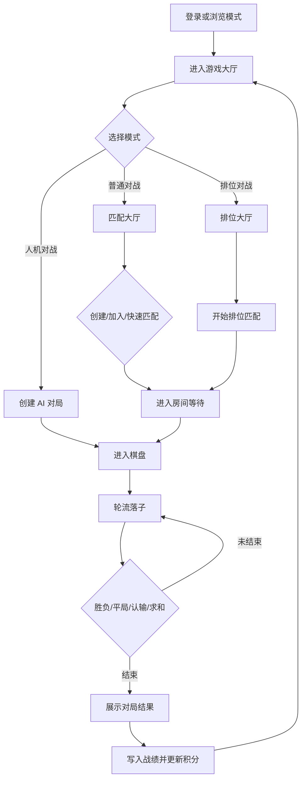
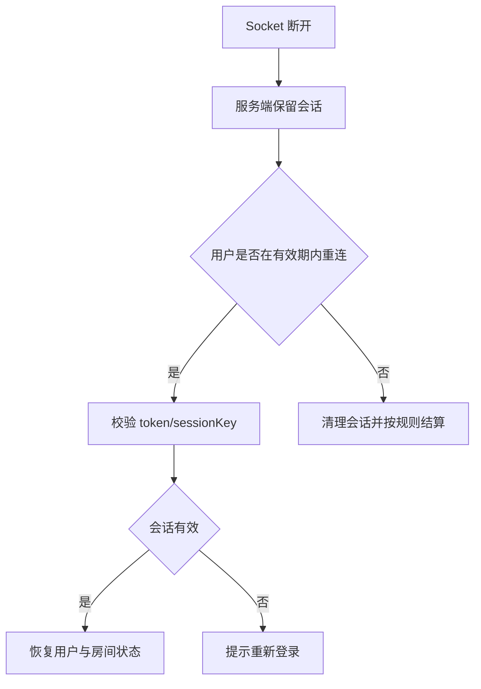
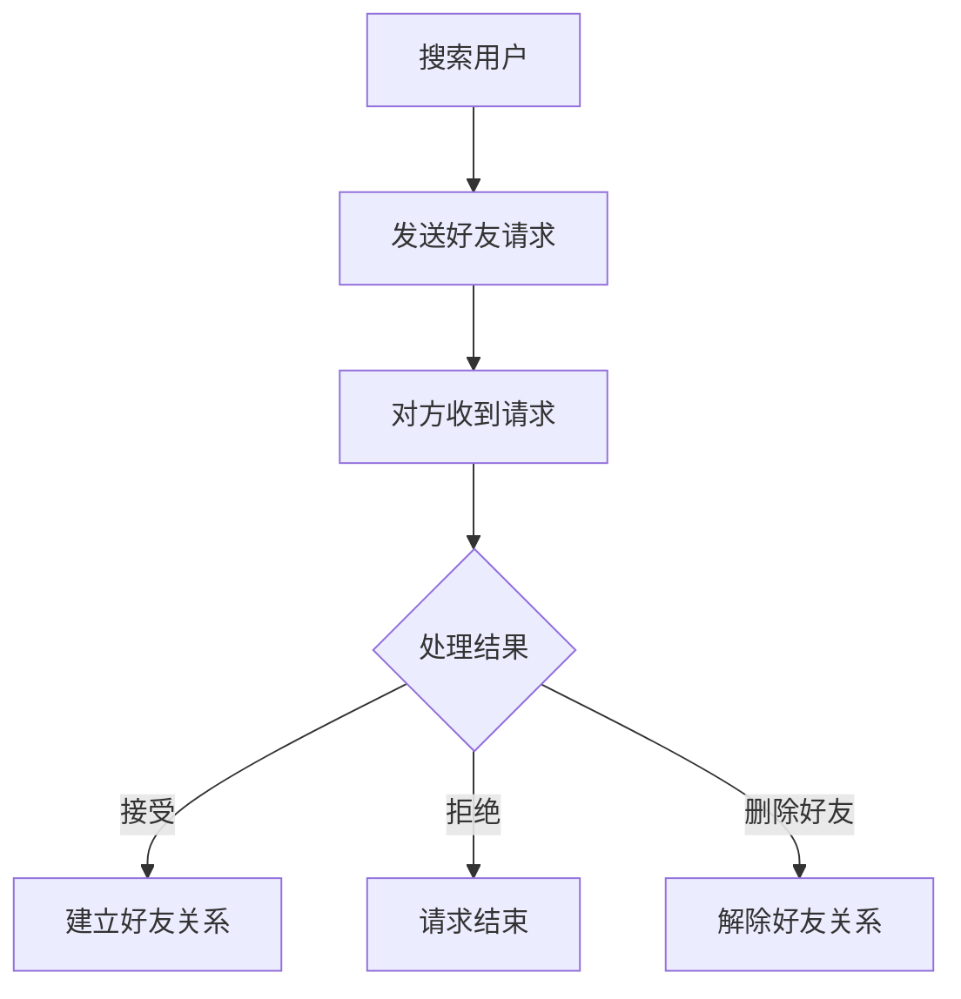

# GoMatch 五子棋对战平台 - 产品需求文档（PRD）

PRD 面向汇报、答辩和产品说明，只保留**产品目标、用户价值、功能模块、页面体验、核心业务流程和验收口径**。实现细节不在这里展开：需求清单见 [requirements.md](requirements.md)，技术架构见 [TECHNICAL_ARCHITECTURE.md](TECHNICAL_ARCHITECTURE.md)，数据库和缓存见 [DATABASE_DESIGN.md](DATABASE_DESIGN.md)。

## 1. 产品概述

GoMatch 是一个基于 JavaFX 桌面客户端和 Socket 服务端的网络五子棋对战平台。它服务于校园实训和局域网对战场景，目标是让用户从注册登录、匹配/建房、实时对弈、聊天观战到战绩排行形成完整闭环。

### 1.1 目标用户

| 用户类型 | 核心需求 |
|----------|----------|
| 休闲玩家 | 快速开始一局对战，界面清晰，反馈及时。 |
| 竞技玩家 | 排位匹配、积分变化、排行榜和历史战绩。 |
| 实训学生/教师 | 结构完整、可演示、可说明 C/S 架构与数据库设计。 |

### 1.2 核心价值

- **完整对战闭环**：账号、房间、落子、结算、战绩、排行一体化。
- **实时互动**：TCP 长连接支持落子、聊天、观战状态同步。
- **可演示性强**：无服务器时可用浏览模式展示主要界面。
- **工程分层清晰**：client/server/common/database 多模块拆分，便于团队协作。

## 2. 功能模块

| 模块 | 功能 |
|------|------|
| 用户认证 | 注册、登录、退出、修改密码、个人资料展示。 |
| 游戏大厅 | 普通对战入口、排位入口、房间列表、排行榜抽屉、好友/设置入口。 |
| 房间与匹配 | 创建房间、加入房间、快速匹配、排位匹配、等待开局。 |
| 棋盘对战 | 15x15 棋盘、实时落子、轮次控制、胜负判定、悔棋、求和、认输。 |
| 社交互动 | 房间聊天、好友列表、好友请求、观战聊天。 |
| 数据统计 | 战绩查询、棋谱回放、积分、胜率、排行榜。 |
| 人机对战 | 本地/服务端 AI 能力用于练习和预览体验。 |
| 用户设置 | 主题、语言、字体、音频、窗口大小、服务器地址等偏好。 |

详细功能编号以 [requirements.md](requirements.md) 第 2 节为准。

## 3. 页面体验

| 页面 | 体验目标 |
|------|----------|
| 登录/注册 | 最短路径进入系统；浏览模式可绕过网络依赖。 |
| 游戏大厅 | 提供清晰的模式入口和个人状态反馈。 |
| 匹配大厅 | 让用户快速理解哪些房间可加入、可观战、是否有密码。 |
| 排位大厅 | 突出段位/积分和开始匹配动作。 |
| 房间等待 | 展示双方状态，并在开局前支持聊天。 |
| 棋盘对战 | 棋盘是视觉中心，双方信息、聊天和操作按钮不干扰落子。 |
| 对局结束 | 明确展示结果，并提供返回大厅或再来一局。 |
| 战绩/排行榜 | 便于比较、回看和确认积分变化。 |
| 好友/设置/关于 | 作为辅助页面，保持信息密度和操作清晰。 |

界面编号和验收清单见 [requirements.md](requirements.md) 第 4 节。

## 4. 核心流程

### 4.1 对战流程

### 4.2 断线重连流程

### 4.3 好友流程

## 5. 非功能口径

| 维度 | 目标 |
|------|------|
| 性能 | 局域网内落子同步目标延迟不超过 100ms。 |
| 并发 | 满足课堂演示和多人联调场景，目标支持 100 连接级别。 |
| 可用性 | 网络失败、校验失败、权限失败均有明确提示。 |
| 一致性 | 对局结果、战绩、积分、排行榜保持一致。 |
| 可维护性 | 协议集中在 common，客户端/服务端职责边界清晰。 |
| 视觉一致性 | 遵守双主题磨砂设计规范，避免页面风格割裂。 |

## 6. 交付与验收

验收以 [requirements.md](requirements.md) 第 6 节为准。PRD 汇报时重点展示：

1. 登录到完成一局对战的主流程。
2. 房间、匹配、聊天、观战、战绩、排行榜等扩展能力。
3. 断线/重连或异常提示场景。
4. JavaFX 客户端 UI 的双主题和响应式表现。
5. C/S 架构、多模块 Maven、Socket 协议、MySQL/Redis 数据支撑。

## 7. 文档版本

| 版本 | 日期 | 说明 |
|------|------|------|
| v4.0 | 2026-07-09 | 添加用户设置、OSS、隐私保护等产品说明。 |
| v4.1 | 2026-07-10 | 去除与需求、架构、数据库文档重复的实现细节，收敛为产品说明文档。 |
