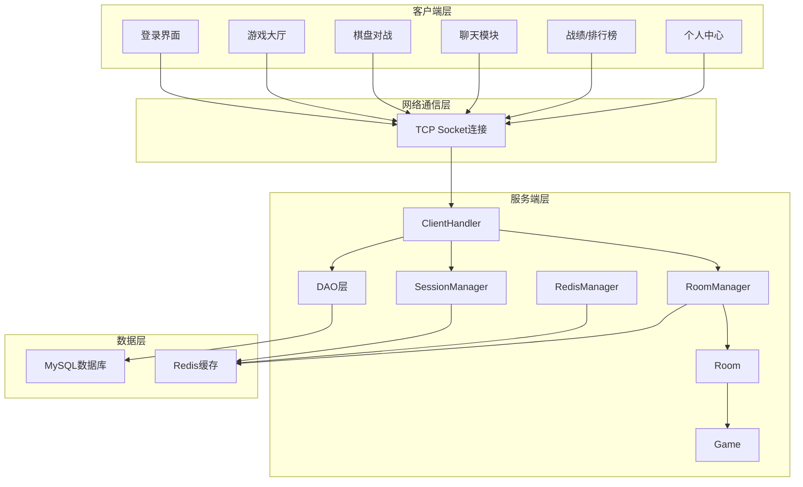
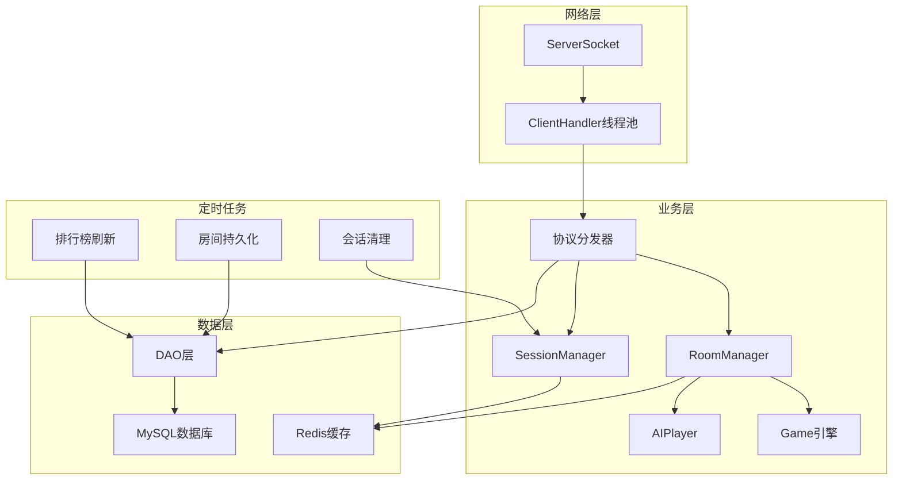
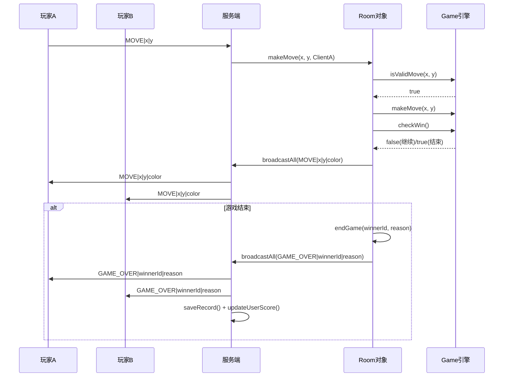
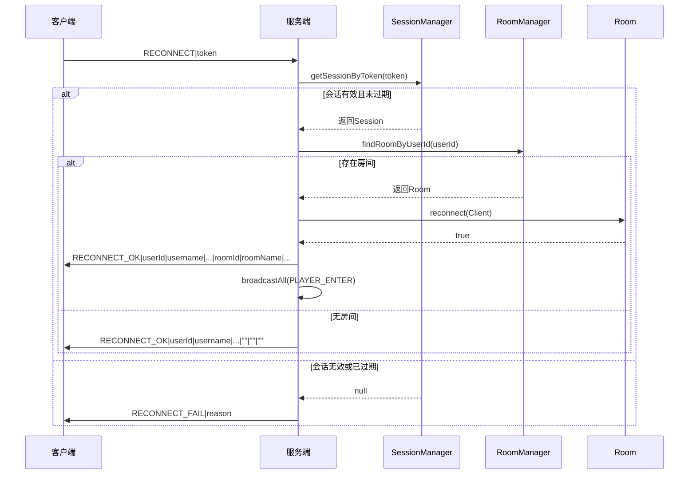
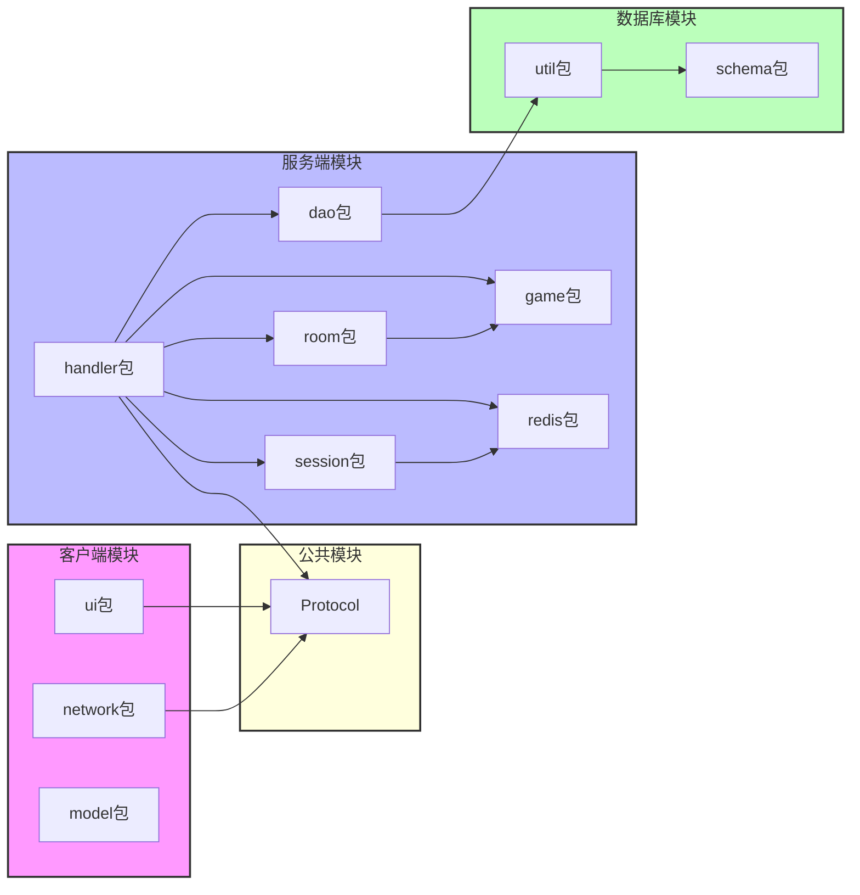

## 1. 架构设计



## 2. 技术描述

| 层级 | 技术 | 版本 | 说明 |
|------|------|------|------|
| 语言 | Java | 21 LTS | 跨平台运行基础 |
| 客户端 UI | JavaFX (FXML + CSS) | 21 | 桌面窗口、棋盘绘制、交互组件 |
| 网络通信 | Java Socket（TCP） | JDK内置 | 实时双向数据传输，JSON 消息协议 |
| 并发模型 | Java原生多线程 | JDK内置 | 每连接独立ClientHandler线程 |
| 数据持久化 | JDBC + MySQL | MySQL 8.x | 用户、战绩、排行榜等数据 |
| 缓存 | Redis | 7.x | 会话、排行榜、匹配队列、在线状态 |
| 连接池 | HikariCP | 5.x | 数据库连接复用 |
| JSON序列化 | Gson | 2.10+ | 数据序列化/反序列化 |
| 日志 | SLF4J + Logback | SLF4J 2.x / Logback 1.4+ | 日志输出与追踪 |
| 密码存储 | 明文 | - | 密码明文比对 |
| Redis客户端 | Lettuce | - | Redis连接与操作 |

## 3. 通信协议定义

格式：`{"cmd":"COMMAND","data":{"key":"value"}}`

### 3.1 客户端 → 服务端

| 命令 | 参数 | 说明 |
|------|------|------|
| LOGIN | username\|password | 用户登录 |
| REGISTER | username\|password | 用户注册 |
| LOGOUT | - | 退出登录 |
| CREATE_ROOM | roomName\|password(可选) | 创建房间 |
| CREATE_AI_ROOM | roomName | 创建人机对战房间 |
| JOIN_ROOM | roomId\|password(可选) | 加入房间 |
| LEAVE_ROOM | - | 离开房间 |
| READY | - | 准备开始 |
| MOVE | x\|y | 落子 |
| CHAT | message | 聊天消息 |
| SURRENDER | - | 认输 |
| REQUEST_UNDO | - | 请求悔棋 |
| REPLY_UNDO | 1/0 | 响应悔棋 |
| REQUEST_DRAW | - | 请求求和 |
| REPLY_DRAW | 1/0 | 响应求和 |
| QUICK_MATCH | - | 快速匹配 |
| RANKED_MATCH | - | 排位匹配 |
| SPECTATE | roomId | 观战 |
| ROOM_LIST | - | 获取房间列表 |
| RANKING | - | 获取排行榜 |
| QUERY_RECORD | page\|size(可选) | 查询战绩 |
| CHANGE_PASSWORD | oldPassword\|newPassword | 修改密码 |
| RECONNECT | token | 断线重连 |
| ADD_FRIEND | friendId\|message(可选) | 添加好友 |
| ACCEPT_FRIEND | requestId | 接受好友请求 |
| REJECT_FRIEND | requestId | 拒绝好友请求 |
| DELETE_FRIEND | friendId | 删除好友 |
| FRIEND_LIST | - | 获取好友列表 |
| FRIEND_REQUESTS | - | 获取好友请求列表 |
| SAVE_GAME | saveName(可选) | 保存棋局 |
| LOAD_GAME | saveId | 加载棋局 |
| DELETE_SAVE | saveId | 删除存档 |
| SAVE_LIST | page\|size(可选) | 获取存档列表 |
| CHAT_HISTORY | page\|size(可选) | 获取聊天历史 |
| WATCHER_HISTORY | page\|size(可选) | 获取观战记录 |

### 3.2 服务端 → 客户端

| 命令 | 参数 | 说明 |
|------|------|------|
| LOGIN_OK | userId\|username\|score\|winCount\|loseCount\|drawCount\|token | 登录成功 |
| LOGIN_FAIL | reason | 登录失败 |
| LOGOUT_OK | - | 退出登录成功 |
| REGISTER_OK | - | 注册成功 |
| REGISTER_FAIL | reason | 注册失败 |
| JOIN_OK | roomId\|roomName\|players/max\|hasPassword/AI/RANKED | 加入成功 |
| JOIN_FAIL | reason | 加入失败 |
| PLAYER_ENTER | userId\|username\|SPECTATOR(可选) | 玩家进入 |
| PLAYER_LEAVE | userId\|username | 玩家离开 |
| GAME_START | blackId\|whiteId | 游戏开始 |
| MOVE | x\|y\|color | 落子同步 |
| GAME_OVER | winnerId\|reason | 游戏结束 |
| CHAT | userId\|username\|message | 聊天消息 |
| ERROR | reason | 通用错误 |
| DISCONNECT | reason | 断开连接 |
| RANKING_LIST | rank\|username\|score\|winRate\|... | 排行榜列表 |
| RECORD_LIST | recordId\|player1Id\|player1Name\|player2Id\|player2Name\|winnerId\|result\|moveCount\|duration\|createTime\|... | 战绩列表 |
| ROOM_LIST | roomId\|roomName\|status\|players\|max\|... | 房间列表 |
| CHANGE_PASSWORD_OK | - | 修改密码成功 |
| CHANGE_PASSWORD_FAIL | reason | 修改密码失败 |
| RECONNECT_OK | userId\|username\|score\|winCount\|loseCount\|drawCount\|roomId\|roomName\|players/max | 重连成功 |
| RECONNECT_FAIL | reason | 重连失败 |
| UNDO_REQUESTED | requesterId\|requesterName | 悔棋请求 |
| UNDO_ACCEPTED | - | 同意悔棋 |
| UNDO_REJECTED | - | 拒绝悔棋 |
| DRAW_REQUESTED | requesterId\|requesterName | 求和请求 |
| DRAW_REJECTED | - | 拒绝求和 |
| ADD_FRIEND_OK | - | 添加好友成功 |
| ADD_FRIEND_FAIL | reason | 添加好友失败 |
| ACCEPT_FRIEND_OK | - | 接受好友成功 |
| ACCEPT_FRIEND_FAIL | reason | 接受好友失败 |
| REJECT_FRIEND_OK | - | 拒绝好友成功 |
| REJECT_FRIEND_FAIL | reason | 拒绝好友失败 |
| DELETE_FRIEND_OK | - | 删除好友成功 |
| DELETE_FRIEND_FAIL | reason | 删除好友失败 |
| FRIEND_LIST | friendId\|friendName\|friendScore\|... | 好友列表 |
| FRIEND_REQUEST_LIST | requestId\|fromUserId\|fromUsername\|fromScore\|message\|... | 好友请求列表 |
| SAVE_GAME_OK | saveId\|saveName | 保存棋局成功 |
| SAVE_GAME_FAIL | reason | 保存棋局失败 |
| LOAD_GAME_OK | saveId\|saveName\|boardData\|currentPlayer\|gameStatus | 加载棋局成功 |
| LOAD_GAME_FAIL | reason | 加载棋局失败 |
| DELETE_SAVE_OK | - | 删除存档成功 |
| DELETE_SAVE_FAIL | reason | 删除存档失败 |
| SAVE_LIST | saveId\|saveName\|gameStatus\|createTime\|... | 存档列表 |
| CHAT_HISTORY | messageId\|userId\|username\|content\|createTime\|... | 聊天历史 |
| WATCHER_HISTORY | roomId\|joinTime\|leaveTime\|... | 观战记录 |
| QUICK_MATCH_WAIT | message | 快速匹配等待中 |
| RANKED_MATCH_WAIT | message | 排位匹配等待中 |

## 4. 服务端核心类

### 4.1 类职责

| 类名 | 职责 | 文件路径 |
|------|------|----------|
| ServerMain | 服务端入口，监听端口，启动定时任务 | server/src/main/java/com/gomatch/server/ServerMain.java |
| ClientHandler | 每个连接的线程，解析协议并分发请求 | server/src/main/java/com/gomatch/server/handler/ClientHandler.java |
| RoomManager | 管理所有房间，提供匹配功能 | server/src/main/java/com/gomatch/server/room/RoomManager.java |
| Room | 房间状态机：等待中、对局中、已结束 | server/src/main/java/com/gomatch/server/room/Room.java |
| Game | 棋盘状态、落子校验、胜负判定 | server/src/main/java/com/gomatch/server/game/Game.java |
| AIPlayer | 简单AI玩家，启发式评分策略 | server/src/main/java/com/gomatch/server/game/AIPlayer.java |
| SessionManager | 会话管理，支持断线重连 | server/src/main/java/com/gomatch/server/session/SessionManager.java |
| RedisManager | Redis缓存管理 | server/src/main/java/com/gomatch/server/redis/RedisManager.java |
| Protocol | 消息协议常量与编解码工具 | common/src/main/java/com/gomatch/common/Protocol.java |
| DBUtil | JDBC连接池工具类 | database/src/main/java/com/gomatch/database/util/DBUtil.java |

### 4.2 DAO类

| 类名 | 职责 | 文件路径 |
|------|------|----------|
| UserDAO | 用户数据访问（注册、登录、积分更新） | server/src/main/java/com/gomatch/server/dao/UserDAO.java |
| RecordDAO | 战绩数据访问（保存、查询） | server/src/main/java/com/gomatch/server/dao/RecordDAO.java |
| RankDAO | 排行榜数据访问（物化表） | server/src/main/java/com/gomatch/server/dao/RankDAO.java |
| ChatDAO | 聊天消息持久化 | server/src/main/java/com/gomatch/server/dao/ChatDAO.java |
| FriendDAO | 好友关系管理 | server/src/main/java/com/gomatch/server/dao/FriendDAO.java |
| RoomWatcherDAO | 观战记录管理 | server/src/main/java/com/gomatch/server/dao/RoomWatcherDAO.java |
| GameSaveDAO | 棋局保存管理 | server/src/main/java/com/gomatch/server/dao/GameSaveDAO.java |
| GameActionDAO | 游戏操作记录管理 | server/src/main/java/com/gomatch/server/dao/GameActionDAO.java |
| SocketSessionDAO | Socket会话持久化 | server/src/main/java/com/gomatch/server/dao/SocketSessionDAO.java |
| RoomDAO | 房间定时持久化 | server/src/main/java/com/gomatch/server/dao/RoomDAO.java |

## 5. 服务端架构图



## 6. 数据库表结构

```mermaid
erDiagram
    t_user ||--o{ t_game_record : "参与"
    t_user ||--o{ t_rank : "拥有"
    t_user ||--o{ t_game_save : "保存"
    t_user ||--o{ t_socket_session : "连接"
    t_user ||--o{ t_chat_message : "发送"
    t_user ||--o{ t_room_watcher : "观战"
    t_user ||--o{ t_game_action : "操作"
    t_user ||--o{ t_friend : "好友"
    t_user ||--o{ t_friend_request : "好友请求"
    t_game_record ||--o{ t_game_action : "关联"
    t_room ||--o{ t_chat_message : "消息"
    t_room ||--o{ t_room_watcher : "观战者"
    
    t_user {
        bigint user_id PK "用户ID"
        varchar username UK "用户名"
        varchar password "密码"
        varchar email UK "邮箱"
        varchar avatar "头像"
        varchar role "角色"
        varchar status "状态"
        int score "积分"
        int win_count "胜场数"
        int lose_count "负场数"
        int draw_count "平局数"
        int ai_win_count "AI胜场"
        int ai_lose_count "AI负场"
        int version "版本号(乐观锁)"
        datetime create_time "创建时间"
        datetime update_time "更新时间"
    }
    
    t_game_record {
        bigint record_id PK "记录ID"
        bigint player1_id FK "玩家1ID"
        bigint player2_id FK "玩家2ID"
        varchar game_type "游戏类型"
        varchar result "结果"
        text board_data "棋谱数据(JSON)"
        int duration "时长(秒)"
        int move_count "落子数"
        datetime create_time "创建时间"
    }
    
    t_rank {
        bigint rank_id PK "排名ID"
        bigint user_id FK UK "用户ID"
        int rank "排名"
        int score "积分"
        decimal win_rate "胜率"
        decimal ai_win_rate "AI胜率"
        int version "版本号(乐观锁)"
        datetime update_time "更新时间"
    }
    
    t_game_save {
        bigint save_id PK "保存ID"
        bigint user_id FK "用户ID"
        bigint record_id FK "关联对局ID"
        varchar file_uri UK "棋局文件URI"
        varchar save_name "保存名称"
        text board_data "棋盘状态(JSON)"
        int current_player "当前执子方"
        varchar game_status "游戏状态"
        varchar checksum "文件校验和"
        int file_size "文件大小"
        datetime create_time "创建时间"
        datetime update_time "更新时间"
    }
    
    t_socket_session {
        bigint session_id PK "会话ID"
        bigint user_id FK "用户ID"
        varchar session_key UK "会话密钥"
        varchar client_ip "客户端IP"
        varchar connection_id "连接ID"
        varchar room_id FK "当前房间ID"
        varchar status "连接状态"
        datetime last_heartbeat "最后活跃时间"
        datetime disconnect_time "断开时间"
        datetime create_time "创建时间"
        datetime update_time "更新时间"
    }
    
    t_chat_message {
        bigint message_id PK "消息ID"
        varchar room_id FK "房间ID"
        bigint user_id FK "发送者ID"
        varchar content "消息内容"
        varchar message_type "消息类型"
        datetime create_time "创建时间"
    }
    
    t_room {
        varchar room_id PK "房间ID"
        varchar room_name "房间名称"
        varchar password "房间密码"
        int max_players "最大人数"
        int current_players "当前人数"
        int watcher_count "观战人数"
        varchar status "房间状态"
        bigint host_id FK "房主ID"
        boolean allow_watch "允许观战"
        int version "版本号(乐观锁)"
        datetime create_time "创建时间"
        datetime update_time "更新时间"
    }
    
    t_room_watcher {
        bigint watcher_id PK "观战记录ID"
        varchar room_id FK "房间ID"
        bigint user_id FK "观战者ID"
        datetime join_time "加入时间"
        datetime leave_time "离开时间"
    }
    
    t_game_action {
        bigint action_id PK "操作ID"
        bigint record_id FK "对局ID"
        bigint user_id FK "操作用户ID"
        varchar action_type "操作类型"
        varchar action_status "操作状态"
        int move_number "操作时落子数"
        varchar reject_reason "拒绝原因"
        datetime create_time "创建时间"
    }
    
    t_friend {
        bigint friend_id PK "好友关系ID"
        bigint user_id FK "用户ID"
        bigint friend_user_id FK "好友ID"
        varchar relation_type "关系类型"
        datetime create_time "创建时间"
    }
    
    t_friend_request {
        bigint request_id PK "请求ID"
        bigint from_user_id FK "发起者ID"
        bigint to_user_id FK "接收者ID"
        varchar status "请求状态"
        datetime create_time "创建时间"
        datetime respond_time "响应时间"
    }
```

## 7. 核心流程

### 7.1 落子同步流程



### 7.2 断线重连流程



## 8. Redis Key设计

| Key | 类型 | 说明 | 过期时间 |
|-----|------|------|----------|
| session:{token} | String | 用户会话数据(JSON) | 5分钟 |
| online:{userId} | String | 用户在线状态(token) | 5分钟 |
| rank:leaderboard | Sorted Set | 排行榜(score: userId) | 持久 |
| match:queue | List | 快速匹配队列 | 无 |
| match:ranked | Sorted Set | 排位匹配队列(score: userId) | 无 |
| game:{roomId} | String | 棋盘状态(JSON) | 1小时 |

## 9. 模块划分



### 9.1 模块职责

| 模块 | 职责 |
|------|------|
| client/ui | JavaFX Controller、FXML布局、场景导航 |
| client/network | Socket连接、接收线程、消息分发 |
| client/model | 数据模型(User、RoomInfo、GameRecord等) |
| common | 协议常量定义、编解码工具 |
| server/handler | 客户端连接处理、协议分发 |
| server/room | 房间状态机、广播机制、匹配逻辑 |
| server/game | 棋盘状态、落子校验、五连判定、AI玩家 |
| server/session | 会话管理、断线重连支持 |
| server/redis | Redis缓存操作、排行榜、匹配队列 |
| server/dao | 数据库访问层、各表CRUD操作 |
| database/util | JDBC连接池、数据库工具类 |
| database/schema | 数据库初始化脚本、表结构定义 |

## 10. 运行命令

```powershell
# 1. 安装 common 到本地 Maven 仓库
mvn install -pl common -am

# 2. 编译服务端
mvn clean compile -pl server -am

# 3. 运行服务端
mvn -f server/pom.xml exec:java -Dexec.mainClass="com.gomatch.server.ServerMain"

# 4. 运行客户端
.\scripts\scripts/ssc_client.ps1
```

**注意**：JavaFX 21 依赖 JDK 17+，若系统默认 Java 不是 JDK 21，请确保 `JAVA_HOME` 指向 JDK 21，或直接使用 `scripts/` 目录下的启动脚本（已内置自动检测逻辑）。

