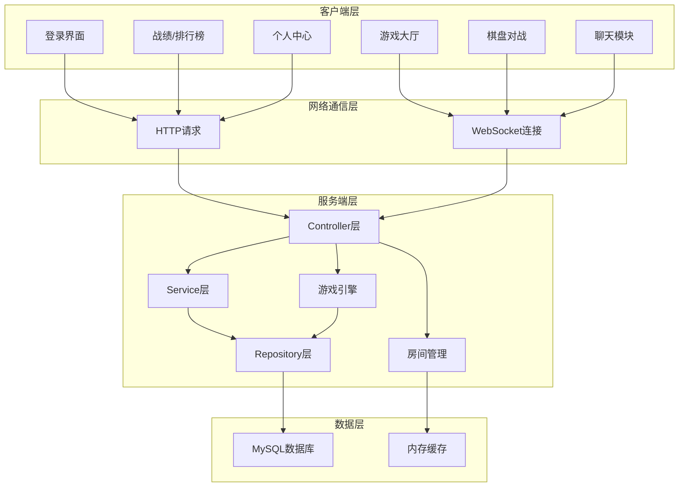
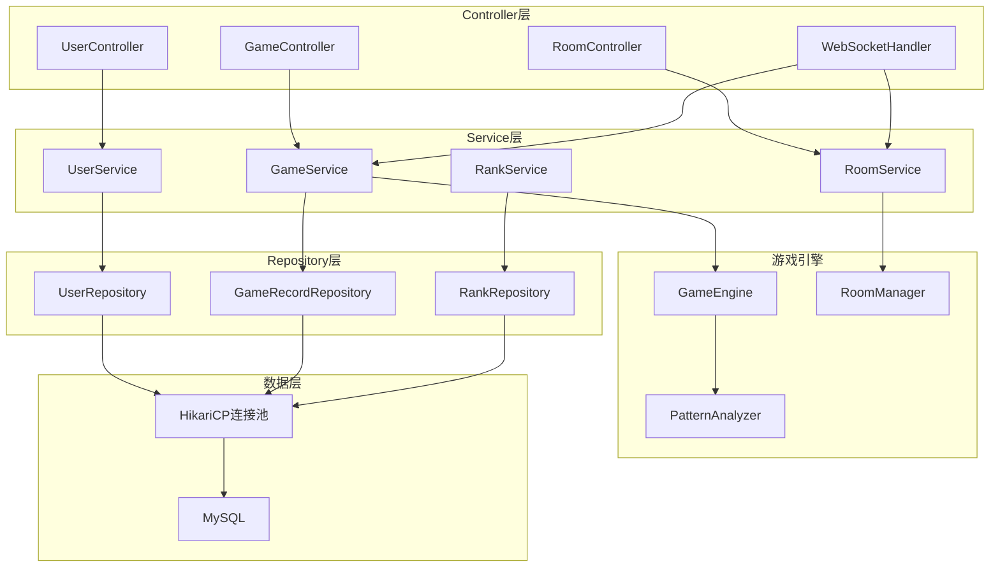
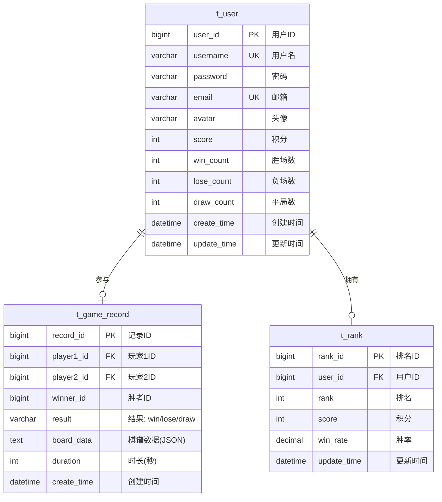
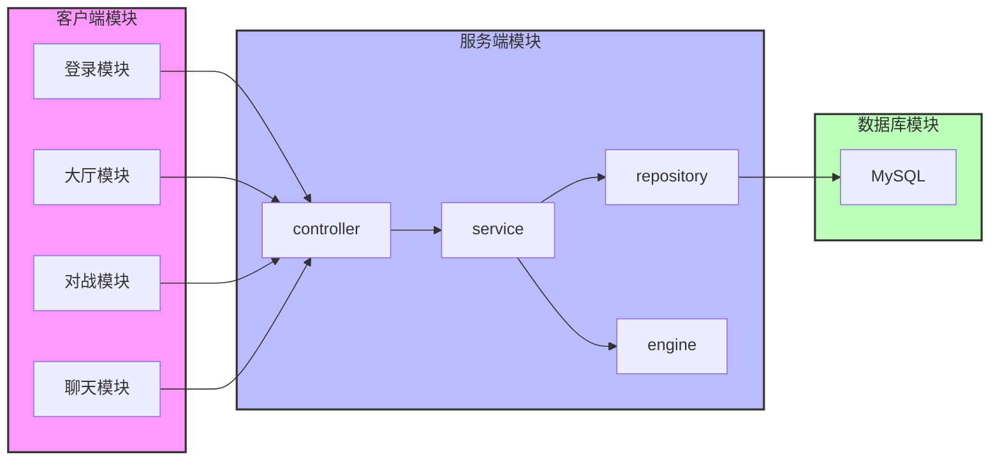

## 1. 架构设计



## 2. 技术描述

- **语言**: Java 8+
- **数据库**: MySQL 8.0+
- **网络通信**: WebSocket (Netty)
- **连接池**: HikariCP
- **日志**: SLF4J + Logback

## 3. 路由定义

| 路由 | 方法 | 用途 |
|------|------|------|
| /api/user/login | POST | 用户登录 |
| /api/user/register | POST | 用户注册 |
| /api/user/{id} | GET | 获取用户信息 |
| /api/user/{id} | PUT | 更新用户信息 |
| /api/room/list | GET | 获取房间列表 |
| /api/room/create | POST | 创建房间 |
| /api/room/join/{roomId} | POST | 加入房间 |
| /api/room/leave/{roomId} | POST | 离开房间 |
| /api/game/record | GET | 获取战绩列表 |
| /api/game/record/{id} | GET | 获取单条战绩 |
| /api/rank | GET | 获取排行榜 |

## 4. API定义

### 4.1 用户认证

**登录请求**
```json
POST /api/user/login
{
    "username": "string",
    "password": "string"
}
```

**登录响应**
```json
{
    "code": 0,
    "message": "success",
    "data": {
        "userId": 1,
        "username": "player1",
        "score": 1000,
        "winCount": 10,
        "loseCount": 5,
        "avatar": "string"
    }
}
```

**注册请求**
```json
POST /api/user/register
{
    "username": "string",
    "password": "string",
    "email": "string"
}
```

### 4.2 房间管理

**创建房间请求**
```json
POST /api/room/create
{
    "roomName": "string",
    "password": "string (可选)",
    "maxPlayers": 2
}
```

**创建房间响应**
```json
{
    "code": 0,
    "message": "success",
    "data": {
        "roomId": 1,
        "roomName": "string",
        "passwordRequired": false,
        "currentPlayers": 1,
        "maxPlayers": 2,
        "status": "waiting"
    }
}
```

### 4.3 战绩查询

**获取战绩请求**
```json
GET /api/game/record?userId=1&page=1&size=10
```

**获取战绩响应**
```json
{
    "code": 0,
    "message": "success",
    "data": {
        "records": [
            {
                "recordId": 1,
                "player1Id": 1,
                "player1Name": "player1",
                "player2Id": 2,
                "player2Name": "player2",
                "winnerId": 1,
                "result": "win",
                "boardData": "[[0,0,...],[0,1,...],...]",
                "createTime": "2026-01-01 12:00:00",
                "duration": 120
            }
        ],
        "total": 100
    }
}
```

## 5. 服务端架构图



## 6. 数据模型

### 6.1 数据模型定义



### 6.2 数据定义语言

**t_user 表**
```sql
CREATE TABLE `t_user` (
    `user_id` BIGINT PRIMARY KEY AUTO_INCREMENT COMMENT '用户ID',
    `username` VARCHAR(50) NOT NULL UNIQUE COMMENT '用户名',
    `password` VARCHAR(100) NOT NULL COMMENT '密码(加密)',
    `email` VARCHAR(100) UNIQUE COMMENT '邮箱',
    `avatar` VARCHAR(255) COMMENT '头像URL',
    `score` INT DEFAULT 1000 COMMENT '积分',
    `win_count` INT DEFAULT 0 COMMENT '胜场数',
    `lose_count` INT DEFAULT 0 COMMENT '负场数',
    `draw_count` INT DEFAULT 0 COMMENT '平局数',
    `create_time` DATETIME DEFAULT CURRENT_TIMESTAMP COMMENT '创建时间',
    `update_time` DATETIME DEFAULT CURRENT_TIMESTAMP ON UPDATE CURRENT_TIMESTAMP COMMENT '更新时间',
    INDEX idx_username (`username`),
    INDEX idx_score (`score`)
) ENGINE=InnoDB DEFAULT CHARSET=utf8mb4 COMMENT='用户表';
```

**t_game_record 表**
```sql
CREATE TABLE `t_game_record` (
    `record_id` BIGINT PRIMARY KEY AUTO_INCREMENT COMMENT '记录ID',
    `player1_id` BIGINT NOT NULL COMMENT '玩家1ID',
    `player2_id` BIGINT NOT NULL COMMENT '玩家2ID',
    `winner_id` BIGINT COMMENT '胜者ID(平局为NULL)',
    `result` VARCHAR(10) NOT NULL COMMENT '结果: win/lose/draw',
    `board_data` TEXT NOT NULL COMMENT '棋谱数据(JSON格式)',
    `duration` INT COMMENT '对局时长(秒)',
    `create_time` DATETIME DEFAULT CURRENT_TIMESTAMP COMMENT '创建时间',
    INDEX idx_player1 (`player1_id`),
    INDEX idx_player2 (`player2_id`),
    INDEX idx_create_time (`create_time`),
    FOREIGN KEY (`player1_id`) REFERENCES `t_user`(`user_id`) ON DELETE CASCADE,
    FOREIGN KEY (`player2_id`) REFERENCES `t_user`(`user_id`) ON DELETE CASCADE,
    FOREIGN KEY (`winner_id`) REFERENCES `t_user`(`user_id`) ON DELETE SET NULL
) ENGINE=InnoDB DEFAULT CHARSET=utf8mb4 COMMENT='游戏记录表';
```

**t_rank 表**
```sql
CREATE TABLE `t_rank` (
    `rank_id` BIGINT PRIMARY KEY AUTO_INCREMENT COMMENT '排名ID',
    `user_id` BIGINT NOT NULL UNIQUE COMMENT '用户ID',
    `rank` INT DEFAULT 0 COMMENT '排名',
    `score` INT DEFAULT 0 COMMENT '积分',
    `win_rate` DECIMAL(5,2) DEFAULT 0.00 COMMENT '胜率',
    `update_time` DATETIME DEFAULT CURRENT_TIMESTAMP ON UPDATE CURRENT_TIMESTAMP COMMENT '更新时间',
    INDEX idx_rank (`rank`),
    INDEX idx_score (`score`),
    FOREIGN KEY (`user_id`) REFERENCES `t_user`(`user_id`) ON DELETE CASCADE
) ENGINE=InnoDB DEFAULT CHARSET=utf8mb4 COMMENT='排行榜表';
```

## 7. 数据库接口设计

### 7.1 Repository 接口规范

#### UserRepository
```java
public interface UserRepository {
    User findById(Long userId);
    User findByUsername(String username);
    User findByEmail(String email);
    User save(User user);
    User update(User user);
    void deleteById(Long userId);
    boolean existsByUsername(String username);
    boolean existsByEmail(String email);
    int updateScore(Long userId, int score);
    int updateWinCount(Long userId);
    int updateLoseCount(Long userId);
    int updateDrawCount(Long userId);
}
```

#### GameRecordRepository
```java
public interface GameRecordRepository {
    GameRecord findById(Long recordId);
    List<GameRecord> findByUserId(Long userId, int page, int size);
    List<GameRecord> findRecent(int limit);
    GameRecord save(GameRecord record);
    void deleteById(Long recordId);
    int countByUserId(Long userId);
}
```

#### RankRepository
```java
public interface RankRepository {
    Rank findByUserId(Long userId);
    List<Rank> findAll(int page, int size);
    List<Rank> findTopN(int n);
    Rank save(Rank rank);
    Rank update(Rank rank);
    void deleteById(Long rankId);
    void refreshRank();
}
```

### 7.2 数据模型实体

#### User 实体
| 字段名 | 类型 | 含义 | 约束 |
|--------|------|------|------|
| userId | Long | 用户ID | 主键 |
| username | String | 用户名 | 非空、唯一 |
| password | String | 密码 | 非空 |
| email | String | 邮箱 | 唯一 |
| avatar | String | 头像URL | 可空 |
| score | Integer | 积分 | 默认1000 |
| winCount | Integer | 胜场数 | 默认0 |
| loseCount | Integer | 负场数 | 默认0 |
| drawCount | Integer | 平局数 | 默认0 |
| createTime | Date | 创建时间 | 自动生成 |
| updateTime | Date | 更新时间 | 自动更新 |

#### GameRecord 实体
| 字段名 | 类型 | 含义 | 约束 |
|--------|------|------|------|
| recordId | Long | 记录ID | 主键 |
| player1Id | Long | 玩家1ID | 非空 |
| player2Id | Long | 玩家2ID | 非空 |
| winnerId | Long | 胜者ID | 可空(平局) |
| result | String | 结果 | 非空 |
| boardData | String | 棋谱数据(JSON) | 非空 |
| duration | Integer | 时长(秒) | 可空 |
| createTime | Date | 创建时间 | 自动生成 |

#### Rank 实体
| 字段名 | 类型 | 含义 | 约束 |
|--------|------|------|------|
| rankId | Long | 排名ID | 主键 |
| userId | Long | 用户ID | 非空、唯一 |
| rank | Integer | 排名 | 默认0 |
| score | Integer | 积分 | 默认0 |
| winRate | BigDecimal | 胜率 | 默认0.00 |
| updateTime | Date | 更新时间 | 自动更新 |

## 8. 模块划分与解耦



### 8.1 模块职责

| 模块 | 职责 | 对外接口 |
|------|------|----------|
| Controller层 | 接收HTTP/WebSocket请求，返回响应 | REST API、WebSocket协议 |
| Service层 | 业务逻辑处理，事务管理 | 内部接口 |
| Repository层 | 数据库访问，数据持久化 | 内部接口 |
| GameEngine | 游戏规则引擎，胜负判定 | 内部接口 |
| RoomManager | 房间管理，状态同步 | 内部接口 |

### 8.2 解耦策略

1. **依赖倒置**：Service依赖Repository接口，不依赖具体实现
2. **接口隔离**：每个Repository只暴露必要的方法
3. **事务边界**：事务控制在Service层，Repository只负责数据访问
4. **数据传输**：使用DTO在模块间传输数据，不直接暴露实体
5. **配置分离**：数据库连接配置独立，支持多环境切换