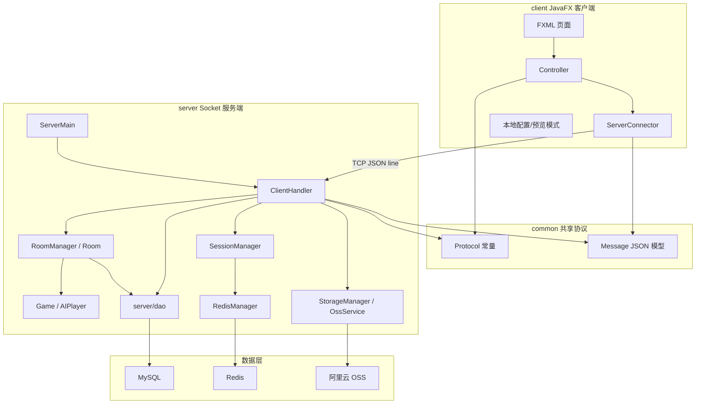
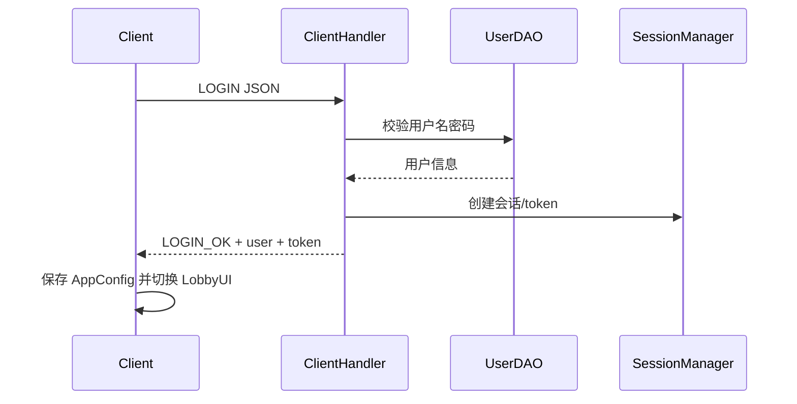
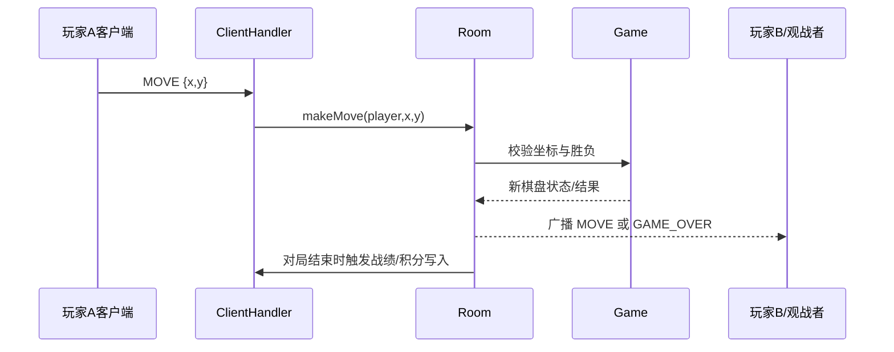

# Gomatch 技术架构文档

本文档维护跨模块架构、关键运行链路和工程边界。详细协议字段见 [COMMON.md](COMMON.md)，客户端实现见 [CLIENT.md](CLIENT.md)，服务端实现见 [SERVER.md](SERVER.md)，数据库/Redis/OSS 设计见 [DB_DESIGN.md](DB_DESIGN.md)。

## 1. 总体架构



## 2. 技术栈

| 层级 | 技术 | 说明 |
|------|------|------|
| 运行环境 | JDK 21 | JavaFX 与服务端运行基础。 |
| 客户端 | JavaFX 21 + FXML + CSS | 桌面 UI、棋盘、弹窗、主题和动态背景。 |
| 网络 | Java Socket TCP 长连接 | JSON 行消息，服务端按连接创建 `ClientHandler`。 |
| 共享协议 | common 模块 | `Protocol` 管理命令常量，`Message` 管理 JSON 序列化。 |
| 服务端 | Java 多线程 + synchronized/并发集合 | 房间隔离、对局状态、匹配和广播。 |
| 数据持久化 | JDBC + HikariCP + MySQL 8 | 用户、战绩、房间、好友、设置等数据。 |
| 缓存 | Redis 7 + Lettuce | 会话、在线状态、排行榜、匹配队列。 |
| 对象存储 | 阿里云 OSS | 用户头像与背景音乐文件存储。 |
| 构建 | Maven 多模块 | `client`、`server`、`common`、`database` 分离。 |

## 3. 模块边界

| 模块 | 职责 | 详细文档 |
|------|------|----------|
| `client/` | JavaFX UI、窗口/场景管理、网络连接、浏览模式、本地 AI。 | [CLIENT.md](CLIENT.md) |
| `common/` | 两端共享协议常量和 JSON 消息模型。 | [COMMON.md](COMMON.md) |
| `server/` | Socket 接入、消息分发、房间/棋局/匹配/会话/DAO。 | [SERVER.md](SERVER.md) |
| `database/` | 数据库实体/仓储参考代码；当前服务端业务 DAO 以 `server/dao` 为准。 | [DB_DESIGN.md](DB_DESIGN.md) |
| `sql/` | 初始化 DDL 和种子数据。 | `sql/init.sql` |

约束：客户端只能依赖 `common`，不能直接依赖服务端 DAO；服务端协议命令必须使用 `common.Protocol` 常量；数据库结构变更必须同步 SQL 和数据库文档。

## 4. 通信模型

主协议是 JSON 行消息：

```json
{"cmd":"COMMAND","data":{"key":"value"}}
```

- 客户端通过 `ServerConnector` 建立 TCP 连接，并启动接收线程。
- 接收线程解析 `Message` 后通过 JavaFX Application Thread 分发到当前 Controller。
- 服务端 `ServerMain` 监听端口，接入后创建 `ClientHandler` 线程。
- `ClientHandler` 根据 `cmd` 调用用户、房间、匹配、战绩、好友、设置等处理逻辑。
- 房间内事件通过 `Room.broadcast` 同步给玩家和观战者。

命令清单和示例以 [COMMON.md](COMMON.md) 为准，避免在架构文档里维护第二份协议表。

## 5. 核心流程

### 5.1 登录与进入大厅



### 5.2 对局落子



### 5.3 匹配与排位

- 快速匹配使用 Redis List 队列，先进先出配对。
- 排位匹配使用 Redis Sorted Set，以 ELO 分数作为 score 查找接近对手。
- 匹配成功后由 `RoomManager` 创建房间并启动对局。

### 5.4 断线重连

- Socket 断开由 `ClientHandler` 捕获并通知房间/会话层。
- `SessionManager` 保留短期会话，Redis 保存 token/session 数据。
- 用户重连时通过 token 恢复会话，并尝试回到原房间。
- 超时或会话无效时清理在线状态，并由房间规则决定结算。

## 6. 并发与一致性

| 位置 | 策略 |
|------|------|
| 连接处理 | 每个客户端连接一个 `ClientHandler` 线程。 |
| 房间状态 | `Room` 内部同步关键操作，避免同一房间内并发落子/离开竞态。 |
| 集合 | 房间、会话等共享注册表使用并发集合。 |
| Redis | 匹配、在线状态、会话和排行榜缓存统一经 `RedisManager` 访问。 |
| 数据库 | DAO 使用连接池和事务边界处理注册、结算、好友、设置等写操作。 |

## 7. 数据设计边界

架构层只约定数据职责，不重复表结构：

| 数据 | 存储 |
|------|------|
| 用户、战绩、好友、房间持久化、用户设置 | MySQL |
| 会话、在线状态、排行榜缓存、匹配队列 | Redis |
| 头像/音乐等大文件方案 | 见数据库设计中的 OSS/文件代理章节 |

详细表字段、索引、Redis Key、事务策略见 [DB_DESIGN.md](DB_DESIGN.md)。

## 8. 运行入口

常用启动与联调命令统一维护在 [docs/README.md](README.md) 第 6 节。模块文档只说明模块专属入口和前置条件，不再复制完整命令清单。

关键顺序：先安装/编译 `common`，再启动服务端，最后启动客户端。推荐使用 `scripts/` 下的成员脚本，避免在文档里写死本机 JDK 路径。

## 9. 维护规则

| 变更 | 应同步 |
|------|--------|
| 协议命令或消息字段 | [COMMON.md](COMMON.md)、相关模块文档。 |
| 页面、路由、Controller、主题行为 | [CLIENT.md](CLIENT.md)、必要时 [UI_GUIDELINE.md](UI_GUIDELINE.md)。 |
| 服务端流程、匹配、房间、DAO 行为 | [SERVER.md](SERVER.md)。 |
| 表结构、Redis Key、索引、事务 | [DB_DESIGN.md](DB_DESIGN.md)、`sql/init.sql`。 |
| 需求范围或验收标准 | [PRD.md](PRD.md)。 |
