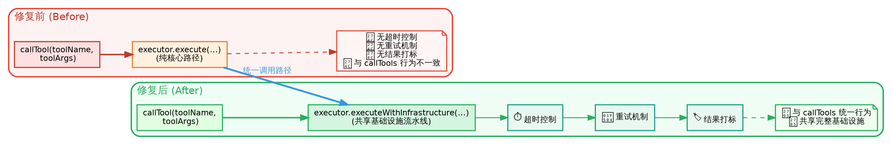

# 我的第一次 Git 贡献：从 fork 到合并 PR #3130

> 🦀 **这是我人生中的第一篇博客！** 想把第一次给开源项目提 PR 的经历好好记下来。第一次写，有点紧张，写得不好请多多包涵呀～

- 作者：KIM406-CMD
- 日期：2026-10-23
- 预计阅读：约 8 分钟

---

其实到现在我都还记得，第一次打开终端敲下 `git` 命令的时候，手心是有点出汗的。但就是在这种又紧张又有点小兴奋的状态下，我完成了人生第一个 Pull Request。

## 目录

1. [故事的开始](#一故事的开始)
2. [Fork 与 Clone：把项目搬到自己手里](#二fork-与-clone把项目搬到自己手里)
3. [读懂要修什么](#三读懂要修什么)
4. [动手改代码（和 ossmainer ai 一起）](#四动手改代码和-ossmainer-ai-一起)
5. [写测试](#五写测试)
6. [Commit、Push、提 PR](#六commitpush提-pr)
7. [踩过的坑与心里的话](#七踩过的坑与心里的话)
8. [写在最后](#八写在最后)

---

## 一、故事的开始

我是一个刚学 Java 没多久的小白。后来了解到一个叫 **AgentScope** 的开源项目——一个用来构建分布式、长时运行 Agent 的框架。

有一天我翻了翻项目的 Issue 列表，看到了 [#3114](https://github.com/agentscope-ai/agentscope-java/issues/3114)，说的是 `callTool` 没有走共享的工具基础设施流水线（缺少超时、重试等保护）。维护者回复说「欢迎提 PR」。

我盯着这条回复看了好久。说实话心里有点痒痒的——我一直想学 Git，但总觉得「开源贡献」是大佬们才做的事。可这个 issue 改动范围不大，又能完整体验全流程。我咬了咬牙：要不……就试试吧。大不了搞砸了再删嘛。

---

## 二、Fork 与 Clone：把项目搬到自己手里

刚开始 `fork`、`clone`、`branch` 我搞了好久才弄明白，其实没那么吓人：

- **Fork**：在 GitHub 点一下「Fork」，在自己账号下复制一份项目副本。原项目叫 `upstream`，你的叫 `origin`。改坏了也不怕。
- **Clone**：把 fork 出来的代码下载到本地。
- **Branch**：开一条「支线」改代码，改完再合并回主线。就像打草稿，草稿废了不影响正文。

我对着教程一步一步敲：

```bash
$ git clone https://github.com/KIM406-CMD/agentscope-java.git
$ cd agentscope-java
$ git remote add upstream https://github.com/agentscope-ai/agentscope-java.git
$ git checkout -b fix/route-calltool-shared-infra
```

> 一定要记得加 `upstream`！不然后面提交可能会冲突一堆，到时候会慌的（别问我怎么知道的……）。

---

## 三、读懂要修什么

动手前我反复提醒自己：先别急着写，先把问题搞懂。花了一个下午啃 `Toolkit.java` 和 `ToolExecutor.java` 的源码，终于理清楚了。

项目里有两个调用工具的入口：`callTool`（单个）和 `callTools`（批量）。原来 `callTools` 走了完整的基础设施流水线（调度、超时、重试、优雅关闭、结果 id/name 打标），但 `callTool` 只走了纯核心路径，什么保护都没有。

这就导致两个问题：工具卡住没有超时会拖死整个 Agent；返回结果没有 id/name，调用方没法对应请求。

**修复前后对比：**



> 读懂问题花的时间比写代码还长，但真的特别值得——你改的不是「代码」，而是「理解」。

---

## 四、动手改代码（和 ossmainer ai 一起）

思路很清晰：让 `callTool` 也走 `executeWithInfrastructure` 这条共享路径。主要改了三处：

1. **`callTool` 改走共享基础设施**，并加了一个支持 per-call 配置的重载
2. **提取配置合并逻辑**为 `resolveToolExecutionConfig` 方法（DRY 原则，别重复自己）
3. **拆分 `executeWithInfrastructure` 为三个重载**，让批量和单工具路径最终都调用同一个共享实现

### 和 ossmainer ai 一起反复打磨

这些代码不是我一个人闷头写的。整个过程我一直和 **ossmainer ai** 在一起打磨——它像个耐心的搭档，陪我一遍又一遍地改。

第一次改完我自我感觉良好，结果丢给 ossmainer ai 一看，它马上指出好几个问题：空指针判断漏了、重载顺序不对、注释不清楚……我有点小挫败，但还是老老实实改了。

第二轮以为没问题了，它又揪出新细节：方法可见性要放宽、优先级注释要写明白、边界情况没覆盖……就这样一轮两轮三轮，每次我觉得「差不多了」，它总能再找出一点可以更好的地方。中间有几次我都不耐烦了，心想「至于这么较真吗」，但改完回头看，又不得不承认它说得对。

> **和 AI 协作的小心得**：AI 不会累，但你要有判断力。它的建议不一定全对，你要想清楚「为什么这么改」，而不是无脑全收。想明白了，代码才真的是「你写的」。

最后一轮改完，看着干干净净的代码，心里有种说不出的踏实——因为每一行我都知道为什么要这么写。

---

## 五、写测试

一开始我只想改完代码就提 PR，但项目要求必须有测试。我硬着头皮开始写，写测试时也拉着 ossmainer ai 一起想边界场景。

一共写了 7 个测试，覆盖了：成功/错误结果打标、input 优先级、null 配置一致性、per-call 配置生效、超时覆盖、工具不存在和参数校验失败的打标。

最有意思的是「超时覆盖」测试——写了个慢 300ms 的工具，toolkit 超时设 100ms，per-call 超时设 10 分钟，验证 per-call 配置能覆盖 toolkit 配置。

> 以前我觉得测试是「负担」，这次才明白，测试是帮你验证理解对不对的工具。跑通的那一刻，我才真正确信改对了。

---

## 六、Commit、Push、提 PR

终于到了最紧张又最期待的环节。

### 查看改动

```bash
$ git status
  modified:   agentscope-core/.../tool/ToolExecutor.java
  modified:   agentscope-core/.../tool/Toolkit.java
  modified:   agentscope-core/.../tool/ToolkitTest.java
```

### 写 Commit Message

按 **Conventional Commits** 规范写的：

```text
fix(core): route callTool through shared tool infrastructure

Route Toolkit.callTool(ToolCallParam) through the same infrastructure
pipeline used by Toolkit.callTools(...): scheduling, timeout, retry,
graceful shutdown guard, final ToolResult id/name stamping.

Closes #3114.
```

> 第一行不超 50 字符，写 `Closes #3114` 能让 PR 合并时自动关闭 Issue。

### 提交并推送

```bash
$ git add -A
$ git commit -m "fix(core): route callTool through shared tool infrastructure"
 3 files changed, 210 insertions(+), 12 deletions(-)
$ git push -u origin fix/route-calltool-shared-infra
```

### 发起 PR

点终端里的链接跳到 GitHub，填好标题描述，鼠标悬在「Create pull request」上停了几秒——真的要提交了吗？万一写错了怎么办？

然后我对自己说：没事的，大不了改嘛。

点了下去。**PR #3130 就这样诞生了。**

---

## 七、踩过的坑与心里的话

第一次贡献踩了不少坑，记下来希望能帮到同样紧张的小白：

1. **忘了同步 upstream** → 提 PR 前先 `git fetch upstream && git rebase upstream/main`
2. **Commit message 太随意** → 按规范写，是对维护者时间的尊重
3. **差点没跑测试就提交** → 本地 `mvn test` 跑通再提，心里才踏实
4. **想把所有改动塞一个 Commit** → 拆成小 Commit，review 不累，回滚也方便

> Git 其实没那么可怕，可怕的是「不敢开始」。维护者们大多很友善，他们比你更希望项目变好。

---

## 八、写在最后

如果你也想给开源项目贡献代码但心里打鼓，我想轻轻跟你说：**别害怕，找个感兴趣的项目，翻一翻 Issue，挑一个「我好像能改」的，动手就好了。**

第一个 PR 不需要完美。修个错别字、补行注释、改个小 bug 都行。重要的是迈出第一步。

感谢 AgentScope 团队，也感谢每一个审我 PR 的维护者——你们的每一句回复对我都很珍贵。

这是我的第一篇博客，能坚持写完对我来说已经是小小的胜利了。心里有点暖暖的。

下一个 PR，下一篇博客，我还会来的。🦀

---

— 全文完 —

## 参考链接

1. [PR #3130 — fix(core): route callTool through shared tool infrastructure](https://github.com/agentscope-ai/agentscope-java/pull/3130)
2. [Issue #3114](https://github.com/agentscope-ai/agentscope-java/issues/3114)
3. [AgentScope Java 仓库](https://github.com/agentscope-ai/agentscope-java)
4. [Conventional Commits 规范](https://www.conventionalcommits.org/)
