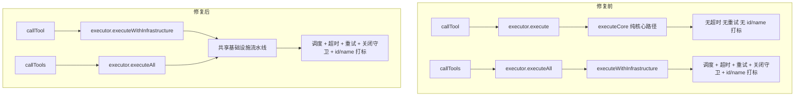

# 我的第一次 Git 贡献：从 fork 到合并 PR #3130

> 🎉 **这是我人生中的第一篇博客！** 记录一个编程小白第一次用 Git 给开源项目提 PR 的全过程，顺便聊聊这次 PR 到底修了什么。
>
> 写得不好的地方请多多包涵，欢迎在评论区交流～

- 作者：KIM406-CMD
- 日期：2026-10-23
- 预计阅读：约 12 分钟

---

说实话，第一次打开终端敲下 `git` 命令的时候，我的手心是出汗的。看着屏幕上一堆看不懂的英文，脑子里只有一个念头：「这玩意儿会不会把我电脑搞坏？」但就是在这种紧张又兴奋的状态下，我完成了人生第一个 Pull Request。

## 目录

1. [故事的开始：我为什么要学 Git](#一故事的开始我为什么要学-git)
2. [第一步：Fork 与 Clone——把项目「搬」到自己手里](#二第一步fork-与-clone把项目搬到自己手里)
3. [第二步：读懂这个 PR 要修什么](#三第二步读懂这个-pr-要修什么)
4. [第三步：动手改代码](#四第三步动手改代码)
5. [第四步：写测试——新手最容易忽略的一步](#五第四步写测试新手最容易忽略的一步)
6. [第五步：Commit、Push、提 PR](#六第五步commitpush提-pr)
7. [新手踩坑清单与心得](#七新手踩坑清单与心得)
8. [写在最后](#八写在最后)

---

## 一、故事的开始：我为什么要学 Git

我是一个刚学 Java 没多久的小白。最近在玩一个叫 **AgentScope** 的开源项目——它是一个用来构建分布式、生产级长时运行 Agent 的框架。我在写自己的小玩具时，发现调用单个工具的 `callTool` 方法和批量调用的 `callTools` 行为不太一样：单个调用似乎没有走超时、重试这些基础设施。

我翻了翻项目的 Issue 列表，发现已经有人提了 [#3114](https://github.com/agentscope-ai/agentscope-java/issues/3114)，描述的正是这个问题。维护者回复说「欢迎提 PR」。既然我也遇到了同样的困扰，不如就趁这个机会，把 Git 真正用起来，动手把它修了。

> **为什么是 Git？**
>
> Git 是现在几乎所有开源项目的「版本控制系统」。简单说，它能记录你每一次改动，还能让一群人同时改同一份代码而不打架。GitHub 则是把 Git 仓库托管在网上的平台——你能看到全世界的开源项目，也能贡献自己的代码。

---

## 二、第一步：Fork 与 Clone——把项目「搬」到自己手里

刚接触 Git 时，我搞不懂 `fork`、`clone`、`branch` 这几个词到底什么区别。后来用大白话想明白了：

- **Fork**：在 GitHub 上点一下「Fork」按钮，相当于在**你自己的账号下复制一份项目副本**。原项目叫 `upstream`，你 fork 出来的叫 `origin`。
- **Clone**：把你 fork 出来的那份代码**下载到本地电脑**，这样你就能在本地编辑了。
- **Branch**：在本地开一条「支线」来改代码，改完再合并回主线。这样改坏了也不影响主代码。

### 我的操作顺序

```bash
$ git clone https://github.com/KIM406-CMD/agentscope-java.git
Cloning into 'agentscope-java'...

$ cd agentscope-java

$ git remote add upstream https://github.com/agentscope-ai/agentscope-java.git

$ git checkout -b fix/route-calltool-shared-infra
Switched to a new branch 'fix/route-calltool-shared-infra'
```

> **新手小贴士**
>
> 别忘了加 `upstream` 远程地址！这样以后原项目有更新，你可以用 `git fetch upstream && git merge upstream/main` 把最新代码同步过来，避免提交时出现一堆冲突。

分支名我用了 `fix/route-calltool-shared-infra`，这是项目推荐的命名方式——**类型前缀 + 简短描述**。看起来专业一点，维护者审 PR 时也一目了然。

---

## 三、第二步：读懂这个 PR 要修什么

在动手之前，必须先搞清楚问题在哪。我花了一个下午读 `Toolkit.java` 和 `ToolExecutor.java` 的源码，终于理清楚了来龙去脉。

### 问题：callTool 绕过了共享基础设施

项目里有两个调用工具的入口：

- `callTool(ToolCallParam)` —— 调用**单个**工具
- `callTools(List<ToolUseBlock>, ...)` —— 调用**多个**工具（支持并发）

原来的代码里，`callTools` 走了完整的基础设施流水线（调度、超时、重试、优雅关闭守卫、结果 id/name 打标），但 `callTool` 只调用了 `executor.execute(param)`——这是一个**纯核心执行**路径，没有任何超时和重试保护。

这就导致两个问题：

1. 单个工具调用如果卡住，**没有超时机制**，整个 Agent 可能被拖死。
2. 返回的 `ToolResultBlock` **没有打上 id 和 name**，调用方没法把结果和原始请求对应起来。

**修复前后的调用路径对比：**



> 读懂问题花的时间，比写代码花的时间还长。但这一步是绝对值得的——你改的不是「代码」，而是「理解」。

---

## 四、第三步：动手改代码

思路很清晰：让 `callTool` 也走 `executeWithInfrastructure` 这条共享路径。但说起来简单，做起来要注意不少细节。

### 4.1 Toolkit.callTool 改造

原来的代码：

```java
// 旧实现
public Mono<ToolResultBlock> callTool(ToolCallParam param) {
    return executor.execute(param);
}
```

改成走共享基础设施：

```java
public Mono<ToolResultBlock> callTool(ToolCallParam param) {
    return executor.executeWithInfrastructure(param, resolveToolExecutionConfig(null));
}

// 顺便加了一个支持 per-call 配置的重载
public Mono<ToolResultBlock> callTool(ToolCallParam param, ExecutionConfig perCallConfig) {
    return executor.executeWithInfrastructure(param, resolveToolExecutionConfig(perCallConfig));
}
```

### 4.2 提取配置合并逻辑

原来 `callTools` 里有一大段「合并执行配置」的代码，优先级是 *agent 级 > toolkit 级 > 系统默认*。我把它抽成了一个私有方法 `resolveToolExecutionConfig`，这样两个入口都能用：

```java
private ExecutionConfig resolveToolExecutionConfig(ExecutionConfig perCallConfig) {
    ExecutionConfig base = ExecutionConfig.mergeConfigs(
            config.getExecutionConfig(), ExecutionConfig.TOOL_DEFAULTS);
    return perCallConfig == null ? base
            : ExecutionConfig.mergeConfigs(perCallConfig, base);
}
```

> **DRY 原则**
>
> Don't Repeat Yourself（不要重复自己）。把重复的配置合并逻辑抽成一个方法，以后改优先级只需要改一处。这是我从这次 PR 里学到的最重要的编码习惯之一。

### 4.3 ToolExecutor 的重载拆分

为了让 `executeWithInfrastructure` 既能被批量路径调用，也能被单工具路径调用，我把它拆成了三个重载：

| 重载签名 | 用途 |
|---------|------|
| `executeWithInfrastructure(ToolUseBlock, ExecutionConfig, Agent, ...)` | 批量路径调用，从 ToolUseBlock 构造 ToolCallParam |
| `executeWithInfrastructure(ToolCallParam, ExecutionConfig)` | 单工具直接调用，从 runtimeContext 解析 requestConfig |
| `executeWithInfrastructure(ToolCallParam, ExecutionConfig, ToolRequestConfig, BiConsumer)` | **真正的共享实现**，前两个最终都调到这里 |

这样就实现了**「单工具和批量工具走同一条基础设施流水线」**的目标。

---

## 五、第四步：写测试——新手最容易忽略的一步

说实话，一开始我只想改完代码就提 PR。但看了项目的贡献指南，发现必须有测试。硬着头皮写了 7 个测试用例，没想到这一步帮我发现了好几个边界问题。

### 我写的测试覆盖了这些场景

- **成功结果打标**：`callTool` 返回的结果应该带有正确的 `id` 和 `name`
- **错误结果打标**：工具抛异常时，结果也应该带上 id/name
- **ToolCallParam.input 优先于 ToolUseBlock.input**：确保调用方传入的 input 不会被覆盖
- **null 配置 == 单参数重载**：传 `null` 作为 per-call 配置时行为一致
- **per-call 配置生效**：传自定义配置后结果正常打标
- **per-call 超时覆盖 toolkit 超时**：用一个 `SlowTool` 验证短超时被长 per-call 超时覆盖
- **工具不存在 / 参数校验失败时打标**：异常路径也要带 id/name

其中最有意思的是「超时覆盖」测试。我写了一个故意慢 300ms 的工具，给 toolkit 设了 100ms 的超时，再给 per-call 设 10 分钟超时——如果 per-call 配置正确生效，工具应该能正常返回 `"done"` 而不是超时错误。

```java
public static class SlowTool {
    @Tool(name = "slow", description = "Delay then return done")
    public Mono<String> slow(
            @ToolParam(name = "delayMs") long delayMs) {
        return Mono.delay(Duration.ofMillis(delayMs)).thenReturn("done");
    }
}
```

> **心得**
>
> 测试不是「写完代码后的负担」，而是**帮你验证理解是否正确的工具**。跑通测试的那一刻，我才真正确信自己的改动是对的。

---

## 六、第五步：Commit、Push、提 PR

代码和测试都跑通了，终于到了最激动人心的环节——提交！

### 6.1 查看改动

```bash
$ git status
On branch fix/route-calltool-shared-infra
Changes not staged for commit:
  modified:   agentscope-core/.../tool/ToolExecutor.java
  modified:   agentscope-core/.../tool/Toolkit.java
  modified:   agentscope-core/.../tool/ToolkitTest.java
```

### 6.2 写 Commit Message

项目用的是 **Conventional Commits** 规范，格式是 `<type>(<scope>): <描述>`。我写的是：

```text
fix(core): route callTool through shared tool infrastructure

Route Toolkit.callTool(ToolCallParam) through the same infrastructure
pipeline used by Toolkit.callTools(...):

- scheduling
- timeout
- retry
- graceful shutdown guard
- final ToolResult id/name stamping

Closes #3114.
```

> **Commit 小技巧**
>
> 第一行不超过 50 个字符，空一行后写详细描述。写上 `Closes #3114`，PR 合并时 GitHub 会自动关闭对应的 Issue，非常方便。

### 6.3 提交并推送

```bash
$ git add -A

$ git commit -m "fix(core): route callTool through shared tool infrastructure"
[fix/route-calltool-shared-infra a1b2c3d] fix(core): ...
 3 files changed, 210 insertions(+), 12 deletions(-)

$ git push -u origin fix/route-calltool-shared-infra
remote: Create a pull request for 'fix/...' on GitHub by visiting:
remote:   https://github.com/KIM406-CMD/agentscope-java/pull/new/fix/...
```

### 6.4 在 GitHub 上发起 Pull Request

点击终端输出的链接，就跳到了 GitHub 的 PR 创建页面。我填好标题和描述，确认 `base: main` ← `compare: fix/route-calltool-shared-infra`，点击「Create pull request」——

**PR #3130 就这样诞生了。** 我盯着屏幕看了好一会儿，不敢相信这是真的。

---

## 七、新手踩坑清单与心得

第一次贡献并不顺利，我踩了不少坑。把它们记下来，希望能帮到和我一样的小白：

### 踩过的坑

1. **忘了同步 upstream，导致 push 时冲突一堆。**
   *解决*：提 PR 前先 `git fetch upstream && git rebase upstream/main`，把你的改动「叠」在最新代码之上。

2. **Commit message 写得太随意。**
   *解决*：严格按 Conventional Commits 写，维护者看到规范的 message 会更愿意审你的 PR。

3. **没跑测试就提交。**
   *解决*：本地一定要先 `mvn test` 跑通，CI 绿了才好意思提 PR。

4. **一个 Commit 塞了太多不相关的改动。**
   *解决*：保持 Commit 粒度小，一个改动一个 Commit，方便 review 和回滚。

### 最大的心得

> **一句话总结**
>
> Git 并不可怕，可怕的是「不敢开始」。只要你愿意读文档、愿意试错、愿意把 Commit message 写清楚，维护者们大多是非常友善的——他们比你更希望项目变好。

这次 PR 让我从「只会用 `git add . && git commit`」的小白，变成了能看懂分支、rebase、提 PR 的贡献者。更重要的是，我学会了**通过读源码来理解一个真实项目是怎么运作的**——这比看十篇教程都管用。

---

## 八、写在最后

如果你也是一个想给开源项目贡献代码但还在犹豫的小白，我的建议是：**找一个你正在用的项目，翻一翻它的 Issue 列表，挑一个你觉得「我好像能改」的，然后动手。**

你的第一个 PR 不需要很完美。它可以是修一个错别字、补一行注释、改一个小 bug。重要的是**迈出第一步**。一旦你提交了第一个 PR，GitHub 这个庞大的世界就向你打开了一扇门。

最后，感谢 AgentScope 团队维护了这么棒的项目，也感谢每一个耐心审我 PR 的维护者。

这是我的第一篇博客，能坚持写完它，对我来说已经是一个小小的胜利。下一个 PR，下一篇博客，我来了。

---

— 全文完 —

## 参考链接

1. [GitHub Pull Request #3130 — fix(core): route callTool through shared tool infrastructure](https://github.com/agentscope-ai/agentscope-java/pull/3130)
2. [GitHub Issue #3114 — callTool does not route through shared tool infrastructure](https://github.com/agentscope-ai/agentscope-java/issues/3114)
3. [AgentScope Java 官方仓库](https://github.com/agentscope-ai/agentscope-java)
4. [Conventional Commits 规范](https://www.conventionalcommits.org/)
