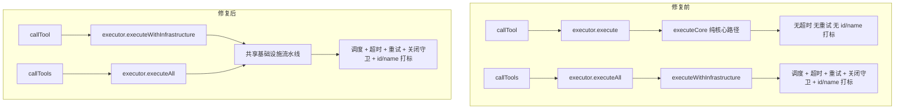

# 我的第一次 Git 贡献：从 fork 到合并 PR #3130

> 🦀 **这是我人生中的第一篇博客！** 想把第一次给开源项目提 PR 的经历好好记下来，也顺便聊聊这次 PR 到底修了什么。
>
> 第一次写博客，有点紧张，写得不好的地方请大家多多包涵呀～如果有什么想说的，欢迎在评论区告诉我，我会认真看的。

- 作者：KIM406-CMD
- 日期：2026-10-23
- 预计阅读：约 12 分钟

---

其实到现在我都还记得，第一次打开终端敲下 `git` 命令的时候，手心是有点出汗的。看着屏幕上滚过一堆看不懂的英文，心里偷偷想：「这玩意儿……会不会把我电脑搞坏啊？」

但就是在这种又紧张又有点小兴奋的状态下，我完成了人生第一个 Pull Request。现在回头看，心里还是暖暖的。

## 目录

1. [故事的开始：我为什么要学 Git](#一故事的开始我为什么要学-git)
2. [第一步：Fork 与 Clone——把项目「搬」到自己手里](#二第一步fork-与-clone把项目搬到自己手里)
3. [第二步：读懂这个 PR 要修什么](#三第二步读懂这个-pr-要修什么)
4. [第三步：动手改代码](#四第三步动手改代码)
5. [第四步：写测试——新手最容易忽略的一步](#五第四步写测试新手最容易忽略的一步)
6. [第五步：Commit、Push、提 PR](#六第五步commitpush提-pr)
7. [踩过的坑与心里的话](#七踩过的坑与心里的话)
8. [写在最后](#八写在最后)

---

## 一、故事的开始：我为什么要学 Git

我是一个刚学 Java 没多久的小白。后来了解到一个叫 **AgentScope** 的开源项目——它是一个用来构建分布式、生产级长时运行 Agent 的框架，听起来挺厉害的。

有一天我随手翻了翻项目的 Issue 列表，看到了 [#3114](https://github.com/agentscope-ai/agentscope-java/issues/3114)，说的是 `callTool` 没有走共享的工具基础设施流水线（缺少超时、重试这些保护）。维护者在下面回复说「欢迎提 PR」。

我盯着这条回复看了好久。说实话，心里有点痒痒的——我一直想学学 Git 到底怎么用，但总觉得「开源贡献」这四个字离我好远，好像是大佬们才做的事。

可这个 issue 看起来改动范围不大，又能完整体验从 fork 到提 PR 的全流程。我咬了咬牙，默默在心里说：要不……就试试吧。大不了搞砸了再删嘛。

> **为什么是 Git？**
>
> 如果你和我一样是新手，可能会问：Git 到底是啥呀？简单说，它是一个「版本控制系统」，能记住你每一次改了什么，还能让好多人一起改同一份代码而不打架。GitHub 就是把这些代码放在网上的地方——在那里你能看到全世界的开源项目，也能把自己的改动贡献出去。

---

## 二、第一步：Fork 与 Clone——把项目「搬」到自己手里

说实话，刚接触 Git 的时候，`fork`、`clone`、`branch` 这几个词我搞了好久才弄明白。后来用大白话想通了，其实没那么吓人：

- **Fork**：在 GitHub 上点一下「Fork」按钮，就相当于在**你自己的账号下复制了一份项目副本**。原项目叫 `upstream`，你 fork 出来的那份叫 `origin`。这样改坏了也不怕，反正不影响别人。
- **Clone**：把你 fork 出来的那份代码**下载到自己电脑上**，这样就能在本地慢慢改了。
- **Branch**：在本地开一条「支线」来写代码，改完再合并回主线。我把它理解成「打草稿」——草稿改坏了扔掉就行，正文不会受影响。

### 我的操作顺序

我对着教程一步一步敲，每敲一行都要深呼吸一下：

```bash
$ git clone https://github.com/KIM406-CMD/agentscope-java.git
Cloning into 'agentscope-java'...

$ cd agentscope-java

$ git remote add upstream https://github.com/agentscope-ai/agentscope-java.git

$ git checkout -b fix/route-calltool-shared-infra
Switched to a new branch 'fix/route-calltool-shared-infra'
```

看到终端回显「Switched to a new branch」的时候，我心里小小的松了一口气——第一步好像……成功了？

> **新手小贴士**
>
> 一定要记得加 `upstream` 远程地址哦！这样以后原项目有更新，你可以用 `git fetch upstream && git merge upstream/main` 把最新代码同步过来，不然后面提交的时候可能会出现一堆冲突，到时候会慌的（别问我怎么知道的……）。

分支名我用了 `fix/route-calltool-shared-infra`，是按照项目推荐的方式起的——**类型前缀 + 简短描述**。虽然只是个名字，但总觉得起得规规矩矩的，维护者看到会愿意多瞄两眼。

---

## 三、第二步：读懂这个 PR 要修什么

在动手改代码之前，我反复提醒自己：先别急着写，先把问题搞懂。

于是我花了整整一个下午，捧着 `Toolkit.java` 和 `ToolExecutor.java` 的源码慢慢啃。说实话中间有好几次都想放弃了，觉得「这都什么跟什么啊」，但还是硬着头皮一行一行读下去。终于，理清楚了来龙去脉。

### 问题：callTool 绕过了共享基础设施

项目里有两个调用工具的入口：

- `callTool(ToolCallParam)` —— 调用**单个**工具
- `callTools(List<ToolUseBlock>, ...)` —— 调用**多个**工具（还支持并发）

原来的代码里，`callTools` 走了完整的基础设施流水线（调度、超时、重试、优雅关闭守卫、结果 id/name 打标），但 `callTool` 只调用了 `executor.execute(param)`——这是一个**纯核心执行**路径，什么超时啊重试啊，统统没有。

这就导致两个让人有点头疼的问题：

1. 单个工具调用如果卡住了，**没有超时机制**，整个 Agent 可能就被拖死在那里了。
2. 返回的 `ToolResultBlock` **没有打上 id 和 name**，调用方拿到结果都不知道是哪个请求返回的，怪难受的。

**修复前后的调用路径对比：**



> 读懂问题花的时间，其实比写代码花的时间还长。但现在想想，这一步真的特别值得——你改的不是「代码」，而是「理解」。理解对了，写代码反而顺了。

---

## 四、第三步：动手改代码

思路其实很清晰：让 `callTool` 也走 `executeWithInfrastructure` 这条共享路径就好了。但说起来轻飘飘的，真动手的时候还是要小心翼翼，生怕哪里写错了。

### 4.1 Toolkit.callTool 改造

原来的代码长这样：

```java
// 旧实现
public Mono<ToolResultBlock> callTool(ToolCallParam param) {
    return executor.execute(param);
}
```

我把它改成走共享基础设施：

```java
public Mono<ToolResultBlock> callTool(ToolCallParam param) {
    return executor.executeWithInfrastructure(param, resolveToolExecutionConfig(null));
}

// 顺便加了一个支持 per-call 配置的重载
public Mono<ToolResultBlock> callTool(ToolCallParam param, ExecutionConfig perCallConfig) {
    return executor.executeWithInfrastructure(param, resolveToolExecutionConfig(perCallConfig));
}
```

### 4.2 提取配置合并逻辑

我发现原来 `callTools` 里有一大段「合并执行配置」的代码，优先级是 *agent 级 > toolkit 级 > 系统默认*。这段逻辑如果两个入口各写一份，以后改起来容易漏。于是我把它抽成了一个私有方法 `resolveToolExecutionConfig`，这样两边都能用：

```java
private ExecutionConfig resolveToolExecutionConfig(ExecutionConfig perCallConfig) {
    ExecutionConfig base = ExecutionConfig.mergeConfigs(
            config.getExecutionConfig(), ExecutionConfig.TOOL_DEFAULTS);
    return perCallConfig == null ? base
            : ExecutionConfig.mergeConfigs(perCallConfig, base);
}
```

> **DRY 原则**
>
> Don't Repeat Yourself，就是不要重复自己。把重复的逻辑抽成一个方法，以后要改优先级只需要改一处就好了。这是我从这次 PR 里学到的最重要的编码习惯之一，虽然简单，但真的很有用。

### 4.3 ToolExecutor 的重载拆分

为了让 `executeWithInfrastructure` 既能被批量路径调用，也能被单工具路径调用，我把它拆成了三个重载。一开始我还担心会不会拆多了，后来想清楚了——其实就是「薄入口 + 一个真正干活的实现」，反而更清楚：

| 重载签名 | 用途 |
|---------|------|
| `executeWithInfrastructure(ToolUseBlock, ExecutionConfig, Agent, ...)` | 批量路径调用，从 ToolUseBlock 构造 ToolCallParam |
| `executeWithInfrastructure(ToolCallParam, ExecutionConfig)` | 单工具直接调用，从 runtimeContext 解析 requestConfig |
| `executeWithInfrastructure(ToolCallParam, ExecutionConfig, ToolRequestConfig, BiConsumer)` | **真正的共享实现**，前两个最终都调到这里 |

改完之后，**单工具和批量工具就走同一条基础设施流水线了**。看到代码跑通的那一刻，我偷偷开心了好久。

### 4.4 和 ossmainer ai 一起反复打磨

其实这些代码不是我一个人闷头写出来的。整个修改过程中，我一直和 **ossmainer ai** 在一起打磨——它就像一个耐心的搭档，陪着我一遍又一遍地改。

第一次改完，我自我感觉还挺良好的。结果把代码丢给 ossmainer ai 一看，它马上指出了好几个我没注意到的问题：这里少了个空指针判断，那里的重载顺序不太对，还有注释写得不够清楚……我当时心里有点小小的挫败，但还是老老实实照着改了。

改完第二轮，我以为这次总该没问题了吧？结果 ossmainer ai 又揪出了新的细节：`executeWithInfrastructure` 的可见性应该放宽，不然外部调不到；配置合并的优先级注释要写明白；还有几个边界情况没覆盖到……

就这样，一轮、两轮、三轮……我们来来回回改了好多次。每次我觉得「差不多了」，ossmainer ai 总能再找出一点可以更好的地方。说实话中间有几次我都有点不耐烦了，心里想「至于这么较真吗」，但改完之后回头看，又不得不承认它说得对。

> **和 AI 协作的小心得**
>
> AI 不会累，也不会嫌你烦，但你自己要有判断力。它提的建议不一定全都对，你要自己想清楚「为什么要这么改」，而不是无脑全收。把每一次修改都想明白，代码才真的是「你写的」，而不是「AI 写的」。

最后一轮改完，ossmainer ai 说「这次没问题了」的时候，我长长地舒了一口气。看着干干净净的代码，心里有种说不出的踏实——因为每一行我都知道为什么要这么写。

---

## 五、第四步：写测试——新手最容易忽略的一步

说实话，一开始我真的只想改完代码就赶紧提 PR。但翻了翻项目的贡献指南，发现必须有测试才行。我对着屏幕纠结了一会儿，还是硬着头皮开始写。写测试的时候我也拉着 ossmainer ai 一起——它帮我想边界场景，我负责判断哪些是真正需要覆盖的。

没想到，写测试这一步反而帮我发现了好几个之前没注意到的边界问题。现在想想，幸好写了测试，不然提上去肯定会被打回来。

### 我写的测试覆盖了这些场景

- **成功结果打标**：`callTool` 返回的结果应该带有正确的 `id` 和 `name`
- **错误结果打标**：工具抛异常的时候，结果也应该带上 id/name
- **ToolCallParam.input 优先于 ToolUseBlock.input**：确保调用方传进来的 input 不会被偷偷覆盖
- **null 配置 == 单参数重载**：传 `null` 作为 per-call 配置时，行为应该和单参数版本一致
- **per-call 配置生效**：传了自定义配置之后，结果还是能正常打标
- **per-call 超时覆盖 toolkit 超时**：用一个 `SlowTool` 验证短超时能被更长的 per-call 超时覆盖
- **工具不存在 / 参数校验失败时打标**：就算是异常路径，结果也要带上 id/name

其中最有意思的是「超时覆盖」那个测试。我写了一个故意慢 300ms 的工具，给 toolkit 设了 100ms 的超时，再给 per-call 设 10 分钟超时——如果 per-call 配置真的生效了，工具应该能慢悠悠地返回 `"done"`，而不是被 100ms 的超时干掉。

```java
public static class SlowTool {
    @Tool(name = "slow", description = "Delay then return done")
    public Mono<String> slow(
            @ToolParam(name = "delayMs") long delayMs) {
        return Mono.delay(Duration.ofMillis(delayMs)).thenReturn("done");
    }
}
```

> **心里的话**
>
> 以前我总觉得测试是「写完代码之后的负担」，能不写就不写。但这次之后我才明白，测试其实是**帮你验证自己理解对不对的工具**。跑通测试的那一刻，我才真正确信：嗯，我改的是对的。那种踏实的感觉，比随便改完就提交要安心多了。

---

## 六、第五步：Commit、Push、提 PR

代码和测试都跑通了，终于到了我最紧张又最期待的环节——提交！

### 6.1 先看看自己改了啥

我先敲了个 `git status`，确认一下改的文件是不是都对：

```bash
$ git status
On branch fix/route-calltool-shared-infra
Changes not staged for commit:
  modified:   agentscope-core/.../tool/ToolExecutor.java
  modified:   agentscope-core/.../tool/Toolkit.java
  modified:   agentscope-core/.../tool/ToolkitTest.java
```

嗯，三个文件，和预期的一样。

### 6.2 写 Commit Message

项目用的是 **Conventional Commits** 规范，格式是 `<type>(<scope>): <描述>`。我对着规范斟酌了好一会儿，写下了这段：

```text
fix(core): route callTool through shared tool infrastructure

Route Toolkit.callTool(ToolCallParam) through the same infrastructure
pipeline used by Toolkit.callTools(...):

- scheduling
- timeout
- retry
- graceful shutdown guard
- final ToolResult id/name stamping

Closes #3114.
```

> **小小心得**
>
> 第一行尽量不要超过 50 个字符，空一行之后再写详细描述。另外写上 `Closes #3114` 很重要哦——这样 PR 合并的时候，GitHub 会自动把对应的 Issue 关掉，省得维护者还要手动去关，能帮上一点小忙我也挺开心的。

### 6.3 提交并推送

深吸一口气，开始提交：

```bash
$ git add -A

$ git commit -m "fix(core): route callTool through shared tool infrastructure"
[fix/route-calltool-shared-infra a1b2c3d] fix(core): ...
 3 files changed, 210 insertions(+), 12 deletions(-)

$ git push -u origin fix/route-calltool-shared-infra
remote: Create a pull request for 'fix/...' on GitHub by visiting:
remote:   https://github.com/KIM406-CMD/agentscope-java/pull/new/fix/...
```

看到 `3 files changed, 210 insertions(+), 12 deletions(-)` 的时候，我居然有点小小的成就感。

### 6.4 在 GitHub 上发起 Pull Request

我点了终端输出的那个链接，跳到了 GitHub 的 PR 创建页面。认认真真填好了标题和描述，确认 `base: main` ← `compare: fix/route-calltool-shared-infra`，然后把鼠标移到「Create pull request」按钮上……

手指悬在鼠标上停了几秒，心里默默想：真的要提交了吗？万一写错了怎么办？

然后我对自己说：没事的，大不了改嘛。

点了下去。

**PR #3130 就这样诞生了。** 我盯着屏幕看了好一会儿，有点不敢相信——这真的是我提交的吗？

---

## 七、踩过的坑与心里的话

第一次贡献说实话并不顺利，中间踩了好几个坑。我把它们都记下来了，希望能帮到和我一样有点紧张的小白：

### 那些让我慌了一下的坑

1. **忘了同步 upstream，push 的时候冲突一大堆。**
   当时真的有点懵，后来才知道提 PR 之前要先 `git fetch upstream && git rebase upstream/main`，把自己的改动「叠」在最新的代码上面。学会之后就再也没踩过这个坑了。

2. **Commit message 一开始写得很随意。**
   后来看了项目规范才认真改。其实维护者看到规规矩矩的 message，会更愿意花时间审你的 PR——这也是对别人时间的尊重嘛。

3. **没跑测试就差点提交。**
   幸好最后忍住了。本地一定要先 `mvn test` 跑通，看到 CI 绿了再提 PR，心里才踏实。

4. **一开始想把所有改动塞进一个 Commit 里。**
   后来发现还是拆成小的 Commit 比较好，一个改动一个，这样 review 的人看着不累，万一要回滚也方便。

### 最想跟自己说的话

> **一句话总结**
>
> Git 其实没那么可怕，真正可怕的是「不敢开始」。只要你愿意翻文档、愿意试错、愿意把 Commit message 写清楚，维护者们大多都很友善——他们其实比你更希望这个项目变好。

这次 PR 之后，我从一个「只会用 `git add . && git commit`」的小白，变成了能看懂分支、会 rebase、能完整提 PR 的贡献者。但更重要的是，我学会了**通过读源码去理解一个真实项目是怎么运作的**——这比看十篇教程都管用。

---

## 八、写在最后

如果你也和我一样，是一个想给开源项目贡献代码、但心里一直有点打鼓的小白，我想轻轻跟你说：**别害怕，找一个你感兴趣的项目，翻一翻它的 Issue 列表，挑一个你觉得「我好像能改」的，然后动手就好了。**

你的第一个 PR 不需要很完美的。它可以是修一个错别字、补一行注释、改一个小小的 bug。重要的是**迈出第一步**。一旦你提交了第一个 PR，GitHub 那个看起来很庞大的世界，就悄悄为你打开了一扇门。

最后，想好好感谢 AgentScope 团队维护了这么棒的项目，也感谢每一个耐心审我 PR 的维护者——你们的每一句回复，对我来说都很珍贵。

这是我的第一篇博客。说实话，能坚持把它写完，对我来说已经是一个小小的胜利了。心里有点暖暖的。

下一个 PR，下一篇博客，我还会来的。🦀

---

— 全文完 —

## 参考链接

1. [GitHub Pull Request #3130 — fix(core): route callTool through shared tool infrastructure](https://github.com/agentscope-ai/agentscope-java/pull/3130)
2. [GitHub Issue #3114 — callTool does not route through shared tool infrastructure](https://github.com/agentscope-ai/agentscope-java/issues/3114)
3. [AgentScope Java 官方仓库](https://github.com/agentscope-ai/agentscope-java)
4. [Conventional Commits 规范](https://www.conventionalcommits.org/)
